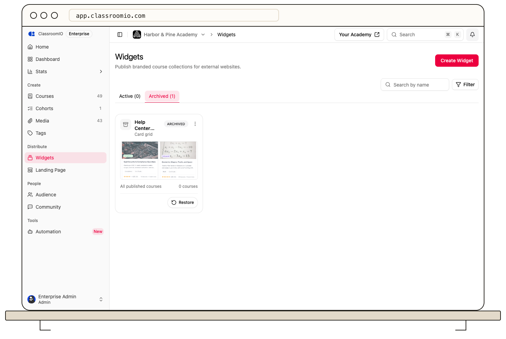

Archiving keeps a widget available in your account while removing it from the active widget list.

1. Open **Distribute → Widgets** and find the widget on the **Active** tab.
2. Use its menu or the editor's **Embed** panel to choose **Archive**.
3. To bring it back, open the **Archived** tab and choose **Restore** on its card.

Check any external page that embeds the widget after changing its status. For a permanent removal, the archived widget menu also offers a delete action; use it only when you no longer need that widget or its versions.
