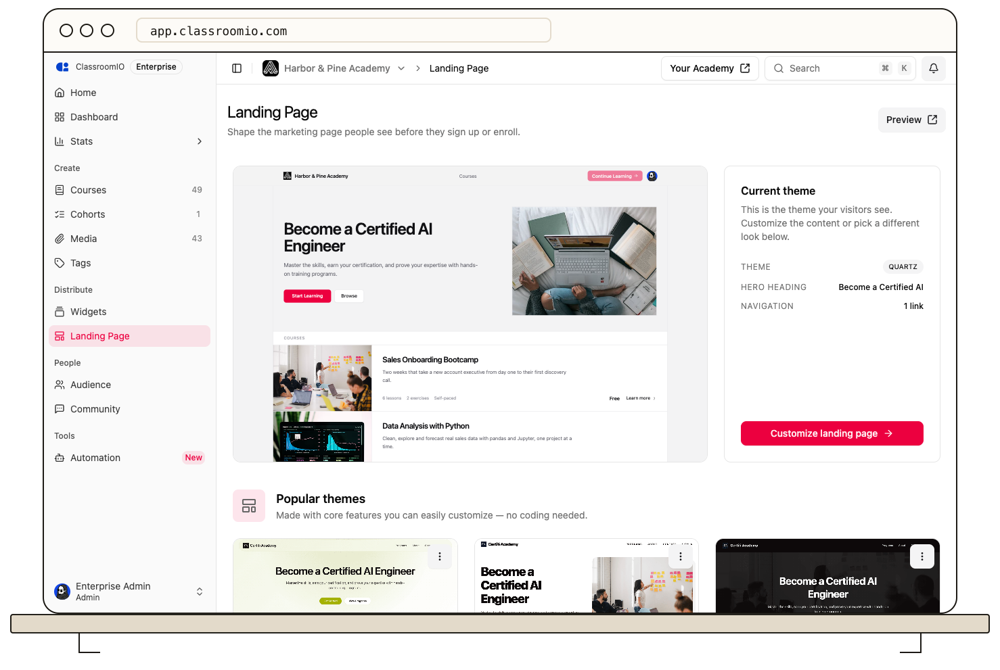

Your academy landing page theme sets the layout of your public homepage.

1. Open **Distribute → Landing Page**.
2. Browse the theme cards and use **Preview** to compare how your existing content looks in each theme.
3. Select the theme you want, then open **Customize** to edit its content.
4. Review the page on your live academy URL after saving.

Some themes require a paid plan. Theme previews show layout and copy but do not navigate when you click links. See [Customize Your Academy Landing Page](/publish-and-brand/org-landing-page) for the full editor.
