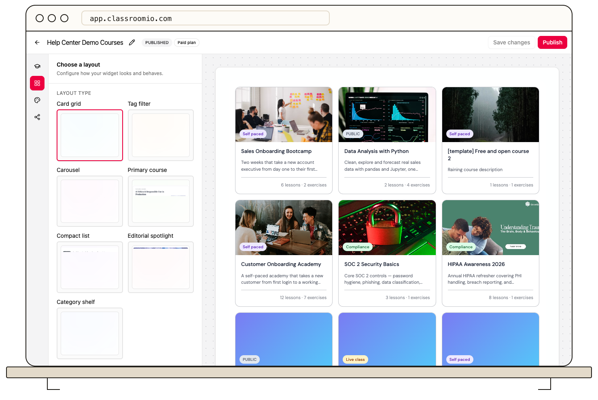

The widget editor separates content selection from layout and appearance.

1. In **Select courses**, use **Manual selection** to pick particular courses or **All published courses** to keep the selection based on published courses.
2. In **Layout**, choose a layout type, sort order, button labels, and visible course details. Some layouts offer additional options such as columns or a featured course.
3. In **Design**, choose a theme preset and adjust colors and branding options.
4. Review the preview, then **Publish** the widget to make those changes available to visitors.

If a course is missing, confirm it is published and matches the selection mode. See [Create a course widget](/publish-and-brand/create-a-course-widget).
