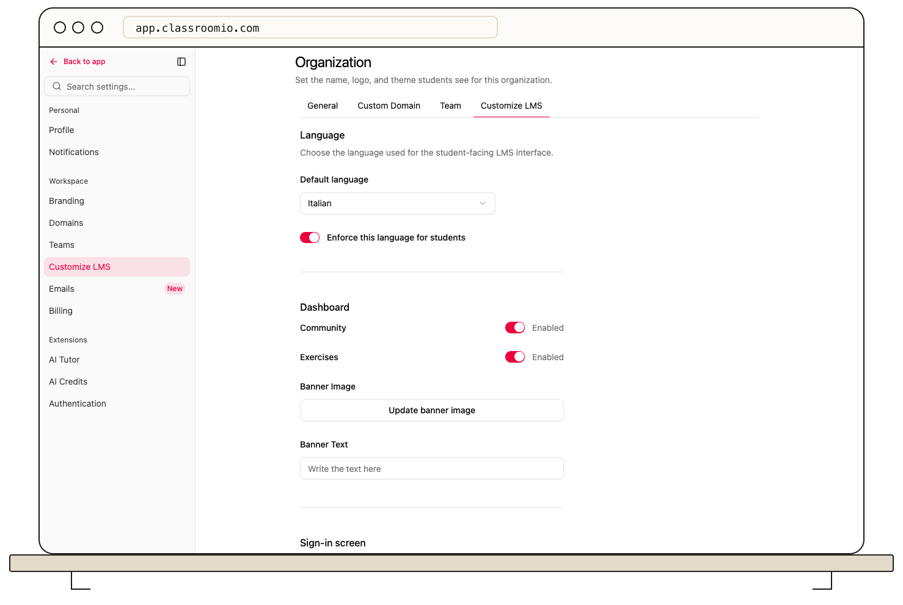

Use **Settings → Customize LMS → Dashboard** to show or hide the **Community** and **Exercises** areas for students. These are the dashboard navigation choices currently available; the page does not provide a general tab reorder control.

## Change the visible areas

1. Open your organization's **Settings** and select **Customize LMS**.
2. Under **Dashboard**, switch **Community** or **Exercises** on or off.
3. Select **Save changes** in the bar at the bottom. Use **Discard** if you do not want to apply the draft.

The saved choice affects the student-facing learning area for your organization. Check it with a demo student account to confirm the result. Hiding an area does not delete courses, exercises, or existing community content.

Other controls on **Customize LMS** govern the banner, course newsfeed and grading, and app features. They are separate from the dashboard area switches.

## Related guides

- [Understand the student dashboard banner settings](/publish-and-brand/customize-the-learner-dashboard-banner) — check the current limits of the saved banner fields
- [Show course newsfeeds and grading](/publish-and-brand/show-course-news-feeds-and-grading) — set course tools
- [Understand the Community forum](/reference/community) — see what Community contains
