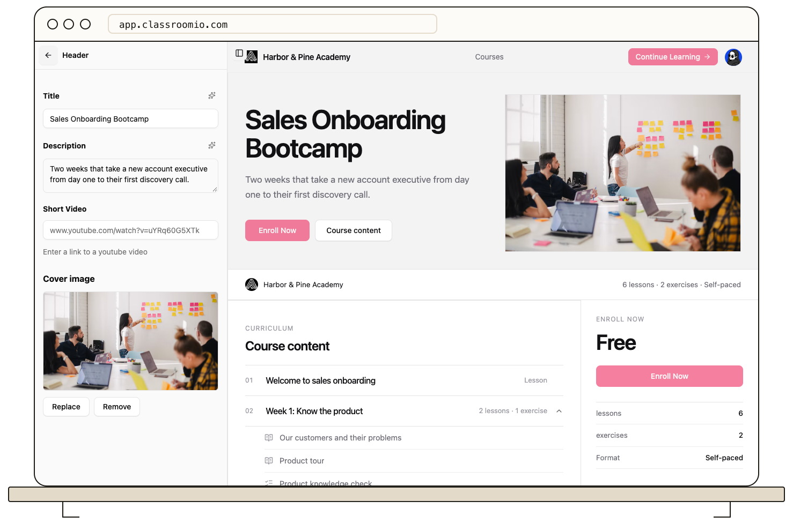

A public course page can show a primary enrollment action. Its outcome depends on the course's publication, enrollment, and pricing settings.

1. Open **Courses**, choose the course, and select **Landing page**.
2. Edit the hero content and review the enrollment button in the page preview.
3. Open **Settings** to confirm the course is published and **Students can enroll themselves** is set as intended.
4. Test the public course URL while signed out.

A paid course can direct visitors to its configured payment link; a closed course requires an invitation. See [Control Who Can Enroll](/manage-students/enrollment-access-control) for those rules.
