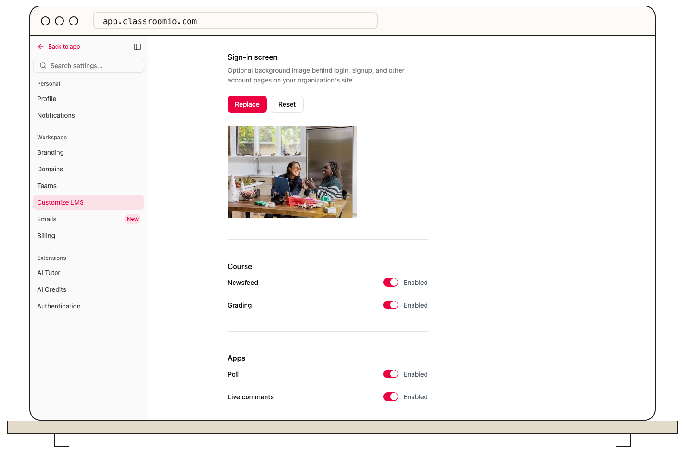

The **Poll** and **Live comments** switches under **Settings → Customize LMS → Apps** control whether students can see those features in the learning area. Save the switches before checking the student view.

## Change the app settings

1. Open your organization's **Settings** and select **Customize LMS**.
2. Scroll to **Apps**.
3. Turn **Poll** and **Live comments** on or off.
4. Select **Save changes** in the action bar at the bottom of the page.

These switches affect feature visibility across the organization. They do not create a poll, publish a comment, or remove activity that already exists. Review the student view with a demo account and decide how you will moderate new contributions before inviting participation.

## Related guides

- [Show course newsfeeds and grading](/publish-and-brand/show-course-news-feeds-and-grading) — set nearby course tools
- [Moderate Community questions and answers](/deliver-and-engage/moderate-community-questions-and-answers) — review a separate discussion area
