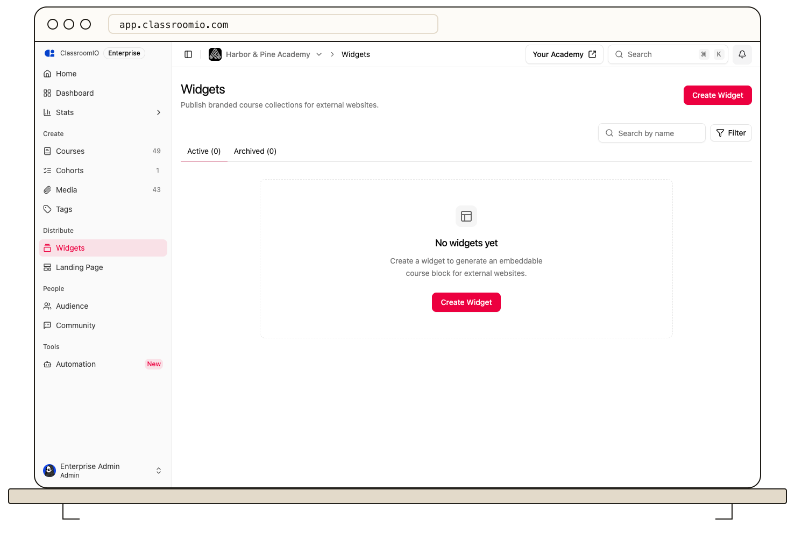

Widgets let you display academy courses on an external website.

1. Open **Distribute → Widgets** and choose **Create**.
2. Name the widget and choose whether to select courses manually or include your published courses.
3. Continue to **Layout** and **Design** to set its appearance. The preview updates as you work.
4. Choose **Publish** when the selection and preview are ready.
5. Open **Embed** to copy the HTML code or hosted URL.

A draft is not the published version visitors see. Republish after later changes. See [Embed a widget on another website](/publish-and-brand/embed-a-widget-on-another-website) for placement.
