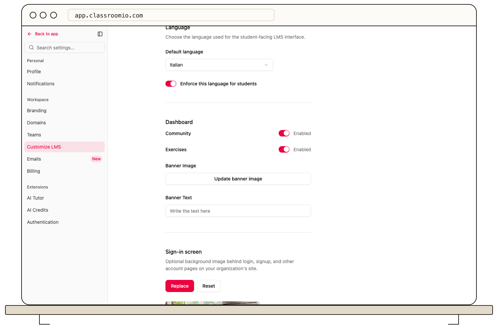

The **Banner Image** and **Banner Text** fields under **Settings → Customize LMS → Dashboard** can be saved, but they do not currently change the student dashboard. The student dashboard uses its own heading and course images. Do not rely on these fields to publish a student-facing message.

## Review the saved fields

1. Open your organization's **Settings** and select **Customize LMS**.
2. Under **Dashboard**, review **Banner Image** and **Banner Text**.
3. If you edit them, select **Save changes** in the bottom action bar. The saved banner image may be used as a social sharing image, but neither field appears as a dashboard banner for students.

If you change your mind before saving, select **Discard**. To check what students actually see, open the dashboard with a demo student account.

## Related guides

- [Choose which LMS navigation tabs students see](/publish-and-brand/choose-which-lms-navigation-tabs-learners-see) — use settings that control visible dashboard areas
- [Customize the sign-in background](/publish-and-brand/customize-the-sign-in-background) — change the separate account-page image
