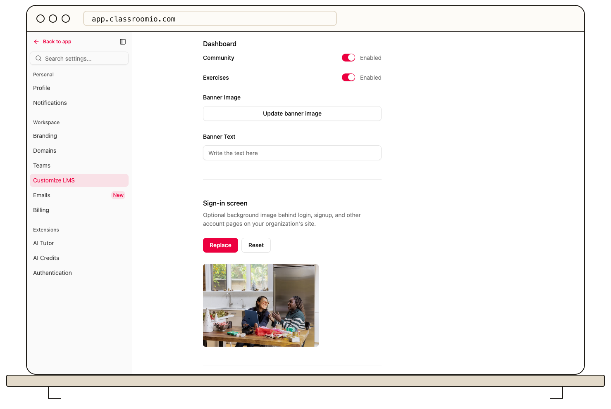

Set a sign-in background in **Settings → Customize LMS → Sign-in screen**. The image appears behind login, signup, and other account pages on your organization's site.

:::info[Paid plan required]
The **Replace** and **Reset** controls are disabled on the Free plan.
:::

## Replace or remove the image

1. Open your organization's **Settings** and select **Customize LMS**.
2. Under **Sign-in screen**, select **Replace** and choose the image in the upload control. The page shows a preview.
3. Select **Save changes** in the bottom action bar.

To return to the default image, select **Reset**, then **Save changes**. Use **Discard** if you want to leave the saved image unchanged.

Check the account page at a narrow and a desktop width. Keep essential words out of the image so the sign-in form remains clear and accessible across screen sizes.

## Related guides

- [Customize the student dashboard banner](/publish-and-brand/customize-the-learner-dashboard-banner) — change the image after sign-in
- [Set your favicon and social sharing preview](/publish-and-brand/academy-sharing-and-branding) — change public-site branding
