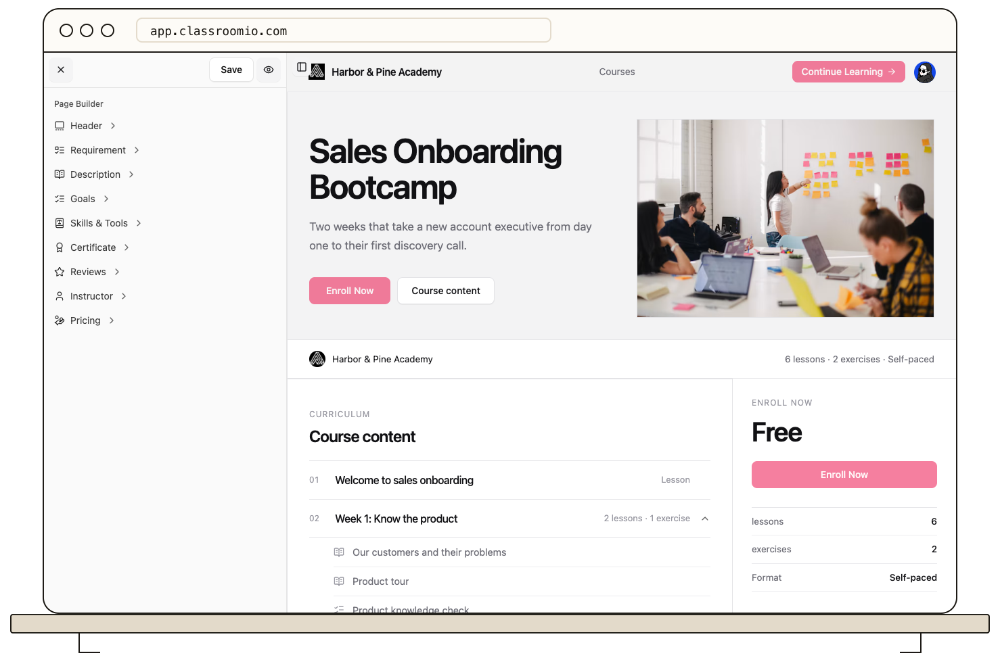

Preview the page layout, then verify enrollment on the live course URL.

1. Open **Courses**, choose the course, and select **Landing page**.
2. Edit the hero, description, requirements, pricing, or other sections and save.
3. Use the preview control to review the page at a glance.
4. In **Settings**, confirm the course is published and self-enrollment matches your intent.
5. Open the course URL on your academy site while signed out and test the visible buttons.

The preview is useful for copy and layout. Only the live page confirms the full sign-in, payment, and enrollment path. See [Create a Course Landing Page](/publish-and-brand/course-landingpage) for all editor sections.
