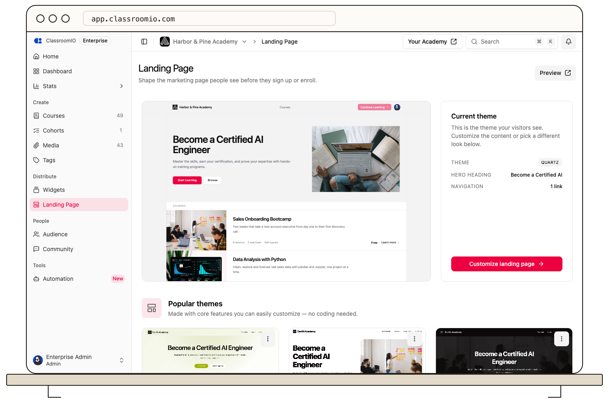

Use the landing page preview to check layout while editing, then confirm interactions on the live academy site.

1. Open **Distribute → Landing Page** and preview the current theme or another theme.
2. Choose **Customize**, make your changes, and save them.
3. Open **Your Academy** or your verified custom domain in another tab.
4. Check the hero buttons, navigation links, catalog cards, and footer on the live page.

The in-app preview disables link navigation. A verified [custom domain](/publish-and-brand/custom-domain) is used for academy links after verification; until then, use the default academy URL.
