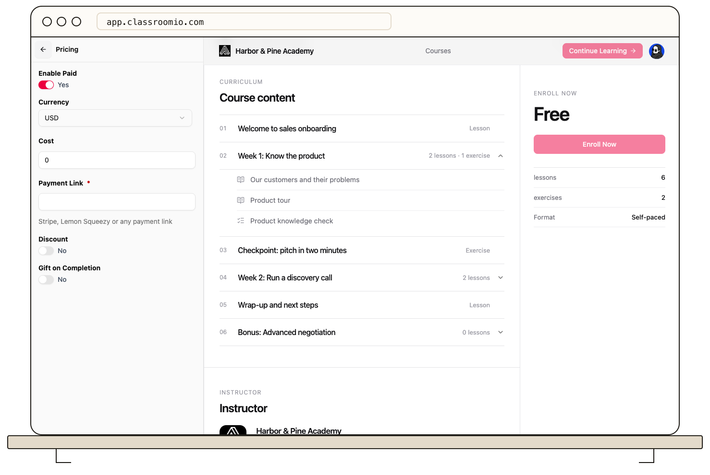

Pricing is configured for one course at a time in its landing page editor.

1. Open **Courses**, choose the course, then select **Landing page**.
2. Open **Pricing** and turn on **Enable Paid**.
3. Choose **USD** or **NGN**, enter the **Cost**, and add the required payment link.
4. Save the page, then preview the course and test its live enrollment flow.

The current editor supports **USD** and **NGN**. A paid course needs a valid payment URL; the editor will not save a paid configuration without it. If you want students to join without paying, keep the course free and check **Students can enroll themselves** in course settings. See [Create a Course Landing Page](/publish-and-brand/course-landingpage).
