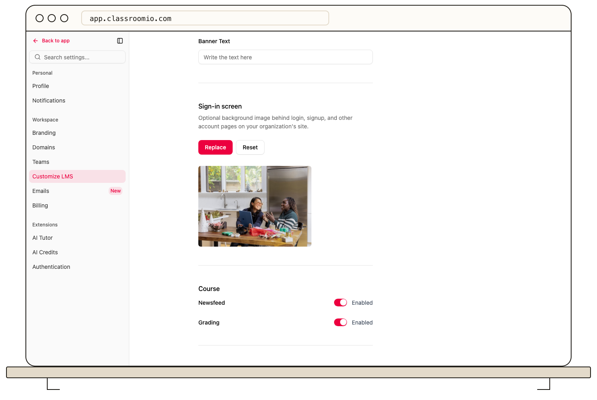

Turn on **Newsfeed** and **Grading** under **Settings → Customize LMS → Course** to make those course tools available in the student learning area. These organization-wide switches control visibility; they do not post announcements or grade submissions for you.

## Change the course tools

1. Open your organization's **Settings** and select **Customize LMS**.
2. Under **Course**, turn **Newsfeed** and **Grading** on or off as needed.
3. Select **Save changes**. The bottom action bar appears when you have unsaved changes.

If you turn off a tool after students have used it, check the student view before communicating the change. Saved posts and grades are separate course data; hiding a tool does not mean those records are deleted.

To publish a message, use the course's [newsfeed](/deliver-and-engage/post-a-course-announcement). To review or export scores, use the course's [Marks](/deliver-and-engage/view-and-export-marks) tab.

## Related guides

- [Post a course announcement](/deliver-and-engage/post-a-course-announcement) — add content to the newsfeed
- [View and export marks](/deliver-and-engage/view-and-export-marks) — inspect graded work
- [Choose which LMS navigation tabs students see](/publish-and-brand/choose-which-lms-navigation-tabs-learners-see) — control dashboard areas
