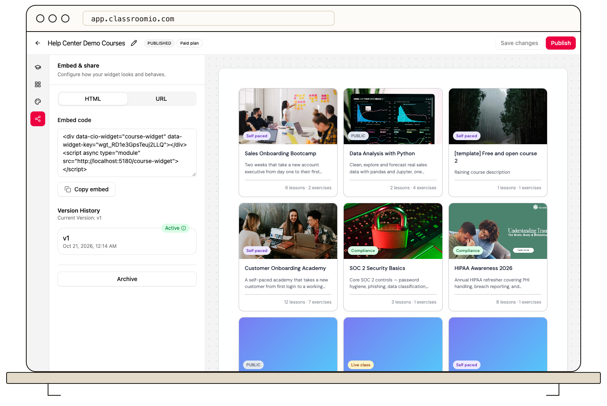

Each time you publish a widget, ClassroomIO records a version.

1. Open **Distribute → Widgets**, choose a widget, and select **Embed Code**.
2. Scroll to **Version history**. The list shows version numbers and publication times; the current published version is marked.
3. Select **Restore** on an earlier version to make it the active published version.
4. Reload the page where the widget is embedded to confirm the result.

Restoring changes what visitors see, so inspect the earlier version's courses and appearance before using it on a public page. See [Choose widget courses, layout, and design](/publish-and-brand/choose-courses-layout-and-design) to make a new version instead.
