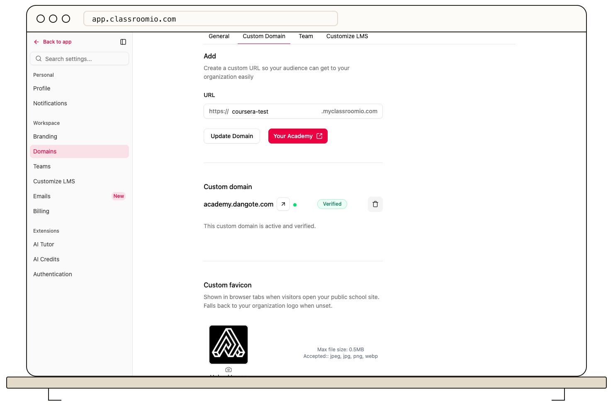

A connected domain is ready for academy links once ClassroomIO reports it as verified.

1. Open **Settings → Domains** and review the status of your custom hostname.
2. If it says **Pending DNS**, compare the displayed records with your DNS provider. If it says **Pending verification**, wait for the checks and refresh the status.
3. When the status is **Verified**, open the domain with `https://` and confirm the academy page loads securely.
4. Test a course page and sign-in path on the same domain.

If the status becomes **Reconnect required** or **Error**, follow [Reconnect a domain that needs attention](/publish-and-brand/reconnect-a-domain-that-needs-attention). Until verification succeeds, generated academy links continue to use the default academy URL.
