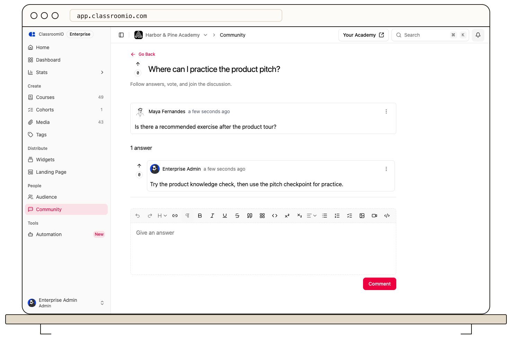

**Community** is an academy-wide place for questions, answers, and discussion. A question can be linked to a course, but the conversation belongs to the organization's Community rather than that course's news feed.

## Where to use each discussion area

Use **Community** when students and staff need to ask and answer questions across the academy. Members can search for questions and take part in threads. Linking a question to a course gives readers context without turning it into a course announcement.

Use a course **News Feed** for updates to that course's enrolled students. Use a cohort **Newsfeed** for updates to that cohort's members. The organization can hide the **Community** navigation item from the student learning area; ask an administrator if you do not see it.

Administrators can moderate Community questions and answers. A student can edit or remove their own question according to the available controls. See the [Community overview](/reference/community) for the roles and interaction details.

## Related guides

- [Use the Community forum](/integrations/use-the-community-forum) — ask and answer questions
- [Moderate Community questions and answers](/deliver-and-engage/moderate-community-questions-and-answers) — manage discussions
- [Post a course announcement](/deliver-and-engage/post-a-course-announcement) — send a course-scoped update
- [Post to a cohort news feed](/manage-learners/post-to-a-cohort-news-feed) — update one cohort
