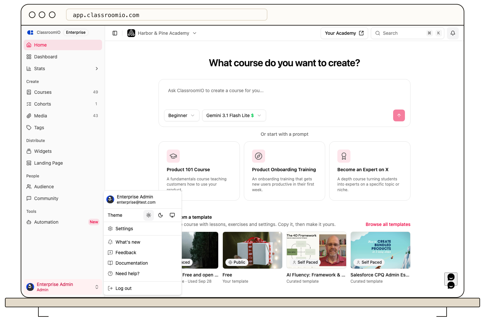

Email [help@classroomio.com](mailto:help@classroomio.com) when your academy team cannot resolve a ClassroomIO issue. In the administrator dashboard, open your profile menu and select **Need help?** to start the same email.

## Before you contact support

Check the guide for the affected task and try the reversible checks it lists. For access problems, the academy administrator can first confirm your invitation, role, and sign-in method. For a course issue, include someone who can inspect that course's settings.

## What to include

- Your academy URL and the course or feature name involved
- What you tried to do, what happened, and the result you expected
- The exact visible error text and approximate date and time
- Your browser, device, and whether the issue also occurs in another browser
- A screenshot with names, email addresses, student work, and private URLs hidden when the visual state matters

Support can use that context to reproduce or locate the problem. Send account-specific details by email rather than posting them in a public course discussion.

:::warning[Keep secrets out of support messages]
Never send a password, one-time sign-in code, reset or invitation link, API key, payment-card details, or an unredacted student record.
:::

ClassroomIO does not publish a response-time promise in the Help Center. Watch the email address you used to contact support for a reply or follow-up question.

## Related guides

- [Troubleshoot login and verification emails](/troubleshooting-and-reference/troubleshoot-login-and-verification-emails) — check access and delivery first
- [Troubleshoot course access and enrollment](/troubleshooting-and-reference/troubleshoot-course-access-and-enrollment) — identify a student or course setting
- [Troubleshoot custom domains and SSL](/troubleshooting-and-reference/troubleshoot-custom-domains-and-ssl) — collect domain status and DNS evidence
