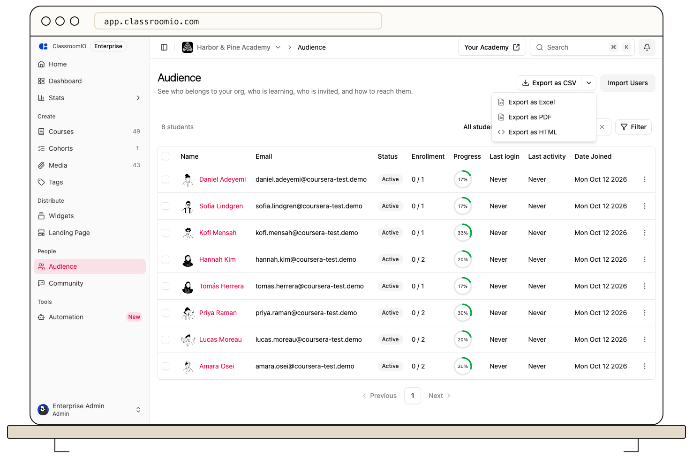

ClassroomIO exports the rows for the page or report you are viewing. Choose the source first, then select the file format that suits your next task.

## Choose the source

- **Audience → Export:** An organization-wide student summary, including membership and progress. Filters and selected rows affect which students are included.
- **Student profile → Export:** One student's courses and progress, one course per row.
- **Course → Analytics → Export:** Progress for the students in one course.
- **Course → Marks → Export:** Exercise grades for that course.
- **Compliance → Export:** Current student-course obligations, with status and relevant dates.

Where available, **Export as CSV** offers the default spreadsheet-friendly `.csv` file, with other formats in its adjacent menu. The [Exports guide](/reference/exports) lists the current columns and row limits for each source and format. There is no single export that combines every student with every course in one detailed file.

Check the file before sharing it. Exports can contain student names, email addresses, grades, and compliance status; send them only to people who should have that information.

## Related guides

- [Export your audience](/manage-learners/export-your-audience) — download an organization student list
- [View and export marks](/deliver-and-engage/view-and-export-marks) — get course exercise grades
- [Report on compliance status](/analytics-and-reporting/report-on-compliance-status) — export current training obligations
