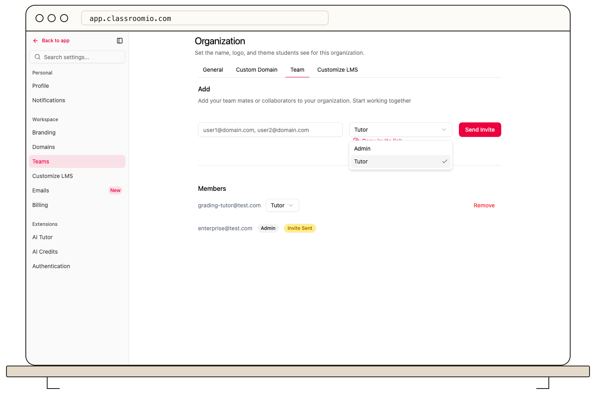

An organization role controls which management areas a person can use. Course enrollment is a separate decision: a student can belong to the organization without being enrolled in every course.

## Compare the roles

- **Administrator:** Manages organization settings, team access, billing, and courses. Administrators can create courses.
- **Tutor:** Uses the administrator dashboard for courses they teach. A tutor can work with assigned course content but cannot manage organization-wide settings or create a course.
- **Student:** Uses the academy learning area to take courses. Student access does not grant administrator dashboard controls.

Analytics access is narrower than general management access: organization **Analytics → Academy** and **Analytics → Compliance** are admin-only, **Analytics → Marketing** also allows tutors, and a cohort's or course's **Analytics** is limited to administrators plus that cohort's or course's own admins and tutors. See [Who can open analytics](/organization-and-team/roles-and-permissions#who-can-open-analytics).

An invitation to join the team as an administrator or tutor is different from an invitation to study a course. If a person needs to teach one course, add them as a tutor for that course. If they need organization-wide management access, review the administrator role before inviting them.

Organization signup controls whether someone can create an academy account. A course's enrollment settings control whether that account can join the course. Check both when diagnosing access.

## Related guides

- [Roles and permissions](/organization-and-team/roles-and-permissions) — full role comparison
- [Invite a team member by email](/account-team-security/invite-a-team-member-by-email) — add an administrator or tutor
- [Choose how students join a course](/manage-students/course-enrollment) — grant course access
- [Choose allowed sign-in methods](/account-team-security/choose-allowed-sign-in-methods) — control organization signup
