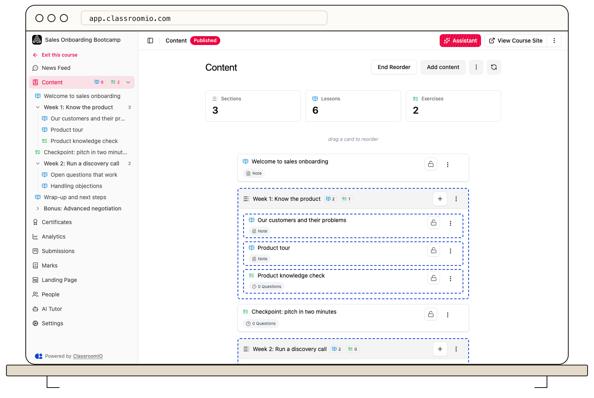

A course contains lessons and exercises. Sections are optional groups that make the course outline easier to navigate; they do not change what students must complete.

## How the outline fits together

The **Content** page shows lessons and exercises in the order students encounter them. With content grouping enabled, you can place either kind of item inside a named section or leave it at the top level. A section is a heading and container, not a separate piece of learning content.

- **Lesson:** Presents teaching material such as notes, video, slides, or documents. Its completion rule determines when a student's lesson counts as finished.
- **Exercise:** Collects answers to questions. Its completion rule can count a submission or require a passing score. Some answers can be graded automatically; others need a tutor or administrator to grade them.
- **Section:** Groups related lessons and exercises. It has a title but no independent grade or completion result.

You can [turn content grouping off](/build-courses/turn-content-grouping-on-or-off) to show a flat outline. The lessons and exercises remain in the course.

## Order and progression are different

Reordering the outline changes the sequence students see. If the course uses **Sequential** progression, students must complete earlier items before later ones unlock. With **Free** progression, students can open any available item; an individual lesson or exercise can still have its own availability lock.

Putting items in a section does not, by itself, lock the next section. Review [progression and completion rules](/create-and-deliver/course-progression) before changing the order of a course already in use.

## Related guides

- [Organize content with sections](/build-courses/organize-content-with-sections) — create and rename groups
- [Create and reorder lessons and exercises](/build-courses/create-and-reorder-lessons-and-exercises) — build the outline
- [Create and edit a lesson](/build-courses/create-and-edit-a-lesson) — add teaching material
- [Choose an exercise question type](/build-courses/choose-an-exercise-question-type) — decide how students respond
