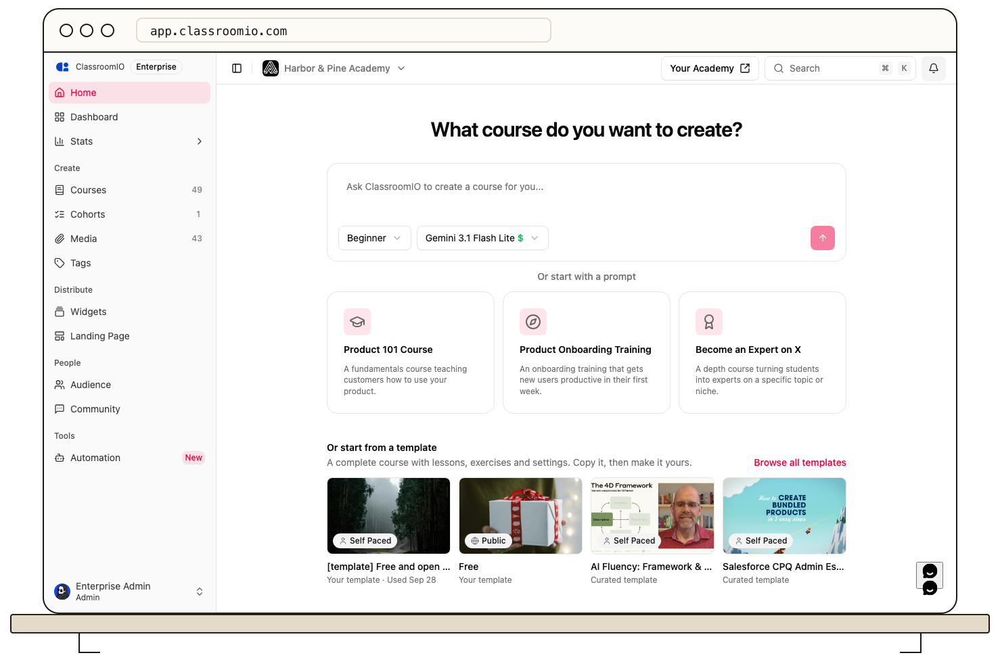

ClassroomIO runs in a web browser and adapts to desktop, tablet, and phone screens. Use a current version of a mainstream browser with JavaScript and cookies enabled. ClassroomIO does not publish a minimum browser-version matrix, so do not rely on an old or unsupported release for critical work.

## If a page or control does not work

1. Update your browser, reload the page, and try the action again.
2. Open the academy in a normal browser tab rather than an embedded browser inside another app. If a link opened inside an email or social app, copy it into your browser.
3. Check that JavaScript and cookies are allowed for the academy address. Sign-in and saved work can fail when these are blocked.
4. Try a private window or another current browser to distinguish a site problem from an extension or cached page. Sign in again if the private window starts without your session.
5. If media fails while the rest of the course works, test another network and follow [video playback troubleshooting](/troubleshooting-and-reference/troubleshoot-video-uploads-and-playback).

The page should load without missing controls, and your changes should remain after a refresh. If a problem persists in multiple browsers, tell the course team the device, operating system, browser and version, academy URL, approximate time, and visible error. Do not include a password or one-time code.

## Related guides

- [Troubleshoot login and verification emails](/troubleshooting-and-reference/troubleshoot-login-and-verification-emails) — check account access
- [Contact ClassroomIO support](/troubleshooting-and-reference/contact-classroomio-support) — send safe diagnostic details
