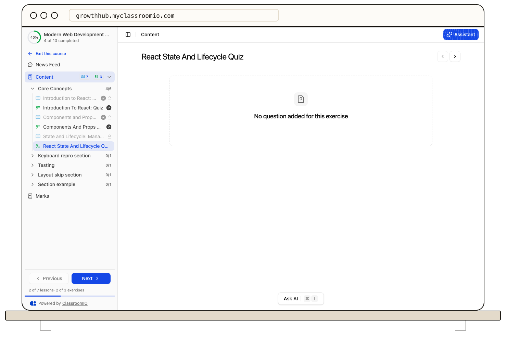

A student may be blocked because they are in the wrong account, the course is unavailable or not open for enrollment, an invitation or payment is incomplete, or an item is locked by progression rules. First identify whether the whole course or only one lesson or exercise is inaccessible.

## If the course is missing or cannot be joined

Ask the student to sign in with the email address and academy URL used for the invitation or purchase. Check whether the invitation is still pending and whether a paid enrollment completed. A student added to a cohort may need the course assignment to be in place before it appears.

As an administrator or course tutor, confirm that the course is published and review its enrollment and visibility settings. Check whether self-enrollment is enabled, whether organization signup rules restrict new accounts, and whether the student is already on the course's **People** list. A landing-page preview does not prove that a signed-out visitor can enroll; test the live academy URL.

For the full set of controls, see [Course enrollment access](/manage-students/enrollment-access-control) and [Preview and publish a course landing page](/publish-and-brand/preview-and-publish-a-course-landing-page).

## If only an item is locked

Open the course outline and check the item immediately before the lock. **Sequential** progression can require earlier lessons or exercises to be complete. An exercise may need a passing grade, including manual grading, and an individual item can have its own availability lock. A course can be published while one item remains locked.

Ask the student to finish the displayed requirement and refresh the course. If it remains locked, compare the item status with [locked content and progression](/learner-guides/understand-locked-content-and-progression).

## If access still fails

Record the academy URL, course and item names, account email, approximate time, and visible error message. Share these with the course team without sending a password or payment details.

## Related guides

- [Manage pending invitations](/manage-learners/manage-pending-invitations) — check an invitation that was not accepted
- [Add and remove people from a course](/manage-learners/add-and-remove-people-from-a-course) — verify the course roster
- [Troubleshoot course publishing and visibility](/troubleshooting-and-reference/troubleshoot-course-publishing-and-visibility) — diagnose a live course page
