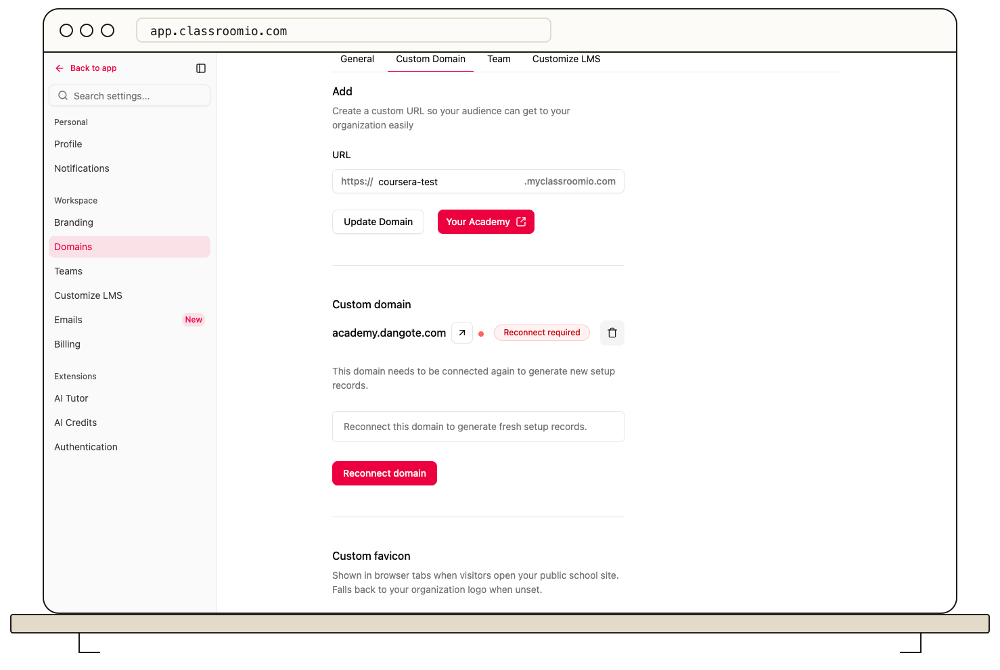

A custom domain cannot serve your academy until the required DNS records are in place and ClassroomIO verifies the connection. If the domain shows **Pending**, **Reconnect required**, or **Error**, start with the status and records shown under **Settings → Domains**.

## Compare the DNS records

Open **Settings → Domains** and compare each displayed record's name, type, and value with the records at your DNS provider. Check that you edited the right hostname: a root domain and a subdomain such as `learn.example.com` use different names. Remove conflicting records only after confirming they serve no other site or mail service.

After you save a DNS change, allow time for the provider's records to update. Use **Refresh** to check the status. If the domain previously worked and now shows **Reconnect required** or **Error**, restore any changed record and select **Reconnect** for the existing hostname.

## Check HTTPS and redirects

Wait for the domain to show **Verified**, then open its `https://` address in a browser. Test academy sign-in and a course link. If the browser still shows a certificate or redirect problem, check whether your DNS provider has a forwarding rule or proxy that sends the hostname somewhere else. Do not share the custom URL as your main academy address until it works.

Your default ClassroomIO academy subdomain remains a useful way to reach the academy while you repair a custom domain. See [Add the required DNS records](/publish-and-brand/add-the-required-dns-records) and [Verify your domain and SSL certificate](/publish-and-brand/verify-your-domain-and-ssl-certificate) for the setup checks.

## If you need support

Provide the hostname, current ClassroomIO status, DNS record types and values, approximate time of the last change, and the browser's visible error. Do not share DNS-provider credentials or private account details.

## Related guides

- [Reconnect a domain that needs attention](/publish-and-brand/reconnect-a-domain-that-needs-attention) — retry an existing connection
- [Set up a custom domain](/publish-and-brand/custom-domain) — review the full setup
