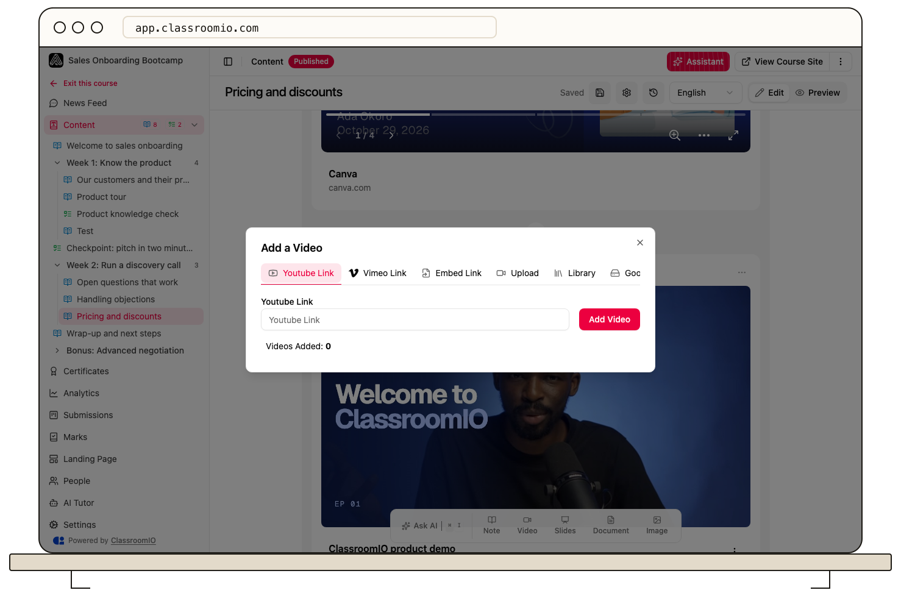

An upload can fail before the file is saved, while a saved video can still be processing. Playback failures can also come from a hosted video's permissions or the student's browser and network.

## If the upload does not finish

Open the lesson in **Edit** mode, select **Change Video** on the video block (if the lesson has none, add a **Video** block from **Add content** first), and choose **Upload**. Video uploads require a paid plan. Check the uploader's current file-size limit and any displayed format message; those are the limits for your deployment. Keep the tab open and the connection stable until the upload completes and the video appears in the lesson.

If an upload was interrupted, try again with a smaller supported file or a stable network. Upload progress and video processing are separate: after the transfer completes, wait for the video's status and test playback before closing the editor. See [Add or upload a video](/build-courses/add-or-upload-a-video) for the full workflow. For a file that failed on the **Media** page, see [If a file fails](/build-courses/upload-files-to-your-media-library#if-a-file-fails).

## If the video appears but will not play

Try the lesson in an updated browser and another network. Refresh the page and check whether the issue affects one video or every video in the course. If the source is **YouTube**, **Vimeo**, **Google Drive**, or another external embed, verify that the link still works and that a student has permission to view it. A Vimeo domain restriction must allow the academy host; an unlisted link may require its privacy key.

If a lesson requires video-watch completion, use an uploaded video. External embeds do not provide ClassroomIO's video-watch tracking; consider a manual completion rule for those sources.

## If it still fails

Send the course team the course and lesson names, video source, approximate time, device and browser, and the visible error text. Do not send a private video link or account credentials in a public message.

## Related guides

- [Create and edit a lesson](/build-courses/create-and-edit-a-lesson) — check the lesson's blocks
- [Control progression and completion](/create-and-deliver/course-progression) — review the lesson completion rule
