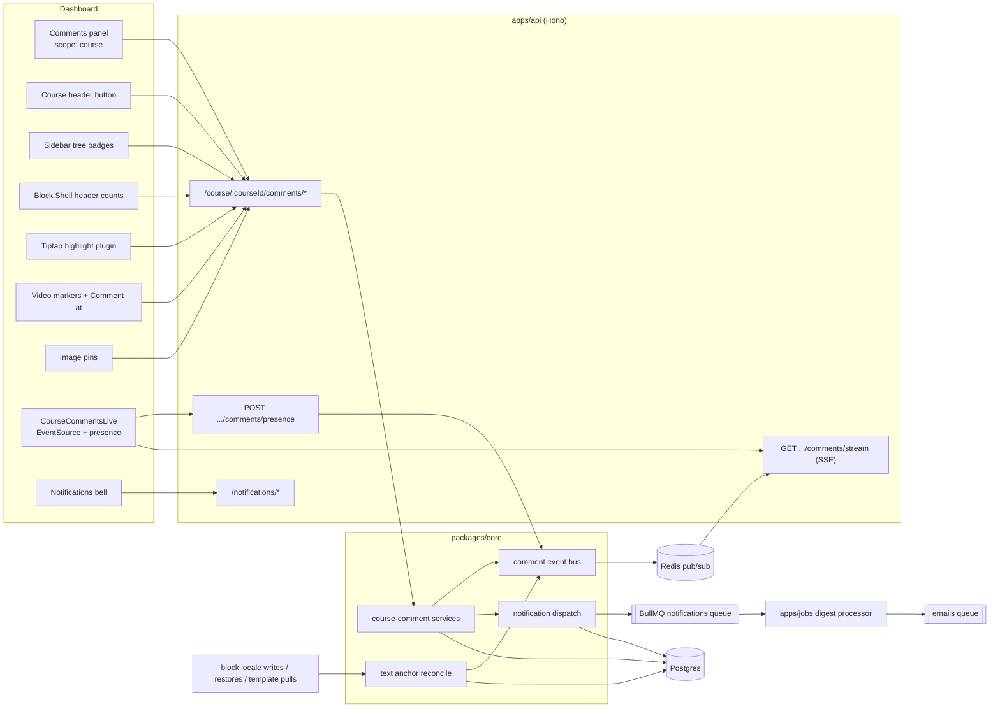

# Collaborative Comments Implementation Plan

Companion to [`README.md`](./README.md) (the PRD) and the clickable prototype in
[`prototypes/collaborative-comments`](../../prototypes/collaborative-comments/README.md).

This plan is written so an agent can pick up any ticket and ship it without re-deriving the design.
Every file path below was checked against `main` at the time of writing. Read the ticket's
"Key files" before changing anything; if a path moved, find its replacement with `rg` rather than
recreating it.

Before you write code, read:

- `CLAUDE.md` (route/service/query layering, translations, Svelte 5 rules, migrations).
- `skills/writing-code/SKILL.md` (comment policy: no narrating comments).
- `skills/security-audit/SKILL.md` in guidance mode, and `skills/public-api-review/SKILL.md` for the
  routes. This feature crosses trust boundaries (roles, tenant isolation, user-controlled text and URLs,
  live fan-out).
- `packages/utils/src/validation/block/ADDING_A_BLOCK_TYPE.md` (block registry rules).

---

## 0. What the codebase looks like today (facts this plan relies on)

| Fact | Where | Consequence |
| --- | --- | --- |
| Lesson content is **blocks**: `block` (uuid, `type`, `data` jsonb, soft `deleted_at`), placed in a lesson via `block_placement` (`lesson_id`, `block_id`, fractional `position`), note HTML per locale in `block_locale` with history in `block_locale_history`. Old lesson columns are deprecated. | `packages/db/src/schema.ts` (`block` ~2199, `blockPlacement` ~2243, `blockLocale` ~2278) | Text, video, slide, image anchors point at `block.id`, not at the lesson. A lesson can have several note blocks. |
| Block types are declared once in a registry, and code must not branch on a block type outside the registry files. | `packages/utils/src/validation/block/registry.ts`, `definition.ts` | "Which kind of comment does this block take, and what identifies its media?" becomes a **new block capability** (`commentAnchor`), not a `switch (block.type)`. |
| Slides are a third-party **iframe embed** (`{ src, platform }`), one per block, with no slide index. | `definitions/slides.ts`, `UI/custom/block/block-slide.svelte` | The app **cannot detect the slide on screen**. The slide number is entered by the commenter (optional). See §1 D4. |
| Video block data: `{ type: youtube|vimeo|generic|upload|google_drive, link, assetId?, metadata? }`. Seek works through `lessonVideoBus.seek()` for Plyr sources; YouTube sources get a no-op seek. | `definitions/video.ts`, `features/course/components/lesson/video/lesson-video-bus.svelte.ts`, `lesson-video-player.svelte` | Media identity = `assetId ?? link`. For sources without a time API the commenter types the time. |
| Image block: `{ url, alt?, fit? }`, rendered in a fixed `aspect-video` box. | `definitions/image.ts`, `UI/custom/block/block-image.svelte` | Pins are stored as `%` of that box. Changing `url` or `fit` makes pins stale. |
| Questions have a **bigint** id. `updateExerciseService` keeps ids; `replaceExerciseService` (course import only) deletes and recreates every question. | `packages/core/src/services/exercise/exercise.ts:771` | Anchor questions by FK with `ON DELETE SET NULL`; a re-import detaches question threads to the exercise (documented, accepted). |
| Course team access check already exists and matches the PRD exactly: course ADMIN/TUTOR **or** active org ADMIN, and the caller must be an active member of the course's org. Cohort-only tutors are excluded. | `isCourseTeamMemberOrOrgAdmin` in `packages/db/src/queries/group/group.ts:210`; `courseTeamMemberMiddleware` in `apps/api/src/middlewares/course-team-member.ts` | Reuse both. Never write a second role check. |
| There is **no** in-app notification table. The bell (`app-header.svelte`) only lists pending org invites, built client-side, and has no read state. | `apps/dashboard/src/lib/features/notifications/` | Building a `notification` table + endpoints is part of this feature (PRD §6 says so explicitly). |
| Email: `enqueueTransactionalEmail` with per-member preferences (`organizationmember_email_notifications` + `EMAIL_TOGGLE_MAP`); BullMQ queues in `@cio/jobs` (installed `bullmq@5.76.5`), workers in `apps/jobs`. | `apps/api/src/services/jobs/email-jobs.ts`, `packages/utils/src/notifications/email-toggles.ts`, `packages/jobs/src/queues/names.ts`, `apps/jobs/src/workers/notifications.ts` | A new toggle `courseComments` and a debounced digest job (BullMQ deduplication). |
| There is **no realtime code** anywhere (no WebSocket, no SSE, no Redis pub/sub). Browser API calls go through a same-origin `/proxy`: a Cloudflare Worker in cloud (`apps/tenant-router`) and the SvelteKit `proxyRequestToApi` when self-hosted. Both **stream response bodies**; the SvelteKit proxy **cannot** forward a WebSocket upgrade. Session cookies are host-only. | `apps/dashboard/src/lib/utils/services/api/index.ts`, `apps/dashboard/src/lib/utils/proxy-api-request.ts`, `apps/tenant-router/src/index.ts`, `packages/db/src/auth.ts` | Use **Server-Sent Events** for server→client and small throttled `POST`s for presence. Works through both proxies with the existing cookie, no new infra. See §1 D1. |
| Redis (node-redis `createClient`) is shared at `@cio/core/utils/redis/redis`. Pub/sub needs a dedicated `redis.duplicate()` connection. | `packages/core/src/utils/redis/redis.ts` | One subscriber connection per API process, fan-out in memory. |
| Side panels: `sidePanel` store with `register(def)`, `open(id, props)`, `toggle`, `close`; `scope: 'course'` panels survive lesson navigation. The panel component draws its own header. | `apps/dashboard/src/lib/features/side-panel/`, registration in `routes/(app)/courses/[id]/+layout.svelte` | The Comments panel is a `scope: 'course'` definition. |
| There is **no per-lesson "Publish"** button. Learners see a lesson/exercise when it is **unlocked** (`isUnlocked`) in a **published course** (`course.is_published`, set in Settings → Publish). | `lesson-settings-tab.svelte:197-290`, `exercise-settings-tab.svelte`, `content-page-menu.svelte`, `content-section-list.svelte`, `features/course/utils/publish-course.ts`, `packages/core/src/services/course/course.ts:~488` | The "publish with open comments" warning hooks the unlock controls and the course publish action. See §1 D6. |
| Lesson history: `lesson_revision` (structure) + `block_locale_history` (text). Restores reuse the original block ids. | `packages/core/src/services/block/lesson-structure.ts` (`restoreLessonToEntry`, `undoLessonChangeSet`), `block.ts` (`restoreLessonBlockVersion`) | Restore must re-run text-anchor reconciliation. Threads are never versioned. |
| Clone copies explicit tables (`copyLessonBlocks`, `cloneCourse`); org deletion script deletes explicit tables; there is no in-app account deletion (CLI script only). | `apps/api/src/services/course/clone.ts`, `packages/core/src/services/block/copy.ts`, `packages/db/src/scripts/lib/org-deletion.ts`, `packages/db/src/scripts/delete-org-by-email.ts` | Clone needs nothing (new tables are never copied) but gets a regression test. Org deletion and account deletion scripts need updating. |
| Existing UI building blocks: `CommentTree.*` (`UI/custom/comment-tree`, numeric ids), `ChatTextarea` + `MentionPopover` (`UI/custom/chat-textarea`, `@[Title](type:id)` syntax), `UserAvatar`, `IconButton`, `DropdownMenu` checkbox items, `Dialog`, `Empty`, `Skeleton`, `NumberBadge`, `AttentionHighlight`. Editor = Edra/Tiptap 3 (`UI/custom/editor`); `TextEditor` exposes `onReady(editor)`; `FindAndReplace.ts` is a working `DecorationSet` plugin. | `packages/ui/src/custom/*`, `apps/dashboard/src/lib/features/ui/text-editor.svelte` | Reuse, don't rebuild. Register the highlight plugin with `editor.registerPlugin()` from `onReady`; no editor prop threading needed. |

---

## 1. Decisions (where this plan deviates from or sharpens the PRD)

Each decision is backed by the facts in §0. Where the PRD is silent, the plan picks the smallest
behaviour consistent with it and records the call in §17 "Resolved questions".

**D1. Live transport = SSE + throttled POST, over the existing `/proxy`.**
WebSockets would need `@hono/node-server` 2.x (the repo is on 1.19, and `@hono/node-ws` is
deprecated), Cloudflare Worker upgrade handling, and a separate auth token because the SvelteKit
proxy cannot forward upgrades and cookies are host-only. SSE needs none of that: it is a normal
authenticated `GET` whose body streams through both proxies. Cross-process fan-out uses Redis
pub/sub with one subscriber connection per API process. Presence (cursors, typing) goes up as
small `POST`s, coalesced client-side to at most ~8/s per user, and down through the same SSE stream.
Upgrading to WebSockets later only swaps the transport module (§7.6).

**D2. Anchors reference real rows; positions live in a typed jsonb.**
`course_comment_thread` has FK columns for every relationship (`course_id`, `lesson_id`,
`exercise_id`, `block_id`, `question_id`) so cascades and joins are real, and an `anchor` jsonb for
positional data (quote, seconds, x/y, slide number) validated by one Zod discriminated union.
This follows "store the relationship, not a copy" from `CLAUDE.md`.

**D3. Block capability `commentAnchor` drives every block-specific branch.**
Add to `BlockDefinition`:

```ts
commentAnchor: {
  kind: 'text' | 'time' | 'slide' | 'point' | 'block';
  fingerprint: ((data) => string | null) | null;
};
```

`kind` says what a comment on that block pins to; `fingerprint` identifies the media so a replaced
video or image is detected ("Video has changed"). The panel, the counts and the stale-anchor logic
read the capability; nothing switches on `block.type`.

**D4. Slides: the commenter enters the slide number.** The composer for a slides block shows an
optional "Slide" `NumberField`. Threads show "Slide 3" when set, otherwise "Slides". No pins on
slides (matches the prototype).

**D5. Anchor types** (`COURSE_COMMENT_ANCHOR_TYPE`): `course`, `page`, `block`, `text`, `time`,
`slide`, `point`, `question`. `page` = a lesson or exercise page (PRD "Lesson / exercise page").
`block` = a whole block whose kind is `block` (documents) or a note block's header button (PRD:
"Click it and the panel opens filtered to that block, with a box to add a comment").

**D6. "Publish" = making content visible to learners.** The warning (PRD §4a) runs when a team
member: unlocks a lesson or exercise (settings switch, section toggle, "Unlock all"), or publishes the
course (Settings → Publish). It lists the open threads that would ship. With no open threads the
action runs with no extra dialog, because these controls never had a confirm before (adding a plain
confirm to every unlock would be a regression). The prototype's lesson-header "Publish" button does
not exist in the product and is not added.

**D7. Counts come from one team-only endpoint, not the course outline.** The PRD asks for counts
"with the course outline rather than one request per lesson". The outline (`GET /course/:courseId`)
is served to learners and parts of it are Redis-cached
(`apps/api/src/utils/redis/course-content-cache.ts`, which must stay free of per-user data). Mixing
per-user unread state into it risks leaking into the cache or to learners. Instead
`GET /course/:courseId/comments/summary` returns all counts for the course in **one** request,
fired by the course layout next to the outline. Learners get a 403 by construction, which satisfies
"counts are never sent to learners" without a conditional field.

**D8. Unread = per person, per thread, by timestamp.** `course_comment_thread_read(thread_id,
profile_id, last_read_at)`. A thread is unread for me when it is open and has a comment newer than
my `last_read_at` written by someone else. A mention is just a comment, so "shows as new until they
open it" falls out. Timestamps survive deletes; the prototype's "seen count" does not.

**D9. Text anchors: one matching algorithm, shared by server and editor.**
`packages/utils/src/comments/text-anchor.ts` turns note HTML into anchor text (`htmlparser2`,
isomorphic) and finds `quote` using `prefix`/`suffix` (PRD rules: same-context match wins, ambiguous
⇒ detached). The server runs it on every write to a note block's locale content and stores
`detached`; the editor runs the same function on the same HTML and maps the text range to
ProseMirror positions for drawing. Nothing is written into lesson content.

**D10. Live events carry ids, not content.** Posted-comment events say "thread X changed"; the
client refetches `GET /comments/:threadId`, which runs the normal access check. Only ephemeral
presence (cursor, typing text) travels in the event body. One authorization path for content.

**D11. Notifications: generic `notification` table, ids only.** Text is rendered from translation
keys at read time (no copies of names or snippets in the row). The bell lists comment
notifications; the course header Comments button shows the per-course unread dot. Opening a thread
marks its notifications read.

**D12. Email digest = BullMQ deduplication with `keepLastIfActive`.** One delayed job per
(recipient, thread): `delay: 5m`, `deduplication: { id, keepLastIfActive: true }`. While a digest
job is waiting, later events are absorbed into it; once it is running, the next event is kept and
runs after it, so no event is lost between the read and the send. The job emails every
still-unread, un-emailed notification for that thread. Read-in-app notifications are not emailed.

**D13. Deleted accounts.** All profile FKs on the new tables are `ON DELETE SET NULL`, with a
nullable `*_deleted_name` snapshot column written by the account deletion script right before the
profile is deleted (there is no in-app deletion flow today; the script is
`packages/db/src/scripts/delete-org-by-email.ts`). The panel shows "Deleted user" and never reads
the snapshot (PRD: audit only).

**D14. Org switch = `organization.customization.apps.teamComments`** (missing ⇒ enabled), next to
the existing learner `apps.comments`. Off hides everything and stops notifications; nothing is
deleted. Edited in `features/settings/pages/customize-lms.svelte` by org admins.

**D15. Video time for embeds without a time API.** When `lessonVideoBus` has no live time for the
block (YouTube today), the composer shows an editable `mm:ss` field (defaults to `00:00`) and the
thread cannot seek; the chip still shows the time.

---

## 2. Architecture



---

## 3. Data model (`packages/db/src/schema.ts`)

Add all new tables in one block near `contentReport` (~4659). Use the modern table pattern (uuid pk,
`timestamp(..., { withTimezone: true, mode: 'string' })`, named FKs).

### 3.1 Enums

```ts
export const courseCommentAnchorType = pgEnum('COURSE_COMMENT_ANCHOR_TYPE', [
  ...COURSE_COMMENT_ANCHOR_TYPES
]);
export const courseCommentThreadStatus = pgEnum('COURSE_COMMENT_THREAD_STATUS', ['open', 'resolved']);
export const courseCommentThreadEventType = pgEnum('COURSE_COMMENT_THREAD_EVENT_TYPE', ['resolved', 'reopened']);
```

`COURSE_COMMENT_ANCHOR_TYPES` lives in `packages/utils/src/constants/course-comments.ts` (same
pattern as `LESSON_VERSION_KIND_VALUES`):

```ts
export const COURSE_COMMENT_ANCHOR_TYPES = ['course', 'page', 'block', 'text', 'time', 'slide', 'point', 'question'] as const;
export type TCourseCommentAnchorType = (typeof COURSE_COMMENT_ANCHOR_TYPES)[number];

export const COURSE_COMMENT_BODY_MAX_LENGTH = 5000;
export const COURSE_COMMENT_QUOTE_MAX_LENGTH = 1000;
export const COURSE_COMMENT_CONTEXT_LENGTH = 32;
export const COURSE_COMMENT_DIGEST_DELAY_MS = 5 * 60 * 1000;
```

### 3.2 `course_comment_thread`

```ts
export const courseCommentThread = pgTable(
  'course_comment_thread',
  {
    id: uuid().defaultRandom().primaryKey().notNull(),
    organizationId: uuid('organization_id').notNull(),
    courseId: uuid('course_id').notNull(),
    lessonId: uuid('lesson_id'),
    exerciseId: uuid('exercise_id'),
    blockId: uuid('block_id'),
    questionId: bigint('question_id', { mode: 'number' }),
    anchorType: courseCommentAnchorType('anchor_type').notNull(),
    /** Positional data for the anchor type; validated by `ZCourseCommentAnchor`. */
    anchor: jsonb().default({}).notNull().$type<TCourseCommentAnchorData>(),
    /** Server-maintained for `text` anchors: the quote can no longer be found. */
    textDetached: boolean('text_detached').default(false).notNull(),
    status: courseCommentThreadStatus().default('open').notNull(),
    createdBy: uuid('created_by'),
    createdByDeletedName: text('created_by_deleted_name'),
    resolvedBy: uuid('resolved_by'),
    resolvedByDeletedName: text('resolved_by_deleted_name'),
    resolvedAt: timestamp('resolved_at', { withTimezone: true, mode: 'string' }),
    lastActivityAt: timestamp('last_activity_at', { withTimezone: true, mode: 'string' }).defaultNow().notNull(),
    createdAt: timestamp('created_at', { withTimezone: true, mode: 'string' }).defaultNow().notNull(),
    updatedAt: timestamp('updated_at', { withTimezone: true, mode: 'string' }).defaultNow().notNull()
  },
  (table) => [
    foreignKey({ columns: [table.organizationId], foreignColumns: [organization.id], name: 'course_comment_thread_organization_id_fkey' }).onDelete('cascade'),
    foreignKey({ columns: [table.courseId], foreignColumns: [course.id], name: 'course_comment_thread_course_id_fkey' }).onDelete('cascade'),
    foreignKey({ columns: [table.lessonId], foreignColumns: [lesson.id], name: 'course_comment_thread_lesson_id_fkey' }).onDelete('cascade'),
    foreignKey({ columns: [table.exerciseId], foreignColumns: [exercise.id], name: 'course_comment_thread_exercise_id_fkey' }).onDelete('cascade'),
    foreignKey({ columns: [table.blockId], foreignColumns: [block.id], name: 'course_comment_thread_block_id_fkey' }).onDelete('set null'),
    foreignKey({ columns: [table.questionId], foreignColumns: [question.id], name: 'course_comment_thread_question_id_fkey' }).onDelete('set null'),
    foreignKey({ columns: [table.createdBy], foreignColumns: [profile.id], name: 'course_comment_thread_created_by_fkey' }).onDelete('set null'),
    foreignKey({ columns: [table.resolvedBy], foreignColumns: [profile.id], name: 'course_comment_thread_resolved_by_fkey' }).onDelete('set null'),
    check(
      'course_comment_thread_page_owner_check',
      sql`(${table.anchorType} = 'course' and ${table.lessonId} is null and ${table.exerciseId} is null)
        or (${table.anchorType} <> 'course' and num_nonnulls(${table.lessonId}, ${table.exerciseId}) = 1)`
    ),
    check(
      'course_comment_thread_block_anchor_check',
      sql`${table.anchorType} not in ('block','text','time','slide','point') or ${table.lessonId} is not null`
    ),
    check(
      'course_comment_thread_question_anchor_check',
      sql`${table.anchorType} <> 'question' or ${table.exerciseId} is not null`
    ),
    index('course_comment_thread_course_status_idx').on(table.courseId, table.status),
    index('course_comment_thread_lesson_idx').on(table.lessonId).where(sql`${table.lessonId} is not null`),
    index('course_comment_thread_exercise_idx').on(table.exerciseId).where(sql`${table.exerciseId} is not null`),
    index('course_comment_thread_block_idx').on(table.blockId).where(sql`${table.blockId} is not null`)
  ]
);
```

Notes:

- `block_id` / `question_id` are **not** in a check that requires them non-null: `SET NULL` on
  delete is exactly how "Question was removed" / "Block was removed" happen. The anchor type is
  kept so the UI can say what was removed.
- The `resolved_*` columns describe the current state; history is in `course_comment_thread_event`.

### 3.3 `course_comment`

```ts
export const courseComment = pgTable(
  'course_comment',
  {
    id: uuid().defaultRandom().primaryKey().notNull(),
    threadId: uuid('thread_id').notNull(),
    authorId: uuid('author_id'),
    authorDeletedName: text('author_deleted_name'),
    /** Plain text exactly as typed. Mentions are spans of this text, see `mentions`. */
    body: text().notNull(),
    mentions: jsonb().default([]).notNull().$type<TCourseCommentMention[]>(),
    editedAt: timestamp('edited_at', { withTimezone: true, mode: 'string' }),
    createdAt: timestamp('created_at', { withTimezone: true, mode: 'string' }).defaultNow().notNull()
  },
  (table) => [
    foreignKey({ columns: [table.threadId], foreignColumns: [courseCommentThread.id], name: 'course_comment_thread_id_fkey' }).onDelete('cascade'),
    foreignKey({ columns: [table.authorId], foreignColumns: [profile.id], name: 'course_comment_author_id_fkey' }).onDelete('set null'),
    index('course_comment_thread_created_idx').on(table.threadId, table.createdAt),
    index('course_comment_mentions_gin_idx').using('gin', table.mentions)
  ]
);
```

`TCourseCommentMention = { profileId: string; start: number; end: number }` — offsets into `body`,
end exclusive, `body.slice(start, end)` starts with `@`. Saved fresh on every edit (PRD).

### 3.4 `course_comment_thread_read`

```ts
export const courseCommentThreadRead = pgTable(
  'course_comment_thread_read',
  {
    threadId: uuid('thread_id').notNull(),
    profileId: uuid('profile_id').notNull(),
    lastReadAt: timestamp('last_read_at', { withTimezone: true, mode: 'string' }).defaultNow().notNull()
  },
  (table) => [
    primaryKey({ columns: [table.threadId, table.profileId], name: 'course_comment_thread_read_pkey' }),
    foreignKey({ columns: [table.threadId], foreignColumns: [courseCommentThread.id], name: 'course_comment_thread_read_thread_id_fkey' }).onDelete('cascade'),
    foreignKey({ columns: [table.profileId], foreignColumns: [profile.id], name: 'course_comment_thread_read_profile_id_fkey' }).onDelete('cascade'),
    index('course_comment_thread_read_profile_idx').on(table.profileId)
  ]
);
```

### 3.5 `course_comment_thread_event` (resolve/reopen audit, PRD Technical Notes)

```ts
export const courseCommentThreadEvent = pgTable(
  'course_comment_thread_event',
  {
    id: uuid().defaultRandom().primaryKey().notNull(),
    threadId: uuid('thread_id').notNull(),
    type: courseCommentThreadEventType().notNull(),
    actorId: uuid('actor_id'),
    /** Display name at the time of the action, kept for the audit trail. */
    actorName: text('actor_name').notNull(),
    createdAt: timestamp('created_at', { withTimezone: true, mode: 'string' }).defaultNow().notNull()
  },
  (table) => [
    foreignKey({ columns: [table.threadId], foreignColumns: [courseCommentThread.id], name: 'course_comment_thread_event_thread_id_fkey' }).onDelete('cascade'),
    foreignKey({ columns: [table.actorId], foreignColumns: [profile.id], name: 'course_comment_thread_event_actor_id_fkey' }).onDelete('set null'),
    index('course_comment_thread_event_thread_idx').on(table.threadId, table.createdAt)
  ]
);
```

`actorName` is the one deliberate name snapshot: the PRD requires "a display-name snapshot" per
resolve/reopen for audit, and it is never rendered in the panel.

### 3.6 `notification` (generic, first user = comments)

```ts
export const notification = pgTable(
  'notification',
  {
    id: uuid().defaultRandom().primaryKey().notNull(),
    organizationId: uuid('organization_id').notNull(),
    recipientId: uuid('recipient_id').notNull(),
    actorId: uuid('actor_id'),
    kind: varchar({ length: 64 }).notNull(),
    courseId: uuid('course_id'),
    courseCommentThreadId: uuid('course_comment_thread_id'),
    courseCommentId: uuid('course_comment_id'),
    readAt: timestamp('read_at', { withTimezone: true, mode: 'string' }),
    emailedAt: timestamp('emailed_at', { withTimezone: true, mode: 'string' }),
    createdAt: timestamp('created_at', { withTimezone: true, mode: 'string' }).defaultNow().notNull()
  },
  (table) => [
    foreignKey({ columns: [table.organizationId], foreignColumns: [organization.id], name: 'notification_organization_id_fkey' }).onDelete('cascade'),
    foreignKey({ columns: [table.recipientId], foreignColumns: [profile.id], name: 'notification_recipient_id_fkey' }).onDelete('cascade'),
    foreignKey({ columns: [table.actorId], foreignColumns: [profile.id], name: 'notification_actor_id_fkey' }).onDelete('set null'),
    foreignKey({ columns: [table.courseId], foreignColumns: [course.id], name: 'notification_course_id_fkey' }).onDelete('cascade'),
    foreignKey({ columns: [table.courseCommentThreadId], foreignColumns: [courseCommentThread.id], name: 'notification_course_comment_thread_id_fkey' }).onDelete('cascade'),
    foreignKey({ columns: [table.courseCommentId], foreignColumns: [courseComment.id], name: 'notification_course_comment_id_fkey' }).onDelete('set null'),
    index('notification_recipient_org_created_idx').on(table.recipientId, table.organizationId, table.createdAt.desc()),
    index('notification_recipient_unread_idx').on(table.recipientId, table.organizationId).where(sql`${table.readAt} is null`),
    index('notification_thread_recipient_pending_idx')
      .on(table.courseCommentThreadId, table.recipientId)
      .where(sql`${table.emailedAt} is null and ${table.readAt} is null`)
  ]
);
```

`kind` values: `course_comment.mentioned`, `course_comment.replied`, `course_comment.resolved`
(constants in `packages/utils/src/constants/notifications.ts`).

### 3.7 Email preference column

On `organizationmemberEmailNotifications` add
`courseComments: boolean('course_comments').default(true).notNull()`.

### 3.8 Types and relations

- `packages/db/src/types.ts`: `TCourseCommentThread`, `TNewCourseCommentThread`, `TCourseComment`,
  `TNewCourseComment`, `TCourseCommentThreadRead`, `TCourseCommentThreadEvent`, `TNotification`,
  `TNewNotification`.
- `packages/db/src/relations.ts`: thread ↔ comments, thread ↔ events, thread ↔ course/lesson/
  exercise/block/question, comment ↔ author profile.

### 3.9 Migration (one file for the whole PR)

1. `pnpm --filter @cio/db db:generate` after editing the schema, or hand-write it like `0049_lesson_blocks.sql`.
   Name: `0051_course_collaborative_comments.sql`.
2. Contents: the three enums, five tables, the email column, all indexes and checks, and the
   `CONTENT_REPORT_TARGET_TYPE` is **not** touched (comments are team-only and not reportable).
3. Journal entry `idx: 51`, `when: int(time.time() * 1000)` at authoring time. Before merging, run the
   two `_journal.json` checks in `CLAUDE.md` and restamp/renumber if `main` moved. One migration file
   for the PR: fold later schema edits into it.

---

## 4. Shared contracts (`packages/utils`)

### 4.1 Block capability (`packages/utils/src/validation/block/definition.ts` + each definition)

```ts
export type TBlockCommentAnchorKind = 'text' | 'time' | 'slide' | 'point' | 'block';

export interface BlockDefinition<TKey extends string, TSchema extends z.ZodType<Record<string, unknown>>> {
  // ...existing fields
  /** What a team comment on this block pins to, and what identifies its media for stale-anchor checks. */
  commentAnchor: {
    kind: TBlockCommentAnchorKind;
    fingerprint: ((data: z.infer<TSchema>) => string | null) | null;
  };
}
```

| Definition | `commentAnchor` |
| --- | --- |
| `note` | `{ kind: 'text', fingerprint: null }` |
| `video` | `{ kind: 'time', fingerprint: (data) => data.assetId ?? data.link ?? null }` |
| `slides` | `{ kind: 'slide', fingerprint: (data) => data.src }` |
| `image` | `{ kind: 'point', fingerprint: (data) => `${data.url}#${data.fit ?? 'cover'}` }` |
| `document` | `{ kind: 'block', fingerprint: (data) => data.assetId ?? data.link ?? null }` |

Registry helpers in `registry.ts`:

```ts
export function getBlockCommentAnchorKind(type: string): TBlockCommentAnchorKind | null {
  if (!isBlockType(type)) return null;

  return BLOCK_DEFINITIONS[type].commentAnchor.kind;
}

/**
 * Identifies the media a block shows, so comments pinned to an older media can be flagged.
 * @returns null when the type has no media identity or the data is unreadable.
 */
export function getBlockCommentFingerprint(type: string, data: Record<string, unknown>): string | null {
  if (!isBlockType(type)) return null;

  const fingerprint = BLOCK_DEFINITIONS[type].commentAnchor.fingerprint as ((value: unknown) => string | null) | null;

  return fingerprint ? fingerprint(data) : null;
}
```

Update `ADDING_A_BLOCK_TYPE.md` §1 with one bullet for `commentAnchor`, and
`packages/utils/tests/block-registry.test.ts` to assert every definition declares it.

### 4.2 Anchor schema (`packages/utils/src/validation/course-comment/anchor.ts`)

```ts
import * as z from 'zod';
import { COURSE_COMMENT_CONTEXT_LENGTH, COURSE_COMMENT_QUOTE_MAX_LENGTH } from '../../constants/course-comments';
import { ZBlockLocale } from '../block/block';

const ZPercent = z.number().min(0).max(100);

const ZPage = z.object({ lessonId: z.uuid().optional(), exerciseId: z.uuid().optional() }).refine(
  (page) => Boolean(page.lessonId) !== Boolean(page.exerciseId),
  { message: 'Exactly one of lessonId or exerciseId is required' }
);

export const ZCourseCommentAnchorInput = z.discriminatedUnion('type', [
  z.object({ type: z.literal('course') }),
  z.object({ type: z.literal('page'), page: ZPage }),
  z.object({ type: z.literal('block'), lessonId: z.uuid(), blockId: z.uuid() }),
  z.object({
    type: z.literal('text'),
    lessonId: z.uuid(),
    blockId: z.uuid(),
    locale: ZBlockLocale,
    quote: z.string().trim().min(1).max(COURSE_COMMENT_QUOTE_MAX_LENGTH),
    prefix: z.string().max(COURSE_COMMENT_CONTEXT_LENGTH),
    suffix: z.string().max(COURSE_COMMENT_CONTEXT_LENGTH),
    start: z.number().int().min(0)
  }),
  z.object({ type: z.literal('time'), lessonId: z.uuid(), blockId: z.uuid(), seconds: z.number().min(0).max(86_400) }),
  z.object({ type: z.literal('slide'), lessonId: z.uuid(), blockId: z.uuid(), slideNumber: z.number().int().min(1).max(10_000).nullable() }),
  z.object({ type: z.literal('point'), lessonId: z.uuid(), blockId: z.uuid(), x: ZPercent.nullable(), y: ZPercent.nullable() }),
  z.object({ type: z.literal('question'), exerciseId: z.uuid(), questionId: z.number().int().positive() })
]);
export type TCourseCommentAnchorInput = z.infer<typeof ZCourseCommentAnchorInput>;

/** What is persisted in `course_comment_thread.anchor`; ids live in FK columns. */
export const ZCourseCommentAnchorData = z.union([
  z.object({}).strict(),
  z.object({ locale: ZBlockLocale, quote: z.string(), prefix: z.string(), suffix: z.string(), start: z.number().int() }),
  z.object({ seconds: z.number(), fingerprint: z.string().nullable() }),
  z.object({ slideNumber: z.number().int().nullable(), fingerprint: z.string().nullable() }),
  z.object({ x: z.number().nullable(), y: z.number().nullable(), fingerprint: z.string().nullable() }),
  z.object({ fingerprint: z.string().nullable() })
]);
export type TCourseCommentAnchorData = z.infer<typeof ZCourseCommentAnchorData>;
```

`x`/`y` must be both null or both set (add a `.refine`). `ZBlockLocale` is the same enum the
`block_locale` routes validate with (`packages/utils/src/validation/block/block.ts`).

### 4.3 Request schemas (`packages/utils/src/validation/course-comment/course-comment.ts`)

```ts
export const ZCourseCommentMention = z.object({
  profileId: z.uuid(),
  start: z.number().int().min(0),
  end: z.number().int().min(1)
});

const ZCommentBody = z.string().trim().min(1).max(COURSE_COMMENT_BODY_MAX_LENGTH);

export const ZCourseCommentWrite = z
  .object({ body: ZCommentBody, mentions: z.array(ZCourseCommentMention).max(50).default([]) })
  .refine(({ body, mentions }) => areMentionSpansValid(body, mentions), { message: 'Invalid mention span', path: ['mentions'] });

export const ZCreateCourseCommentThread = z.object({ anchor: ZCourseCommentAnchorInput }).and(ZCourseCommentWrite);

export const ZCourseCommentThreadParam = z.object({ courseId: z.uuid(), threadId: z.uuid() });
export const ZCourseCommentParam = ZCourseCommentThreadParam.extend({ commentId: z.uuid() });

export const ZListCourseCommentThreadsQuery = z.object({
  status: z.enum(['open', 'resolved', 'all']).default('open'),
  lessonId: z.uuid().optional(),
  exerciseId: z.uuid().optional(),
  blockId: z.uuid().optional()
});

export const ZCourseCommentPresence = z.object({
  pageId: z.uuid(),
  cursor: z.object({ blockId: z.uuid().nullable(), x: z.number().min(0).max(1), y: z.number().min(0).max(1) }).nullable(),
  typing: z
    .object({ threadId: z.uuid().nullable(), text: z.string().max(COURSE_COMMENT_BODY_MAX_LENGTH) })
    .nullable()
});
```

Export types `TCreateCourseCommentThread`, `TCourseCommentWrite`, etc. Add `index.ts` and the
`export * from './course-comment'` line in `validation/index.ts`.

People filtering ("threads they took part in") is done client-side on the loaded list: a course has
tens to low hundreds of threads, and the panel already holds them all.

### 4.4 Mention helpers (`packages/utils/src/comments/mentions.ts`)

Pure functions used by both API and dashboard:

```ts
export function areMentionSpansValid(body: string, mentions: TCourseCommentMention[]): boolean;
/** Splits a body into text and mention segments for rendering with live names. */
export function segmentCommentBody(body: string, mentions: TCourseCommentMention[]): TCommentSegment[];
/** Converts ChatTextarea markup (`@[Name](user:id)`) into a plain body plus mention spans. */
export function fromMentionMarkup(markup: string): { body: string; mentions: TCourseCommentMention[] };
/** Inverse of `fromMentionMarkup`, used when editing a stored comment. */
export function toMentionMarkup(body: string, mentions: TCourseCommentMention[], nameOf: (profileId: string) => string): string;
```

`areMentionSpansValid`: sorted, non-overlapping, in bounds, each span starts with `@`.
`segmentCommentBody` also splits plain `http(s)://` URLs into `link` segments; the renderer passes
them through `isAllowedHref` (from `validation/shared/safe-href.ts`) and renders anything else as
text. Never render a comment body as HTML.

Check `ChatTextarea`'s exact markup regex in `packages/ui/src/custom/chat-textarea/` and reuse its
parser if one is exported, instead of duplicating it.

### 4.5 Text anchor engine (`packages/utils/src/comments/text-anchor.ts`)

Add `htmlparser2@^10.1.0` to `packages/utils` dependencies (already in the lockfile via
`sanitize-html`).

```ts
export interface TTextAnchorTarget { quote: string; prefix: string; suffix: string; start: number }
export type TTextAnchorMatch = { start: number; end: number } | null;

/** Block-level elements end with '\n'; runs of whitespace collapse to one space; entities decode. */
export function htmlToAnchorText(html: string): string;

/**
 * Finds the quote in `text`. One occurrence wins outright. With several, the one whose surrounding
 * text matches `prefix`/`suffix` wins; a tie or no context match returns null (PRD: never guess).
 */
export function findTextAnchor(text: string, target: TTextAnchorTarget): TTextAnchorMatch;

/** Builds the stored target from a selection over `text`. */
export function captureTextAnchor(text: string, start: number, end: number): TTextAnchorTarget;
```

Scoring for several matches: compare the `COURSE_COMMENT_CONTEXT_LENGTH` characters before and after
each occurrence to `prefix`/`suffix` (exact suffix-of/prefix-of match after whitespace collapse). A
unique best score wins; equal best scores ⇒ `null`. The stored `start` is used only as a final
tie-breaker when exactly one tied candidate starts at `start`.

Unit tests (`packages/utils/tests/comments/text-anchor.test.ts`): unique match, edited-around match,
deleted quote, duplicate quote resolved by context, duplicate with equal context ⇒ null, entities,
nested lists/tables, whitespace changes, emoji/surrogate pairs.

### 4.6 Error codes (`packages/utils/src/constants/error-codes.ts`)

`COURSE_COMMENT_THREAD_NOT_FOUND`, `COURSE_COMMENT_NOT_FOUND`, `COURSE_COMMENT_FORBIDDEN`,
`COURSE_COMMENT_ANCHOR_INVALID`, `COURSE_COMMENT_MENTION_INVALID`, `COURSE_COMMENTS_DISABLED`,
`NOTIFICATION_NOT_FOUND`.

### 4.7 Email toggle (`packages/utils/src/notifications/email-toggles.ts`, `member-email-notifications.ts`)

- Add `'courseComments'` to `EMAIL_NOTIFICATION_TOGGLE_KEYS`, to the `course` section of both
  `PERSONAL_` and `ORG_EMAIL_NOTIFICATION_SECTIONS`, and to
  `TUTOR_ONLY_PERSONAL_EMAIL_NOTIFICATION_TOGGLE_KEYS`.
- `EMAIL_TOGGLE_MAP.courseCommentDigest = 'courseComments'`.
- Update `DEFAULT_MEMBER_EMAIL_NOTIFICATION_ROW` and the row mappers.
- Add `courseComments` to the org `settings.emailNotifications` type and its Zod schema
  (`validation/notifications/email-notifications.ts`).

### 4.8 Presence colour (`packages/utils/src/comments/presence.ts`)

`presenceColorIndex(profileId: string): number` — stable hash into an 8-colour palette, so a person
keeps one colour everywhere (PRD §7). The dashboard maps the index to theme tokens.

---

## 5. Query layer (`packages/db/src/queries/course-comment/`)

Files: `thread.ts`, `comment.ts`, `read-state.ts`, `summary.ts`, `team.ts`, `anchor.ts`,
`index.ts`; plus `packages/db/src/queries/notifications/notification.ts`. Every function takes
`dbClient: DbOrTxClient = db`, logs `console.error('<fn> error:', error)` and rethrows, per
`CLAUDE.md`. Do not add the folder to the root `queries/index.ts` barrel (import it as
`@cio/db/queries/course-comment`), matching `notifications`.

### 5.1 `team.ts`

```ts
export interface TCourseCommentTeamMember {
  profileId: string;
  fullname: string;
  username: string | null;
  avatarUrl: string | null;
  role: 'org_admin' | 'admin' | 'tutor';
}

/** Course ADMIN/TUTOR group members plus ACTIVE org admins of the course's org, de-duplicated. */
export async function listCourseCommentTeam(courseId: string, dbClient: DbOrTxClient = db): Promise<TCourseCommentTeamMember[]>;
```

Mirror the joins of `isCourseTeamMemberOrOrgAdmin` so "who is on the team" and "who may call the
API" never disagree. Org admin wins when both apply.

### 5.2 `thread.ts`

```ts
export async function insertCourseCommentThread(values: TNewCourseCommentThread, dbClient?): Promise<TCourseCommentThread>;
export async function getCourseCommentThread(courseId: string, threadId: string, dbClient?): Promise<TCourseCommentThread | null>;
export async function listCourseCommentThreads(input: {
  courseId: string;
  viewerId: string;
  status: 'open' | 'resolved' | 'all';
  lessonId?: string;
  exerciseId?: string;
  blockId?: string;
  threadId?: string;
}, dbClient?): Promise<TCourseCommentThreadRow[]>;
export async function setCourseCommentThreadStatus(input: {
  threadId: string;
  status: 'open' | 'resolved';
  actorId: string;
}, dbClient?): Promise<TCourseCommentThread | null>;
export async function touchCourseCommentThread(threadId: string, dbClient?): Promise<void>;
export async function deleteCourseCommentThread(threadId: string, dbClient?): Promise<void>;
export async function insertCourseCommentThreadEvent(values: TNewCourseCommentThreadEvent, dbClient?): Promise<void>;
```

`listCourseCommentThreads` returns, per thread: thread columns; the joined anchor context
(`block.type`, `block.data`, `block.deleted_at`, whether a `block_placement` exists for
`(lesson_id, block_id)`, question title, lesson/exercise title); every comment with author
`fullname`/`avatarUrl` (left join, null when deleted); `resolvedBy` profile; and the viewer's
`unreadCount` (`count(*) filter (where c.created_at > coalesce(r.last_read_at, '-infinity') and
c.author_id is distinct from :viewer)`, zero when resolved). Always filter by `course_id` first.
Order: `last_activity_at desc` (the service regroups by course order).

Two queries are fine (threads, then comments `where thread_id in (...)`); do not run N+1.

### 5.3 `comment.ts`

`insertCourseComment`, `getCourseComment(threadId, commentId)`, `updateCourseCommentBody(commentId,
{ body, mentions })` (sets `edited_at = now()`), `deleteCourseComment`, `getFirstCommentId(threadId)`,
`listThreadParticipantIds(threadId)` (authors ∪ mentioned profile ids ∪ `created_by`, distinct,
non-null; uses `jsonb_array_elements(mentions)`).

### 5.4 `read-state.ts`

`upsertThreadRead(threadId, profileId)` (`on conflict do update set last_read_at = now()`),
`markAllCourseThreadsRead(courseId, profileId)` (insert-select over open threads with conflict
update).

### 5.5 `summary.ts`

```ts
export interface TCourseCommentSummaryRow {
  lessonId: string | null;
  exerciseId: string | null;
  blockId: string | null;
  questionId: number | null;
  open: number;
  unreadThreads: number;
}

/** Open and unread-for-viewer counts grouped by page, block and question, for one course. */
export async function getCourseCommentSummaryRows(courseId: string, viewerId: string, dbClient?): Promise<TCourseCommentSummaryRow[]>;
```

One `GROUP BY GROUPING SETS ((lesson_id), (exercise_id), (lesson_id, block_id), (exercise_id, question_id), ())`
over open threads joined with a lateral unread check, or two simple `GROUP BY` queries. Measure on
the seeded DB; both are fine at expected sizes thanks to `course_comment_thread_course_status_idx`.

### 5.6 `anchor.ts`

```ts
export async function listTextAnchorsForBlock(blockId: string, locale: TLocale, dbClient?): Promise<Array<{ id: string; anchor: TCourseCommentAnchorData; textDetached: boolean }>>;
export async function updateTextAnchors(updates: Array<{ id: string; start: number | null; textDetached: boolean }>, dbClient?): Promise<void>;
```

`updateTextAnchors` writes `anchor = jsonb_set(anchor, '{start}', ...)` and `text_detached` in one
statement (`update ... from (values ...)`).

### 5.7 `notifications/notification.ts`

`insertNotifications(rows, dbClient?)`, `listNotificationsForRecipient({ recipientId, organizationId, limit, cursor })`
(joins actor profile, course title, thread anchor ids so the dashboard can build links),
`countUnreadNotifications`, `markNotificationRead(id, recipientId)`, `markAllNotificationsRead(recipientId, organizationId)`,
`markThreadNotificationsRead(threadId, recipientId)`,
`listPendingDigestNotifications(threadId, recipientId)`, `markNotificationsEmailed(ids)`.

### 5.8 Lifecycle helpers

- `snapshotDeletedProfileInComments(profileId, displayName, dbClient)` in `course-comment/thread.ts`:
  sets `created_by_deleted_name`, `resolved_by_deleted_name`, `author_deleted_name` where the id
  matches. Called before the profile row is deleted.

---

## 6. Core services (`packages/core/src/services/course-comment/`)

The services live in `packages/core` (not `apps/api`) because block writes, restores and template
pulls, which must reconcile text anchors, already live there. `apps/api/src/services/course-comment/index.ts`
re-exports them, the same way `apps/api/src/services/lesson/index.ts` re-exports core lesson services.

Files: `access.ts`, `threads.ts`, `comments.ts`, `read-state.ts`, `summary.ts`, `anchors.ts`,
`presenter.ts`, `notifications.ts`, `events.ts` (bus), `index.ts`.

### 6.1 `access.ts`

```ts
/** Throws COURSE_COMMENTS_DISABLED (403) when the course's org turned team comments off. */
export async function assertTeamCommentsEnabled(courseId: string): Promise<{ organizationId: string }>;
```

Reads `organization.customization.apps.teamComments !== false` through a small query
(`getCourseOrganizationCustomization(courseId)`, add to `queries/course/course.ts` if missing). The
role check itself is `courseTeamMemberMiddleware` at the route; services that run outside a request
(digest worker, live fan-out) call `isCourseTeamMemberOrOrgAdmin` directly.

### 6.2 `threads.ts` — create

```ts
export async function createCourseCommentThread(input: {
  courseId: string;
  actorId: string;
  data: TCreateCourseCommentThread;
}): Promise<TCourseCommentThreadView> {
  const { organizationId } = await assertTeamCommentsEnabled(input.courseId);
  const team = await listCourseCommentTeam(input.courseId);
  const mentions = keepTeamMentions(input.data.mentions, team);

  const created = await db.transaction(async (tx) => {
    const anchorColumns = await resolveAnchorColumns(input.courseId, input.data.anchor, tx);
    const thread = await insertCourseCommentThread(
      { organizationId, courseId: input.courseId, createdBy: input.actorId, ...anchorColumns },
      tx
    );
    const comment = await insertCourseComment(
      { threadId: thread.id, authorId: input.actorId, body: input.data.body, mentions },
      tx
    );
    await upsertThreadRead(thread.id, input.actorId, tx);

    return { thread, comment };
  });

  await dispatchCommentNotifications({ kind: 'created', organizationId, courseId: input.courseId, ...created, actorId: input.actorId });
  await publishCourseCommentEvent(input.courseId, { type: 'thread.changed', threadId: created.thread.id });

  return getCourseCommentThreadView(input.courseId, created.thread.id, input.actorId);
}
```

`resolveAnchorColumns(courseId, anchor, tx)` is the **tenant boundary** for anchors. It must prove
every referenced id belongs to `courseId` before insert, and throw `COURSE_COMMENT_ANCHOR_INVALID`
(400) otherwise:

| Anchor | Checks | Columns written |
| --- | --- | --- |
| `course` | — | `anchorType`, `anchor: {}` |
| `page` | lesson/exercise `course_id = courseId` | `lessonId` or `exerciseId` |
| `block`, `time`, `slide`, `point` | lesson in course; a `block_placement` exists for `(lessonId, blockId)`; `block.deleted_at is null`; `getBlockCommentAnchorKind(block.type)` equals the anchor's kind (`block` kind accepts any type, which is how a note header button comments on the whole note) | `lessonId`, `blockId`, `anchor` with `fingerprint = getBlockCommentFingerprint(block.type, block.data)` |
| `text` | as above, kind `text`; `findTextAnchor(htmlToAnchorText(blockLocale.content), anchor)` is non-null for that `locale` | `anchor: { locale, quote, prefix, suffix, start: match.start }` |
| `question` | question's `exercise_id` = anchor exercise, exercise in course | `exerciseId`, `questionId` |

`keepTeamMentions` drops mentions whose `profileId` is not in `team` (PRD: you can only mention
people on the team). Prefer dropping over a 400 so a teammate removed mid-typing doesn't lose the
comment; the body keeps the plain `@Name` text.

### 6.3 `threads.ts` — status, delete, read

```ts
export async function resolveCourseCommentThread(input: { courseId; threadId; actorId }): Promise<TCourseCommentThreadView>;
export async function reopenCourseCommentThread(input: { courseId; threadId; actorId }): Promise<TCourseCommentThreadView>;
```

Both: load the thread with `getCourseCommentThread(courseId, threadId)` (404 if missing or in
another course), no-op if already in that state, otherwise in one transaction update status
(`resolved_by/at` set on resolve, cleared on reopen), insert a `course_comment_thread_event` with
`actorName` = current `profile.fullname`, `touchCourseCommentThread`. After commit: resolve notifies
the thread creator (`course_comment.resolved`, skipped when the creator is the actor); publish
`thread.changed`.

`markCourseCommentThreadRead({ courseId, threadId, actorId })`: `upsertThreadRead` +
`markThreadNotificationsRead`. `markAllCourseCommentsRead({ courseId, actorId })`. Neither changes
status (PRD).

### 6.4 `comments.ts`

```ts
export async function replyToCourseCommentThread(input: { courseId; threadId; actorId; data: TCourseCommentWrite }): Promise<TCourseCommentThreadView>;
export async function editCourseComment(input: { courseId; threadId; commentId; actorId; data: TCourseCommentWrite }): Promise<TCourseCommentThreadView>;
export async function deleteCourseComment(input: { courseId; threadId; commentId; actorId; actorIsOrgAdmin: boolean }): Promise<{ threadDeleted: boolean }>;
```

- **Reply**: in one transaction insert the comment, reopen the thread if resolved (PRD "Replying to
  a resolved thread reopens it", plus a `reopened` event), touch `last_activity_at`, mark it read
  for the actor. After commit: notifications (mention ⇒ `mentioned`; other participants ⇒
  `replied`), publish `thread.changed`.
- **Edit**: author only (`comment.author_id === actorId`, else `COURSE_COMMENT_FORBIDDEN` 403). Save
  body + fresh mentions. Notify only **newly added** mentions (diff old/new profile ids). Publish.
- **Delete**: allowed when `author_id === actorId` **or** the actor is an org admin of the course's
  org (PRD: "Org admins can delete any comment"; course-level admins who are not org admins cannot
  delete others' comments). Resolve `actorIsOrgAdmin` in the route from `c.get('orgRoles')[orgId]`
  using the course's org id, or with a query, never from client input. If the comment is the
  thread's first comment, delete the thread (cascade). Publish `thread.deleted` or `thread.changed`.

### 6.5 `presenter.ts` — the one place that shapes output

```ts
export interface TCourseCommentAuthorView {
  profileId: string | null;
  fullname: string | null;
  avatarUrl: string | null;
  role: 'org_admin' | 'admin' | 'tutor' | null;
  state: 'member' | 'former_member' | 'deleted';
}

export type TCourseCommentAnchorState = 'ok' | 'text_removed' | 'media_changed' | 'question_removed' | 'block_removed';
```

- `state`: `deleted` when `author_id` is null; `former_member` when not in `listCourseCommentTeam`;
  else `member`. Computed per request, nothing stored (PRD).
- Deleted authors get `fullname: null, avatarUrl: null`. Never send `*_deleted_name`.
- Mentions are returned as `{ profileId, start, end, fullname | null, isActive }`; a mention of a
  former member or deleted user renders as plain text from the body (PRD edge case).
- `anchorState`:
  - `text`: `textDetached` ⇒ `text_removed`; `block_id` null or no placement ⇒ `block_removed`.
  - `time`/`point`/`slide`: fingerprint differs from `getBlockCommentFingerprint(current block)` ⇒
    `media_changed`; missing block/placement ⇒ `block_removed`.
  - `question`: `question_id` null ⇒ `question_removed`.
- `location`: `{ kind: 'course' } | { kind: 'lesson', lessonId, title } | { kind: 'exercise', exerciseId, title }`
  for grouping and links, plus `blockId`, `blockType`, `questionId`, `questionTitle`.

### 6.6 `summary.ts`

```ts
export interface TCourseCommentSummary {
  enabled: true;
  openTotal: number;
  unreadThreads: number;
  pages: Record<string, { open: number; unread: boolean }>;
  blocks: Record<string, number>;
  questions: Record<string, number>;
}
```

`pages` keys are lesson or exercise ids; `blocks` keys are `${lessonId}:${blockId}` (a block can be
placed in several lessons); `questions` keys are question ids. Threads whose `anchorState` is
`question_removed` count toward their exercise page, and `block_removed` toward their lesson page
(PRD: "its threads move up to the exercise page").

### 6.7 `anchors.ts` — reconcile text anchors on content writes

```ts
/**
 * Re-finds every text anchor on one note block locale after its content changed, and flags quotes
 * that can no longer be found. Publishes an anchors event when anything changed.
 */
export async function reconcileBlockTextAnchors(input: {
  blockId: string;
  locale: TLocale;
  html: string | null;
}, dbClient: DbOrTxClient = db): Promise<{ changedThreadIds: string[] }>;
```

Algorithm: load anchors (`listTextAnchorsForBlock`), `text = htmlToAnchorText(html ?? '')`, for each
`findTextAnchor`; collect rows whose `textDetached` or `start` changed; `updateTextAnchors`. Return
changed ids; the caller publishes `anchors.changed` for each affected course **after** its own
transaction commits.

Call sites (search for every writer of `block_locale.content` with
`rg "blockLocale" packages/db/src/queries packages/core/src` and cover all of them):

| Writer | File | Hook |
| --- | --- | --- |
| Note edit (dashboard autosave) | `packages/core/src/services/block/block.ts:458` `updateLessonBlockLocale` | after the content write, in the same tx |
| Block version restore | `block.ts:799` `restoreLessonBlockVersion` | after restore |
| Lesson restore / undo | `packages/core/src/services/block/lesson-structure.ts:334` `restoreLessonToEntry`, `undoLessonChangeSet` | for every restored note block locale |
| Template pull | `packages/core/src/services/block/copy.ts:108` `pullLessonBlocksFromSource` | for every overwritten note locale |
| Legacy lesson language writes | `packages/core/src/services/lesson-language.ts` (`upsertLessonLanguageService`, etc. → primary note block) | after write |
| AI agent / MCP / public API block edits | follow whatever they call; if they call the services above, nothing extra | verify with `rg` |

Reconciling is a few string searches over one block, so running it synchronously is fine.

### 6.8 `notifications.ts`

```ts
export async function dispatchCommentNotifications(event:
  | { kind: 'created' | 'replied' | 'edited'; organizationId; courseId; thread; comment; actorId; previousMentionIds?: string[] }
  | { kind: 'resolved'; organizationId; courseId; thread; actorId }
): Promise<void>;
```

Recipients:

| Event | Recipients | `kind` |
| --- | --- | --- |
| created | mentioned | `course_comment.mentioned` |
| replied | mentioned in this comment | `course_comment.mentioned` |
| replied | other participants (authors, mentioned in any comment, creator) not already mentioned | `course_comment.replied` |
| edited | newly mentioned only | `course_comment.mentioned` |
| resolved | thread creator | `course_comment.resolved` |

Always remove the actor (PRD: never notified about your own actions), then keep only recipients for
whom `isCourseTeamMemberOrOrgAdmin(courseId, profileId)` is true **now** (PRD: no notifications after
losing access). Insert rows, then `enqueueCourseCommentDigest({ organizationId, threadId, recipientId })`
per recipient when `isRedisConfigured()`. Publish `notifications.changed` to each recipient's user
channel (§7.3) so the bell updates live.

### 6.9 `events.ts` — event bus

```ts
export type TCourseCommentEvent =
  | { type: 'thread.changed'; threadId: string }
  | { type: 'thread.deleted'; threadId: string }
  | { type: 'anchors.changed'; threadIds: string[] }
  | { type: 'presence'; profileId: string; pageId: string; colorIndex: number; cursor: TPresenceCursor | null; typing: TPresenceTyping | null }
  | { type: 'presence.left'; profileId: string }
  | { type: 'access.changed'; profileId: string | null };

export function courseCommentChannel(courseId: string): string {
  return `course-comments:${courseId}`;
}

export async function publishCourseCommentEvent(courseId: string, event: TCourseCommentEvent): Promise<void>;
```

`publishCourseCommentEvent` uses `redis.publish` when Redis is connected, else delivers in-process
(single-instance self-host). It never throws into the caller: on failure log with
`logRedisUnavailableOnce` (live updates are best-effort; the panel catches up on reconnect).

Emit `access.changed` from:

- `deleteCourseMember` (`apps/api/src/services/course/people.ts:373`), with the removed profile id.
- Course member role change to STUDENT (find the role update service in `services/course/people.ts`).
- Org-level `removeTeamMember` / role change (`apps/api/src/services/organization.ts`,
  `services/v1/team.ts`), for every course in the org (`profileId` set; listeners re-check).
- The org `customization` update when `apps.teamComments` flips (`profileId: null` ⇒ everyone re-checks).

---

## 7. Realtime (`apps/api/src/realtime/`)

### 7.1 Hub (`course-comment-hub.ts`)

One instance per API process:

```ts
interface Subscriber {
  profileId: string;
  courseId: string;
  connectionId: string;
  send: (event: TCourseCommentEvent) => void;
  close: () => void;
}

class CourseCommentHub {
  private subscribersByCourse = new Map<string, Set<Subscriber>>();
  private redisSubscriber: RedisClient | null = null;

  async start(): Promise<void>;
  add(subscriber: Subscriber): () => void;
  private deliver(courseId: string, event: TCourseCommentEvent): void;
  private async revalidate(courseId: string, profileId: string | null): Promise<void>;
}

export const courseCommentHub = new CourseCommentHub();
```

- `start()` is called from `apps/api/src/index.ts` after `connectRedis()`. It creates
  `redis.duplicate()`, connects, and `pSubscribe('course-comments:*', handler)` plus
  `pSubscribe('user-notifications:*', handler)`. Without Redis the hub stays in in-process mode.
- `deliver` skips presence events for the sender's own connections.
- `access.changed`: re-run `isCourseTeamMemberOrOrgAdmin` (and the org switch) for the affected
  subscribers; close the ones that fail. Also re-validate every connection every 60 s on a timer.
  This is the PRD's "drop them when they lose access".
- On `presence.left`/disconnect: publish `presence.left` so cursors vanish.
- Cap: max 5 concurrent streams per profile per course (close the oldest).

### 7.2 SSE route

`GET /course/:courseId/comments/stream` with `authMiddleware, courseTeamMemberMiddleware`, then
`assertTeamCommentsEnabled`. Uses `streamSSE` from `hono/streaming`:

```ts
.get('/stream', authMiddleware, courseTeamMemberMiddleware, zValidator('param', ZCourseIdParam), async (c) => {
  try {
    const user = c.get('user')!;
    const { courseId } = c.req.valid('param');
    await assertTeamCommentsEnabled(courseId);

    return streamSSE(c, async (stream) => {
      const connectionId = crypto.randomUUID();
      let closed = false;
      const remove = courseCommentHub.add({
        profileId: user.id,
        courseId,
        connectionId,
        send: (event) => void stream.writeSSE({ event: event.type, data: JSON.stringify(event) }),
        close: () => {
          closed = true;
          void stream.close();
        }
      });
      stream.onAbort(() => {
        closed = true;
        remove();
      });

      await stream.writeSSE({ event: 'ready', data: JSON.stringify({ connectionId }) });
      while (!closed) {
        await stream.sleep(SSE_HEARTBEAT_MS);
        await stream.writeSSE({ event: 'ping', data: '' });
      }
    });
  } catch (error) {
    return handleError(c, error, 'Failed to open comment stream');
  }
})
```

- `SSE_HEARTBEAT_MS = 20_000` keeps Render, Cloudflare and the SvelteKit proxy from idling out.
- Responses must not be compressed or buffered. Verify the SvelteKit proxy
  (`apps/dashboard/src/lib/utils/proxy-api-request.ts`) passes `text/event-stream` through without
  waiting for the body; it returns `new Response(upstream.body, ...)` today, which streams. Verify
  the Cloudflare tenant router returns the upstream response without `await res.text()`. Add an
  integration check in the ticket (curl with `-N` through both proxies).
- The route sits outside RPC typing concerns (the client uses `EventSource`), but keep it on the
  chained router so it is listed with the others.
- The global rate limiter must not count the long-lived stream as more than one request; confirm in
  `apps/api/src/utils/redis/limiter.ts`.

### 7.3 User notification channel

`user-notifications:${profileId}` carries `{ type: 'notifications.changed' }`. The bell subscribes
through `GET /notifications/stream` (same pattern, `authMiddleware` only, only the caller's own
channel). Build this only if the bell needs live counts in v2; otherwise the bell refetches on open
and when the course stream reports `thread.changed` (choose the latter for the first iteration, it is
less code).

### 7.4 Presence route

`POST /course/:courseId/comments/presence` with `authMiddleware, courseTeamMemberMiddleware`,
`zValidator('json', ZCourseCommentPresence)`. Verify `pageId` is a lesson/exercise of the course
(cache the course's page ids in-process for 60 s to avoid a query per cursor move), then publish a
`presence` event with `colorIndex = presenceColorIndex(user.id)`. No DB writes. Rate limit: a
dedicated bucket of 20 requests/second per user per course (add a named limiter in
`apps/api/src/utils/redis/limiter.ts`); excess requests return 204 and are dropped, never 429 (a
dropped cursor frame is harmless).

### 7.5 Client protocol summary

| Event | Payload | Client reaction |
| --- | --- | --- |
| `ready` | `{ connectionId }` | mark online; if this is a reconnect, refetch list + summary (catch-up) |
| `thread.changed` | `{ threadId }` | `GET /comments/:threadId`; merge; refresh summary (debounced 300 ms) |
| `thread.deleted` | `{ threadId }` | remove; refresh summary |
| `anchors.changed` | `{ threadIds }` | refetch those threads; editor re-runs highlight matching |
| `presence` | cursor/typing | update cursor overlay and typing preview |
| `presence.left` | `{ profileId }` | remove cursor and preview |
| `ping` | — | none |

### 7.6 Moving to WebSockets later

Keep `courseCommentHub` transport-agnostic (`send`/`close` callbacks). A future WebSocket route only
adds a different `add()` caller and lets presence travel upstream on the socket. Not in scope.

---

## 8. API routes

### 8.1 `apps/api/src/routes/course/comments.ts`

Mounted in `routes/course/course.ts` with `.route('/:courseId/comments', courseCommentsRouter)`
(next to `/:courseId/lesson`). No `app.ts` change (single root segment stays `/course`).

Every route: `authMiddleware, courseTeamMemberMiddleware`, Zod validation, `try/catch` with
`handleError`, returns `{ success: true, data }` with one data type per route.

| Method | Path | Body/query | Service | Data |
| --- | --- | --- | --- | --- |
| GET | `/` | `ZListCourseCommentThreadsQuery` | `listCourseCommentThreadViews` | `TCourseCommentThreadView[]` |
| GET | `/summary` | — | `getCourseCommentSummary` | `TCourseCommentSummary` |
| GET | `/team` | — | `listCourseCommentTeamView` | mentionable members (`state: member` only) |
| GET | `/stream` | — | SSE (§7.2) | — |
| POST | `/presence` | `ZCourseCommentPresence` | publish | `null` (204) |
| POST | `/read-all` | — | `markAllCourseCommentsRead` | `{ ok: true }` |
| POST | `/` | `ZCreateCourseCommentThread` | `createCourseCommentThread` | `TCourseCommentThreadView` |
| GET | `/:threadId` | — | `getCourseCommentThreadView` | `TCourseCommentThreadView` |
| POST | `/:threadId/comments` | `ZCourseCommentWrite` | `replyToCourseCommentThread` | `TCourseCommentThreadView` |
| PATCH | `/:threadId/comments/:commentId` | `ZCourseCommentWrite` | `editCourseComment` | `TCourseCommentThreadView` |
| DELETE | `/:threadId/comments/:commentId` | — | `deleteCourseComment` | `{ threadDeleted: boolean }` |
| POST | `/:threadId/resolve` | — | `resolveCourseCommentThread` | `TCourseCommentThreadView` |
| POST | `/:threadId/reopen` | — | `reopenCourseCommentThread` | `TCourseCommentThreadView` |
| POST | `/:threadId/read` | — | `markCourseCommentThreadRead` | `{ ok: true }` |

Static paths (`/summary`, `/team`, `/stream`, `/presence`, `/read-all`) are declared **before**
`/:threadId` so Hono does not treat them as ids; `zValidator('param', ZCourseCommentThreadParam)`
(uuid) is the second guard.

When the org switch is off, every route (including `summary`) returns 403 `COURSE_COMMENTS_DISABLED`
and the dashboard treats that code as "feature off" and hides the UI. Non-team callers never learn
the switch state: `courseTeamMemberMiddleware` rejects them before the service runs.

Example handler:

```ts
.post(
  '/:threadId/comments',
  authMiddleware,
  courseTeamMemberMiddleware,
  zValidator('param', ZCourseCommentThreadParam),
  zValidator('json', ZCourseCommentWrite),
  async (c) => {
    try {
      const user = c.get('user')!;
      const { courseId, threadId } = c.req.valid('param');
      const data = c.req.valid('json');
      const thread = await replyToCourseCommentThread({ courseId, threadId, actorId: user.id, data });

      return c.json({ success: true, data: thread }, 201);
    } catch (error) {
      return handleError(c, error, 'Failed to reply to comment thread');
    }
  }
)
```

### 8.2 `apps/api/src/routes/notifications/` (new domain)

`notificationsRouter` mounted in `app.ts` as `.route('/notifications', notificationsRouter)`.
Org scope comes from the `cio-org-id` header the dashboard already sends (the same one
`orgAdminMiddleware` reads); use `orgMemberMiddleware` (`middlewares/org-member.ts`) and read the
org id from context. Routes:

| Method | Path | Data |
| --- | --- | --- |
| GET | `/` (`?cursor&limit≤50`) | `{ items: TNotificationView[]; nextCursor: string | null; unreadCount: number }` |
| POST | `/:notificationId/read` | `{ ok: true }` (404 unless `recipient_id = user.id`) |
| POST | `/read-all` | `{ ok: true }` |

`TNotificationView` = `{ id, kind, createdAt, readAt, actor: { fullname, avatarUrl } | null, course: { id, title }, thread: { id, lessonId, exerciseId } | null, commentSnippet }`.
`commentSnippet` is read live from the referenced comment (first 140 chars of its body, mentions
rendered with current names), never stored. If the recipient lost course access, omit
`commentSnippet` and `thread` (the row stays; clicking it lands on the course which 403s gracefully).

### 8.3 Public API / MCP

Out of scope for v1 (PRD does not ask for it). Do **not** register these routes under
`routes/v1` or MCP tools. If added later, follow `skills/public-api-review/SKILL.md` and add a new
`course_comments:read|write` key scope.

### 8.4 `apps/api/src/rpc-types.ts`

No change (only Hono client types live there). Run `pnpm --filter @cio/api build` so the dashboard
picks up the new routes.

---

## 9. Jobs: email digest

### 9.1 `packages/jobs`

- `queues/names.ts`: `JOB_NAMES.notifications.courseCommentDigest = 'course-comment-digest'`.
- `payloads/notifications.ts`:

  ```ts
  export const ZCourseCommentDigestPayload = z.object({
    organizationId: z.string().min(1),
    threadId: z.string().min(1),
    recipientId: z.string().min(1)
  });
  export type TCourseCommentDigestPayload = z.infer<typeof ZCourseCommentDigestPayload>;
  ```

- `enqueue/notifications.ts`:

  ```ts
  /** Schedules one digest email per recipient per thread; events inside the window share it. */
  export async function enqueueCourseCommentDigest(payload: TCourseCommentDigestPayload): Promise<string | undefined> {
    const deduplicationId = `course-comment-digest-${payload.threadId}-${payload.recipientId}`;
    const job = await getQueue(QUEUE_NAMES.notifications).add(JOB_NAMES.notifications.courseCommentDigest, payload, {
      ...QUEUE_DEFAULTS[QUEUE_NAMES.notifications],
      delay: COURSE_COMMENT_DIGEST_DELAY_MS,
      deduplication: { id: deduplicationId, keepLastIfActive: true }
    });

    return job.id;
  }
  ```

  BullMQ rejects `:` in custom job ids (see `toEmailJobId`), hence the dashes. `keepLastIfActive`
  is in the installed `bullmq@5.76.5` `DeduplicationOptions` type.

### 9.2 `apps/jobs`

- `processors/notifications/course-comment-digest.ts` (model on `notify-course-exercise.ts`):
  1. Parse payload.
  2. `listPendingDigestNotifications(threadId, recipientId)`; exit if empty.
  3. Re-check `isCourseTeamMemberOrOrgAdmin(courseId, recipientId)` and the org switch; if either
     fails, `markNotificationsEmailed(ids)` (so they never send) and exit.
  4. `EmailPreferenceLookupCache.shouldSend({ emailId: 'courseCommentDigest', organizationId, recipientProfileId })`;
     if false, mark emailed and exit.
  5. Build fields: course title, location label, up to 5 items `{ actorName, kindKey, snippet }`
     (newest first) and `moreCount`, `threadUrl` (§11.15), org branding via `buildEmailBranding`.
  6. `enqueueEmailSend` (or the shared helper used by other processors) with idempotency key
     `course-comment-digest-${notificationIds[0]}`.
  7. `markNotificationsEmailed(ids)`.
- `workers/notifications.ts`: add the `case JOB_NAMES.notifications.courseCommentDigest`.

### 9.3 Email template (`packages/email/src/emails/course-comment-digest.ts`)

Org-branded (recipient is addressed as a member of the org, like `teacherStudentJoined`; see
`CLAUDE.md` "Emails: system vs org-branded"): `branding: ZEmailBranding`, render with
`getDefaultTemplate(content, fields.branding)`, send with
`from: buildEmailFromName('<Org> (via ClassroomIO.com)')`. Links use `getAppBaseUrl()` (staff link).
Register in `emails/index.ts` (`export *` + `EmailSchemas` entry). Subject:
`(fields) => \`New comments on ${fields.courseTitle}\``. Escape every interpolated string the way the
other templates do. Add a preview fixture if the email package has a preview script.

---

## 10. `packages/ui` changes (each with a Storybook story, per `CLAUDE.md`)

All classes in `packages/ui/src/**` use the `ui:` prefix. Run `pnpm --filter @cio/ui prefix` after
editing.

| Change | File | Story |
| --- | --- | --- |
| `Block.Shell` gets an optional `headerActions?: Snippet` rendered between `badge` and the ⋯ menu (only when `editable`) | `packages/ui/src/custom/block/block-shell.svelte` | extend the existing block shell story with a "with header actions" variant |
| `MediaPlayerOptions.markers?: Array<{ id: string; seconds: number; label: string; active?: boolean }>` + `onMarkerClick?(id)`; Plyr renders them as absolutely-positioned buttons inside `.plyr__progress` (do not use Plyr's built-in `markers` tooltip, it is not clickable) | `packages/ui/src/custom/media-player/types.ts`, `players/plyr-player.svelte` | media player story: markers, active marker |
| `MediaPlayerOptions.commentControl?: { label: string; onClick: () => void }`, injected like `transcriptPanelControl` | same | same story |
| New family `review-comments`: `ReviewThreadCard.Root/Header/Quote/Comment/Footer`, `ReviewAnchorChip`, `ReviewStatusTag` (`removed`, `resolved`, `new`, `former_member`, `pinned`), `ReviewPin` (numbered pin, `active`, `draft`), `LiveCursor` (colour index, initials, name, optional typing bubble), `TypingPreview` | `packages/ui/src/custom/review-comments/*` | `packages/storybook/src/molecules/review-comments/review-comments.stories.svelte` + `fields.ts`, covering open/resolved/unread/removed/former/deleted author/editing/long body/links/mentions/pins/cursor with and without bubble |

Presentational components take labels as props (the UI package owns no copy) and emit callbacks;
they never call APIs. `ReviewThreadCard.Comment` reuses `CommentTree.Header` for avatar/name/date and
the edit/delete menu instead of rebuilding them, and renders the body from
`segmentCommentBody` output (text, mention chip, safe link). Document props in
`packages/ui/README.md`.

---

## 11. Dashboard (`apps/dashboard/src/lib/features/course-comments/`)

```
course-comments/
  api/
    course-comments.svelte.ts        CourseCommentsApi (list, summary, CRUD, read state)
    course-comments-live.svelte.ts   CourseCommentsLive (EventSource, presence)
    index.ts
  store/
    comments-panel.svelte.ts         panel UI state (filters, block filter, active thread, draft)
    publish-guard.svelte.ts          confirm-before-publish dialog state
  utils/
    types.ts                         all request/response types (inferred)
    anchor-utils.ts                  labels, grouping, link building, block-kind helpers
    filter-utils.ts                  status/person filtering
    editor-highlights.ts             ProseMirror plugin (decorations) for text anchors
    view-highlights.ts               CSS Custom Highlight API for read mode
    constants.ts                     panel id, widths, throttles
  components/
    comments-panel.svelte            the side panel (registered component)
    comments-panel-header.svelte
    comments-filter-menu.svelte
    comments-thread-list.svelte
    comments-thread.svelte           wires ReviewThreadCard to the API
    comments-composer.svelte         ChatTextarea-based composer with @mentions
    comments-new-thread.svelte       draft box (anchor chip, quote, pin/slide/time fields)
    comments-header-button.svelte    course header button with dot/count
    block-comments-button.svelte     Block.Shell headerActions content
    question-comments-button.svelte
    image-comment-pins.svelte
    video-comment-markers.svelte     wires markers + "Comment at" into the player options
    text-comment-highlights.svelte   mounts editor/view highlights for a note block
    live-cursors.svelte              overlay of teammates' cursors on the page
    publish-comments-dialog.svelte
  panel.ts                           SidePanelDefinition
  index.ts
```

### 11.1 Types (`utils/types.ts`)

```ts
import { classroomio, type InferResponseType } from '$lib/utils/services/api';

type CourseComments = (typeof classroomio.course)[':courseId']['comments'];

export type ListCourseCommentsRequest = CourseComments['$get'];
export type GetCourseCommentSummaryRequest = CourseComments['summary']['$get'];
export type GetCourseCommentTeamRequest = CourseComments['team']['$get'];
export type CreateCourseCommentThreadRequest = CourseComments['$post'];
export type GetCourseCommentThreadRequest = CourseComments[':threadId']['$get'];
export type ReplyCourseCommentRequest = CourseComments[':threadId']['comments']['$post'];
export type EditCourseCommentRequest = CourseComments[':threadId']['comments'][':commentId']['$patch'];
export type DeleteCourseCommentRequest = CourseComments[':threadId']['comments'][':commentId']['$delete'];
export type ResolveCourseCommentThreadRequest = CourseComments[':threadId']['resolve']['$post'];
export type ReopenCourseCommentThreadRequest = CourseComments[':threadId']['reopen']['$post'];
export type MarkCourseCommentThreadReadRequest = CourseComments[':threadId']['read']['$post'];
export type MarkAllCourseCommentsReadRequest = CourseComments['read-all']['$post'];
export type SendCourseCommentPresenceRequest = CourseComments['presence']['$post'];

export type CourseCommentThread = Extract<InferResponseType<GetCourseCommentThreadRequest>, { success: true }>['data'];
export type CourseCommentSummary = Extract<InferResponseType<GetCourseCommentSummaryRequest>, { success: true }>['data'];
export type CourseCommentTeamMember = Extract<InferResponseType<GetCourseCommentTeamRequest>, { success: true }>['data'][number];
export type CourseCommentDraftAnchor = TCourseCommentAnchorInput;

export type CourseCommentStatusFilter = { unread: boolean; read: boolean; resolved: boolean };
export interface CourseCommentPresencePeer { profileId: string; colorIndex: number; fullname: string; pageId: string; cursor: ...; typing: ... }
```

No types in `.svelte.ts` files.

### 11.2 `CourseCommentsApi` (`api/course-comments.svelte.ts`)

```ts
class CourseCommentsApi extends BaseApiWithErrors {
  courseId = $state<string | null>(null);
  enabled = $state(true);
  threads = $state<CourseCommentThread[] | null>(null);
  summary = $state<CourseCommentSummary | null>(null);
  team = $state<CourseCommentTeamMember[]>([]);
  isPosting = $state(false);

  resolvedLoaded = $state(false);

  async load(courseId: string) { /* sets courseId, resets, fetches list(status: 'open'), summary, team in parallel */ }
  async loadResolved() { /* once per course: list(status: 'resolved'), merge by id, set resolvedLoaded */ }
  async refreshSummary() {}
  async refreshThread(threadId: string) {}
  async createThread(anchor: CourseCommentDraftAnchor, markup: string) {}
  async reply(threadId: string, markup: string) {}
  async edit(threadId: string, commentId: string, markup: string) {}
  async remove(threadId: string, commentId: string) {}
  async resolve(threadId: string) {}
  async reopen(threadId: string) {}
  async markRead(threadId: string) {}
  async markAllRead() {}
  reset() {}
}
export const courseCommentsApi = new CourseCommentsApi();
```

- Every request goes through `this.execute<RequestType>()`.
- `markup` → `fromMentionMarkup` → `ZCourseCommentWrite.safeParse` before sending; Zod errors map to
  translations via `mapZodErrorsToTranslations`.
- Optimistic updates for resolve/reopen/markRead (roll back on error); posting is not optimistic
  (the server returns the full thread).
- `onError`: use `hasErrorCode(error, ErrorCodes.COURSE_COMMENTS_DISABLED)` to set `enabled = false`
  silently; other errors go to `snackbar.error('course_comments.snackbar.*')`.
- Load every open thread with the course (`status: 'open'`) and filter client-side, which keeps the
  Unread/Read/Person filters instant. Call `loadResolved()` the first time the Resolved filter is
  ticked, or when a deep link or live event points at a resolved thread (`refreshThread` merges it).
  Reopening keeps the thread; resolving one keeps it in the list. Show skeleton rows in the resolved
  part of the list while it loads (§17.5).
- Loading follows **Loading org-scoped page data** in `CLAUDE.md`: the course layout calls
  `load(courseId)` in an `$effect` keyed on `courseId` and the viewer being team, guarded so it runs
  once per course.

### 11.3 `CourseCommentsLive` (`api/course-comments-live.svelte.ts`)

```ts
class CourseCommentsLive {
  status = $state<'idle' | 'connecting' | 'online' | 'offline'>('idle');
  peers = new SvelteMap<string, CourseCommentPresencePeer>();
  private source: EventSource | null = null;

  connect(courseId: string) {}
  disconnect() {}
  sendCursor(pageId: string, cursor: PresenceCursor | null) {}   // rAF-coalesced, ≤ 1 per 120 ms
  sendTyping(pageId: string, typing: PresenceTyping | null) {}   // trailing debounce 150 ms
}
```

- URL: build from the same base the RPC client uses (`getRequestBaseUrl()` in
  `$lib/utils/services/api/index.ts`) + `/course/${courseId}/comments/stream`, `withCredentials: true`.
- `onerror` ⇒ `status = 'offline'`; `EventSource` reconnects on its own; on the next `ready` call
  `courseCommentsApi.load` again (catch-up, PRD §7).
- Presence `POST`s use `classroomio.course[':courseId'].comments.presence.$post` through
  `execute` with no snackbar on error.
- Peers expire if no presence event for 10 s.
- Connect only while the viewer is team, the tab is visible (`visibilitychange`), and the course
  layout is mounted; disconnect on destroy.

### 11.4 Panel state (`store/comments-panel.svelte.ts`)

```ts
class CommentsPanelState {
  status = $state<CourseCommentStatusFilter>({ unread: true, read: true, resolved: false });
  people = new SvelteSet<string>();
  showOnContent = $state({ text: true, time: true, point: true });
  blockFilter = $state<{ lessonId: string; blockId: string } | null>(null);
  activeThreadId = $state<string | null>(null);
  draft = $state<CourseCommentDraftAnchor | null>(null);
  pinMode = $state(false);

  isFiltered = $derived(/* anything differs from defaults */);
  openOnThread(threadId: string) {}
  openForBlock(lessonId: string, blockId: string, draft: CourseCommentDraftAnchor) {}
  startDraft(draft: CourseCommentDraftAnchor) {}
  clearDraft() {}
  resetFilters() {}
}
export const commentsPanel = new CommentsPanelState();
```

`showOnContent` persists in `localStorage` (wrapped in try/catch) as a per-viewer convenience.

### 11.5 Panel definition and registration

```ts
// features/course-comments/panel.ts
export const COURSE_COMMENTS_PANEL_ID = 'course-comments';

export const courseCommentsPanelDefinition: SidePanelDefinition = {
  id: COURSE_COMMENTS_PANEL_ID,
  titleKey: 'side_panel.titles.course_comments',
  scope: 'course',
  component: CommentsPanel as Component<Record<string, unknown>>,
  defaultWidth: 380,
  minWidth: 320,
  maxWidth: 640,
  widthStorageKey: 'course-comments-panel-width'
};
```

Register in `routes/(app)/courses/[id]/+layout.svelte` next to `transcriptPanelDefinition`. The
layout also: starts `courseCommentsApi.load` and `courseCommentsLive.connect` for team viewers
(`!$isStudentExperience` and the user is course team or org admin; use the same predicate as
`RoleBasedSecurity allowedRoles={[1, 2]}`), mounts `<PublishCommentsDialog />` and
`<LiveCursors />`, and handles the `?thread=` deep link (§11.15). Esc closes the panel unless focus is
in a textarea or a menu is open (PRD §4).

### 11.6 Panel UI (`components/comments-panel.svelte`)

Matches the prototype:

- Header: title, then three `IconButton`s with tooltips (`variant="secondary"` per `CLAUDE.md`):
  **+** (new course comment ⇒ `commentsPanel.startDraft({ type: 'course' })`), **filter**
  (`DropdownMenu` with `CheckboxItem`s: Status ▸ Open, Unread (indented), Read (indented),
  Resolved; Person ▸ Anyone + team members with avatars; Show on content ▸ Text highlights, Video
  markers, Image pins; a dot on the icon when `isFiltered`), **×** (close).
- Sub-header: live pill (online/offline from `courseCommentsLive.status`, PRD §7), "N open · only
  admins and tutors see these", **Mark all read** link when anything is unread.
- Block filter header when `blockFilter` is set: "Slides · 4 comments" + **Show all**.
- Draft box (`comments-new-thread.svelte`) at the top when `draft` is set: anchor chip, quote
  (text), and per kind: `point` ⇒ **Pin to a spot** toggle (`pinMode`), `slide` ⇒ optional slide
  `NumberField`, `time` ⇒ `mm:ss` field only when the player cannot report time (D15).
- Groups: "General" (course threads), then each lesson/exercise in **course order** (from
  `getCourseContent(courseApi.course).items`), only groups with matches.
- Thread cards collapsed to the first comment + "N replies" unless active; active shows all comments,
  composer, Resolve/Reopen. Resolved shows "Resolved by X · time". Unread shows blue edge, dot and
  "N new". Anchor problems show the PRD labels.
- Skeleton cards (three) until the first payload arrives (`threads === null`), per `CLAUDE.md`.
- `Empty` state: "No threads match these filters."
- Clicking a card ⇒ `goToThread(thread)` (§11.14) and `markRead`.
- Hovering a card toggles a hover class on its highlight/marker/pin (via `commentsPanel.hoverThreadId`).
- Live typing: when a peer is typing in a thread, show `TypingPreview` (their colour, "Ada is
  typing…", their text) at the end of that thread. A draft for a new thread (`typing.threadId === null`)
  shows only next to their cursor.
- The thread you are typing in keeps its draft and focus across live merges: key thread components by
  id, keep composer text in component state, never replace the list array wholesale (merge by id).

### 11.7 Composer (`components/comments-composer.svelte`)

Wraps `ChatTextarea` from `@cio/ui/custom/chat-textarea` with `mentionItems` from
`courseCommentsApi.team` (excluding the viewer and non-members) and the `@` trigger. On submit:
`fromMentionMarkup(value)`. For editing, prefill with
`toMentionMarkup(comment.body, comment.mentions, nameOf)`. Ctrl/Cmd+Enter submits, Esc cancels.
While typing, call `courseCommentsLive.sendTyping(pageId, { threadId, text: plainText })`; send
`null` on submit/cancel/blur so unposted text vanishes for others (PRD §7).

### 11.8 Course header button

`components/comments-header-button.svelte`, placed in `features/course/components/course-header.svelte`
right before the "View course site" `ButtonGroup`, inside the existing `{#if !$isStudentExperience}`
and only when `courseCommentsApi.enabled` and the viewer is team. `IconButton` with
`MessageSquareIcon`, `aria-pressed` = panel open, tooltip "Comments". Badge: red count of unread
threads, else open count (prototype), using the same corner badge markup as `app-header.svelte`.
Toggles the panel with `sidePanel.toggle(COURSE_COMMENTS_PANEL_ID)`.

### 11.9 Sidebar tree badges

In `features/course/components/sidebar/course-content-tree.svelte`, inside the row's `ml-auto` div,
before the lock icon, when `canManageContent || !$isCourseLearnerView` and the viewer is team:

```svelte
{@const pageSummary = courseCommentsApi.summary?.pages[contentItem.id]}
{#if pageSummary?.unread}
  <span class="ui:bg-primary size-1.5 rounded-full" title={$t('course_comments.tree.unread')}></span>
{/if}
{#if pageSummary?.open}
  <NumberBadge number={pageSummary.open} />
{/if}
```

Mirror in `components/mobile/course-mobile-outline-tree.svelte`. Check `NumberBadge`'s props before
using it; if its style doesn't fit, add a `variant` prop there (with story) rather than a one-off span.

### 11.10 Block header counts

`features/block/components/block-editor.svelte` passes a `headerActions` snippet to `Block.Shell`
rendering `<BlockCommentsButton lessonId blockId blockType />` when a new optional
`commentHost?: { lessonId: string }` prop is present on `BlockEditor` (the lesson page supplies it;
other block owners don't, so they get no comment UI). Keep `features/block` free of comment imports
by passing the button as a snippet from `lesson-blocks.svelte` instead of importing
`course-comments` inside `features/block` (`blockHeaderActions?: Snippet<[BlockRecord]>`).

`BlockCommentsButton`: icon with count `summary.blocks[`${lessonId}:${blockId}`]`. Click ⇒
`commentsPanel.openForBlock(lessonId, blockId, draftFor(block))` where `draftFor` reads
`getBlockCommentAnchorKind(block.type)`:

| kind | draft |
| --- | --- |
| `text` | `{ type: 'block', lessonId, blockId }` (whole note) |
| `time` | `{ type: 'time', lessonId, blockId, seconds: lessonVideoBus time for this block or 0 }` (pauses the player) |
| `slide` | `{ type: 'slide', lessonId, blockId, slideNumber: null }` |
| `point` | `{ type: 'point', lessonId, blockId, x: null, y: null }` |
| `block` | `{ type: 'block', lessonId, blockId }` |

Block filter shows threads where `blockId` matches (for a note: its `text` and `block` threads).

Read mode (`BlockReader`) renders no header today; team members in Preview mode use the panel and
highlights only. Do not add headers to the reader.

### 11.11 Text highlights and "Comment" on selection

`utils/editor-highlights.ts` — a ProseMirror plugin modelled on
`packages/ui/src/custom/editor/extensions/FindAndReplace.ts`:

```ts
export const courseCommentHighlightKey = new PluginKey<DecorationSet>('courseCommentHighlights');

export interface EditorHighlight { threadId: string; quote: string; prefix: string; suffix: string; start: number; active: boolean; hover: boolean }

export function createCourseCommentHighlightPlugin(onClick: (threadIds: string[]) => void): Plugin;
export function setCourseCommentHighlights(editor: Editor, highlights: EditorHighlight[]): void;
```

- Plugin state holds the highlight list; `apply` recomputes decorations when the list changes (meta)
  or the doc changes (`tr.docChanged`), by building the doc's anchor text with a position map
  (walk `doc.descendants`, append text nodes, append `\n` after block nodes, collapse whitespace the
  same way as `htmlToAnchorText`) and running `findTextAnchor`. Unmatched ⇒ no decoration.
- `Decoration.inline(from, to, { class: 'cio-comment-hl', 'data-thread-ids': ids.join(' ') })`;
  overlaps produce one decoration per segment carrying all ids (PRD: "Clicking an overlap shows
  both"); class `cio-comment-hl--multi`, `--active`, `--hover`.
- `props.handleClick` ⇒ read `data-thread-ids` from the event target ⇒ `onClick(ids)`.
- Decorations never change the document, so nothing reaches saved HTML (PRD Technical Notes).

`components/text-comment-highlights.svelte` is rendered by `note-edit.svelte` through a new
optional `onEditorReady` passthrough already available as `TextEditor`'s `onReady(editor)`:
register the plugin with `editor.registerPlugin(...)`, unregister on destroy, and feed it
`highlights` derived from open `text` threads for `(blockId, current locale)`, hidden when
`showOnContent.text` is false except the active thread. Keep the plugin code in
`features/course-comments`; `note-edit.svelte` receives an optional `editorExtras?: Snippet<[Editor]>`
(or an `onEditorReady` callback prop) from `lesson-blocks.svelte` so `features/block` does not import
`course-comments`.

**Comment on selection:** a second bubble action. `packages/ui/src/custom/editor/ui/menus/Menu.svelte`
accepts children; add an optional `extraActions?: Snippet<[Editor]>` to `Editor`/`TextEditor` that
renders after the format buttons in the bubble menu (one small `packages/ui` change + story update).
The dashboard passes a "Comment" button that captures:

```ts
const text = editorAnchorText(editor);               // same walker as the plugin
const { start, end } = selectionToTextRange(editor); // map PM selection to anchor text offsets
const target = captureTextAnchor(text.value, start, end);
commentsPanel.startDraft({ type: 'text', lessonId, blockId, locale: $currentLocale, ...target });
```

Read mode highlights: `utils/view-highlights.ts` uses the CSS Custom Highlight API (`CSS.highlights`,
Baseline 2025: Chrome/Edge 105, Safari 17.2, Firefox 140) over the rendered `note-view` DOM: build
`Range`s from text offsets, register `Highlight` objects named `cio-comment` / `cio-comment-active`,
style with `::highlight(cio-comment)` in the dashboard global CSS. Clicks: on `pointerup` in the note
view, use `document.caretPositionFromPoint` (fallback `caretRangeFromPoint`) and test which ranges
contain the point. Feature-detect `CSS.highlights`; without it, read mode simply shows no highlights.

### 11.12 Video

In `features/course/components/lesson/video/lesson-video-player.svelte` (or its block wrapper
`lesson-block-video-player.svelte`), when the viewer is team and a `commentHost` is present:

- `markers`: open `time` threads for this `(lessonId, blockId)` with `anchorState === 'ok'`, filtered by
  `showOnContent.time` (active thread always shown). Clicking a marker ⇒ `goToThread`.
- `commentControl`: label `$t('course_comments.video.comment_at', { time })` updated from
  `lessonVideoBus.currentTimeSeconds`; click ⇒ pause + `openForBlock` with the current seconds.
- Seeking from a thread: `lessonVideoBus.seek(seconds)` when the bus has a seek function for that
  block; otherwise do nothing (D15).

Confirm how `lessonVideoBus` distinguishes several video blocks on one page (it tracks
`assetId`/sources); key markers and seek by `blockId`. If the bus is single-video, add a
`activeBlockId` field rather than guessing.

### 11.13 Slides, images, questions

- **Slides:** no change to the embed. The block header button opens the draft with the optional
  slide number field. Thread chips read "Slide 3" or "Slides".
- **Images** (`components/image-comment-pins.svelte`, rendered over the image box in `image-edit.svelte`
  via a snippet slot added to `block-image.svelte`): numbered `ReviewPin`s for open `point` threads
  with `x/y` and `anchorState === 'ok'`, numbered by `createdAt`. In `pinMode`, a click on the box
  sets `draft.x/y` as percentages of the box (`(clientX - rect.left) / rect.width * 100`) and shows a
  draft pin; Esc cancels pin mode.
- **Questions** (`features/course/components/question-container.svelte`): add an optional
  `headerAction?: Snippet` rendered absolutely at the top-right of the card; `edit-mode.svelte`
  passes `<QuestionCommentsButton exerciseId questionId />` with the count from
  `summary.questions[questionId]`. Click ⇒ `startDraft({ type: 'question', exerciseId, questionId })`.
  Navigating to a question thread uses `AttentionHighlight` (`getQuestionElementId`).
- **Pages:** a Comments `IconButton` in the lesson page header actions (`features/course/pages/lesson.svelte`
  `RoleBasedSecurity [1,2]` group) and the exercise header (`pages/exercise.svelte`), with the page
  count; click ⇒ `startDraft({ type: 'page', page: { lessonId } })` and filter the panel to that page.

### 11.14 Navigation to a thread (`goToThread`)

```ts
export async function goToThread(thread: CourseCommentThread) {
  commentsPanel.openOnThread(thread.id);
  sidePanel.open(COURSE_COMMENTS_PANEL_ID);
  void courseCommentsApi.markRead(thread.id);

  const path = threadPagePath(courseApi.course!.id, thread);
  if (path && page.url.pathname !== path) await goto(`${path}?thread=${thread.id}`, { keepFocus: true, noScroll: true });

  await tick();
  revealThreadAnchor(thread);
}
```

`revealThreadAnchor`: text ⇒ scroll the highlight into view (editor: `editor.commands.setTextSelection`
not needed, just `scrollIntoView` of the decoration element; view: range `getBoundingClientRect`);
time ⇒ scroll to the block and `lessonVideoBus.seek`; point ⇒ scroll to the block and flash the
pin; question ⇒ `AttentionHighlight`; block ⇒ `Block.Shell` `highlighted` flash via `data-block-id`;
page/course ⇒ nothing. If the thread no longer matches the filters, widen them as the prototype
does (`matchesFilter` fallback).

### 11.15 Deep links and Copy link

- Link format: `${origin}/courses/${courseId}/lessons/${lessonId}?thread=${threadId}`,
  `/exercises/${exerciseId}?thread=` for exercise threads, `/courses/${courseId}/lessons?thread=` for
  course threads. One helper builds it: `buildCourseCommentThreadPath(courseId, { threadId, lessonId,
  exerciseId })` in `packages/utils/src/functions/course-comment-links.ts`, shared by Copy link,
  notifications and the digest email (prefixed with `getAppBaseUrl()` there).
- **Copy link** button on every thread card ⇒ `navigator.clipboard.writeText` + snackbar
  `course_comments.snackbar.link_copied`.
- The course layout reads `page.url.searchParams.get('thread')` once the comments load and calls
  `goToThread`. A learner or outsider opening the link sees the course (or its access error) and no
  comment, because every comment endpoint 403s (PRD §3).

### 11.16 Live cursors (`components/live-cursors.svelte`)

- Sends: on `pointermove` over the page content column, find the closest `[data-block-id]` ancestor;
  send `{ blockId, x, y }` as fractions of that block's box (so different window sizes line up), or
  `{ blockId: null, x, y }` relative to the content column. Send `null` on `pointerleave`.
- Renders: for peers on the same `pageId`, position `LiveCursor` by resolving their block's current
  box; CSS `transition: transform 120ms linear` smooths the low send rate. Colour from
  `colorIndex`; initials + first name; typing bubble shows `typing.text` (truncated) when present.
- Only rendered for team viewers; learners never connect (the stream 403s), so they cannot receive
  cursors even if the component mounted.
- Respect `prefers-reduced-motion` (no transition).

### 11.17 Publish guard (`store/publish-guard.svelte.ts` + `components/publish-comments-dialog.svelte`)

```ts
class PublishGuard {
  pending = $state<{ threads: CourseCommentThread[]; scopeLabel: string; resolve: (choice: 'publish' | 'cancel' | 'review') => void } | null>(null);

  /** Resolves to true when the caller should go ahead. */
  async confirm(scope: { lessonIds?: string[]; exerciseIds?: string[]; wholeCourse?: boolean }): Promise<boolean> {
    const open = openThreadsIn(scope);
    if (open.length === 0) return true;

    const choice = await new Promise<'publish' | 'cancel' | 'review'>((resolve) => (this.pending = { threads: open, scopeLabel: labelFor(scope), resolve }));
    this.pending = null;
    if (choice === 'review') void goToThread(open[0]);

    return choice === 'publish';
  }
}
```

The dialog (`Dialog`, `size="sm"` buttons per **Dialog button hierarchy**): title
"N open comments on this lesson", body copy from the prototype, list of up to 3 `author — snippet` +
"and N more", footer: **Review comments** (`secondary`, left), **Cancel** (`outline`), **Publish
anyway** (default). Wire `confirm` into:

| Control | File | Scope |
| --- | --- | --- |
| Lesson unlock switch (off → on) | `features/course/components/lesson/lesson-settings-tab.svelte` `handleUnlockedChange` | `{ lessonIds: [lessonId] }` |
| Exercise unlock toggle | `features/course/components/exercise/exercise-settings-tab.svelte` | `{ exerciseIds: [exerciseId] }` |
| Row lock toggle | `features/course/components/lesson/content-action-helpers.ts` `toggleLock` (when unlocking) | item |
| Section unlock | `features/course/components/lesson/content-section-list.svelte` (~343) | items in section |
| Unlock all | `features/course/components/lesson/content-page-menu.svelte` | all locked items |
| Course publish | `features/course/utils/publish-course.ts` `publishCourse` (and the Settings → Publish switch that calls it) | `{ wholeCourse: true }` |

When the guard returns false, the control must revert its visual state (switches are bound; reset
the bound value in the handler, mutate in place).

### 11.18 Notifications bell

- `features/notifications/utils/types.ts`: `NotificationKind = 'org_invite' | 'course_comment'`;
  extend `NotificationItem` with optional `href` and `readAt`.
- `features/notifications/api/notifications.svelte.ts`: add a second source — `GET /notifications`
  via `execute` — mapped by `toCourseCommentNotifications` in `utils/notification-utils.ts` (title
  keys `notifications.course_comment.mentioned|replied|resolved` with `{ actor, course }`).
  `unreadCount` = invites + unread comment notifications. Clicking a row ⇒ mark read + `goto(href)`.
  "Mark all read" calls `POST /notifications/read-all`. Keep the current "always unread" behaviour
  for invites.
- The course pages use `CourseHeader` (no bell); the Comments header button covers them (prototype
  decision). The org-level bell in `app-header.svelte` and `lms-header.svelte` (team views only)
  shows comment notifications across courses.

### 11.19 Settings

- Org switch: `features/settings/pages/customize-lms.svelte`, a second `Switch` under the existing
  learner comments switch bound to `customization.apps.teamComments` (default true when missing;
  normalise when loading, like other customization defaults). Copy:
  "Team comments — Let admins and tutors leave private review comments on course content. Turning
  this off hides them; nothing is deleted."
- Personal email toggle: `features/settings/pages/notifications.svelte` picks up `courseComments`
  automatically from the section lists (§4.7); add its label/description keys.

### 11.20 Learner safety in the dashboard

Every comment UI is gated twice: rendered only for team viewers (not `$isStudentExperience`, not
`$isCourseLearnerView`) **and** fed only by team-only endpoints. Learner preview mode
(`isCourseLearnerView`) hides all comment UI, matching what a learner sees.

---

## 12. Translations (`apps/dashboard/src/lib/utils/translations/en.json`)

Add a `course_comments` namespace (panel, filter, chips, states, composer, dialog, snackbar, video,
tree, header, settings) and:

- `side_panel.titles.course_comments`
- `notifications.course_comment.{mentioned,replied,resolved}`
- `settings.notifications.*.courseComments` (match the existing key shape for toggles)
- `settings.customize_lms.team_comments.{label,description}` (match existing shape)

Representative keys:

```json
"course_comments": {
  "panel": {
    "title": "Comments",
    "new": "New comment",
    "filter": "Filter comments",
    "close": "Close (Esc)",
    "open_count": "{count} open · only admins and tutors see these",
    "mark_all_read": "Mark all read",
    "show_all": "Show all",
    "block_header": "{block} · {count} comments",
    "general": "General",
    "empty": "No threads match these filters.",
    "live": "Live",
    "offline": "Offline. Reconnecting…"
  },
  "filter": { "status": "Status", "open": "Open", "unread": "Unread", "read": "Read", "resolved": "Resolved", "person": "Person", "anyone": "Anyone", "you": "{name} (you)", "show_on_content": "Show on content", "text": "Text highlights", "time": "Video markers", "point": "Image pins" },
  "anchor": { "course": "Whole course", "page_lesson": "Lesson", "page_exercise": "Exercise", "note": "Note", "time": "Video · {time}", "slide": "Slide {number}", "slides": "Slides", "image": "Image", "document": "Document", "question": "Question" },
  "state": { "text_removed": "Original text was removed", "media_changed": "Video has changed", "image_changed": "Image has changed", "question_removed": "Question was removed", "block_removed": "Block was removed", "resolved": "Resolved", "new": "{count} new", "former_member": "Former member", "deleted_user": "Deleted user", "edited": "edited", "resolved_by": "Resolved by {name} · {time}", "pinned": "Pinned", "replies": "{count} replies", "typing": "{name} is typing…" },
  "actions": { "reply": "Reply", "comment": "Comment", "save": "Save", "cancel": "Cancel", "edit": "Edit", "delete": "Delete", "resolve": "Resolve", "reopen": "Reopen", "copy_link": "Copy link", "pin": "Pin to a spot", "move_pin": "Move pin", "place_pin": "Click the image to place it", "slide_number": "Slide (optional)", "time": "Time" },
  "composer": { "placeholder": "Write a comment, @ to mention a teammate", "reply_placeholder": "Reply, or @ to mention", "hint": "@ to mention a teammate" },
  "video": { "comment_at": "Comment at {time}" },
  "tree": { "unread": "New replies you have not seen", "open": "Open comments" },
  "publish": { "title": "{count} open comments on this {kind}", "body": "Your team has not resolved these yet. You can still publish, learners never see comments.", "more": "and {count} more", "review": "Review comments", "publish_anyway": "Publish anyway" },
  "snackbar": { "link_copied": "Link copied. Teammates on this course can open it.", "resolved": "Thread resolved", "reopened_by_reply": "Replying reopened the thread", "notified": "Notified {names}", "load_failed": "Could not load comments", "post_failed": "Could not post your comment", "delete_failed": "Could not delete the comment" }
}
```

Use ICU plural forms if the translations util supports them (check how existing `{count}` keys
handle singular/plural and follow that). Then `cd apps/dashboard && pnpm translate`, review that
every `{placeholder}` survived, and fix any translated variable names.

---

## 13. Lifecycle integration checklist

| Event | Required behaviour | Implementation |
| --- | --- | --- |
| Course clone / template / duplicate template / create from template | Comments not copied | Nothing to do (new tables are never read by `cloneCourse`/`copyLessonBlocks`). Add a regression test. |
| Course export (`exportCourseService`, lesson PDF) | No comments | Nothing to do; test that the export payload has no comment keys. |
| Course soft delete (`status: 'DELETED'`) | Comments stay hidden with the course | Nothing to do; endpoints already 404 via course access. |
| Lesson / exercise delete, bulk content delete | Threads deleted | FK `ON DELETE CASCADE` on `lesson_id`/`exercise_id`. Publish `thread.deleted` is unnecessary: clients refresh summary on navigation; add a `summary` refresh after the dashboard's own delete action. |
| Block removed from lesson / purged | Thread stays on the page, "Block was removed" | Derived from missing placement; FK `SET NULL` on purge. |
| Note text edited / restored / template pull | Highlight follows or "Original text was removed" | `reconcileBlockTextAnchors` at every writer (§6.7). |
| Video/image replaced | "Video has changed" / "Image has changed", marker/pin hidden | Fingerprint compare at read time. |
| Question deleted | Moves to exercise page, "Question was removed" | FK `SET NULL`; summary counts it on the page. |
| Course re-import (`replaceExerciseService`) | Question threads detach to the exercise | Same as delete; document in help docs. |
| Lesson version restore | Threads untouched; quotes re-matched | Reconcile at restore call sites. |
| Translations | A highlight belongs to its locale | `anchor.locale`; highlights render only in that locale; panel chip shows the locale code when it differs from the current one. |
| Member removed from course team | Comments stay, "Former member", can't see/mention; live stream dropped | Derived at read time; `access.changed` from `deleteCourseMember`. |
| Org admin removed from course list | Nothing changes | Access predicate already includes org admins. |
| Account deleted (script) | "Deleted user", audit name kept | `snapshotDeletedProfileInComments` in `delete-org-by-email.ts` `deleteUserAccount` before profile delete; FKs `SET NULL`. |
| Org deleted (script) | All rows gone | Add `course_comment_thread` (cascades comments/reads/events) and `notification` to `packages/db/src/scripts/lib/org-deletion.ts` delete order and `countOrgData`. FK cascades on `organization_id` cover it in SQL too, but the script deletes explicitly; keep it consistent. |
| Org turns feature off | Hidden, not deleted, restored when on | `assertTeamCommentsEnabled`; digest worker skips; `access.changed` closes streams. |

---

## 14. Security review notes (guidance mode)

Trust boundaries this feature touches, with the control for each. Reviewers should verify each line.

1. **Learners and outsiders** — every route uses `courseTeamMemberMiddleware`; there is no
   learner-reachable code path that reads the new tables. The course outline is unchanged. SSE and
   presence use the same middleware at connect, and the hub re-validates on `access.changed` and
   every 60 s.
2. **Cross-course / cross-org IDOR** — every thread/comment query filters by `course_id` from the
   validated route param, never by thread id alone. `resolveAnchorColumns` proves lesson, exercise,
   block (via placement), question belong to that course. Tests must try ids from another course and
   another org.
3. **Author-only edit / admin delete** — server-side checks; org admin status comes from
   `orgRoles`/DB, never from the body.
4. **Mentions** — `profileId`s are filtered to the current team; spans validated; mention text is
   rendered from live names, so a crafted `@` span cannot impersonate.
5. **XSS** — bodies are plain text rendered as text nodes; links pass `isAllowedHref` and render with
   `rel="noopener noreferrer" target="_blank"`. The digest email escapes all fields. The quote is
   rendered as text.
6. **Notification privacy** — notifications are only readable by `recipient_id`; snippets are read
   live and hidden when the recipient lost access.
7. **Presence abuse** — size-limited payloads (Zod), per-user rate bucket, page id must belong to the
   course, typing text never stored.
8. **DoS** — max streams per user per course; heartbeat interval; list endpoint bounded by course.
9. **Email** — digest re-checks access and preferences at send time.

---

## 15. Testing plan

Use the scratch DB approach for integration tests (migrate + push + reference rows), as the repo's
API integration tests do.

| Layer | Tests |
| --- | --- |
| `packages/utils` | `text-anchor.test.ts` (§4.5), `mentions.test.ts` (span validation, markup round-trip, URLs, emoji), anchor schema cases, `block-registry.test.ts` asserts `commentAnchor` on every type, email toggle mapping. |
| `packages/db` | query tests for summary counts (open vs resolved, unread per viewer, removed question/block roll-up), participant ids with mentions jsonb, read upsert. |
| `packages/core` | create/reply/edit/delete/resolve/reopen services incl. reply-reopens, first-comment-delete removes thread, non-author edit 403, org-admin delete, mention filtering, notifications recipients matrix (self excluded, lost access excluded, mention vs reply precedence, new mentions on edit), reconcile on edit/restore/template pull, transaction rollback when the comment insert fails after thread insert. |
| `apps/api` | route tests: learner 403 on every route incl. `stream` and `presence`; outsider 403; org admin not on course list 200; cross-course thread id 404; anchor from another course 400; disabled org 403 `COURSE_COMMENTS_DISABLED`; SSE delivers `thread.changed` to a team subscriber and nothing to a learner; access revocation closes the stream. |
| `apps/jobs` | digest: dedup window collapses events into one job, read-in-app not emailed, preference off, access lost. |
| Dashboard | unit tests for `filter-utils`, `anchor-utils`, editor walker ↔ `htmlToAnchorText` parity on the same fixtures (critical: the server and editor must agree). |
| E2E (Playwright, `e2e/`) | tutor highlights text and mentions admin → admin sees bell + thread; video timestamp seek; image pin; resolve hides highlight/badge; publish guard; learner sees nothing and the API returns 403; clone has no comments. Add `testId`s only on the primary hooks (`course-comments-header-button`, `course-comments-composer-submit`, `course-comments-thread-resolve`). |
| Clone regression | `cloneCourse` on a course with threads → new course has zero threads. |
| Acceptance | walk every checkbox in the PRD's Acceptance Criteria on the seeded tenants (Udemy Test: `admin@test.com` + add a tutor; `student@test.com` as learner). |

---

## 16. Delivery phases and tickets

One PR per phase is fine; the migration stays a single file across all phases (fold edits into
`0051`). If phases ship as separate PRs, Phase A carries the migration.

### Phase A — Foundations

| ID | Task | Key files | Depends | Done when |
| --- | --- | --- | --- | --- |
| CC-A1 | Constants, error codes, anchor + request schemas, mention helpers | `packages/utils/src/constants/course-comments.ts`, `constants/notifications.ts`, `constants/error-codes.ts`, `validation/course-comment/*`, `comments/mentions.ts` | — | unit tests pass |
| CC-A2 | Text anchor engine + `htmlparser2` dep | `packages/utils/src/comments/text-anchor.ts` | — | §4.5 tests pass |
| CC-A3 | Block `commentAnchor` capability on all five definitions + registry helpers + doc | `validation/block/definition.ts`, `definitions/*.ts`, `registry.ts`, `ADDING_A_BLOCK_TYPE.md`, `tests/block-registry.test.ts` | — | registry test asserts it |
| CC-A4 | Email toggle `courseComments` | `notifications/email-toggles.ts`, `member-email-notifications.ts`, `validation/notifications/*` | — | toggle mapping test |
| CC-A5 | Schema, relations, types, migration `0051` | `packages/db/src/schema.ts`, `relations.ts`, `types.ts`, `migrations/0051_*.sql`, `meta/_journal.json` | A1 | migration applies on scratch DB; journal `when` > main |
| CC-A6 | Query layer (§5) | `packages/db/src/queries/course-comment/*`, `queries/notifications/notification.ts` | A5 | query tests pass |

### Phase B — Services and API

| ID | Task | Key files | Depends | Done when |
| --- | --- | --- | --- | --- |
| CC-B1 | Event bus + in-process fallback | `packages/core/src/services/course-comment/events.ts` | A1 | unit test |
| CC-B2 | Presenter + access + summary | `course-comment/presenter.ts`, `access.ts`, `summary.ts` | A6 | service tests |
| CC-B3 | Thread/comment/read services with transactions | `course-comment/threads.ts`, `comments.ts`, `read-state.ts` | B1, B2 | service tests incl. rollback |
| CC-B4 | Notification dispatch | `course-comment/notifications.ts` | B3 | recipients matrix test |
| CC-B5 | Anchor reconciliation at every content writer | `course-comment/anchors.ts`, `block/block.ts`, `block/lesson-structure.ts`, `block/copy.ts`, `lesson-language.ts` | A2, A6 | edit/restore/pull tests |
| CC-B6 | Routes + mount + API re-exports | `apps/api/src/routes/course/comments.ts`, `routes/course/course.ts`, `apps/api/src/services/course-comment/index.ts` | B3 | route tests; `pnpm --filter @cio/api build` |
| CC-B7 | Notifications domain routes | `apps/api/src/routes/notifications/*`, `app.ts` | A6 | route tests |
| CC-B8 | Org switch in customization + `access.changed` emitters | org update service, `services/course/people.ts`, `services/organization.ts`, `services/v1/team.ts` | B1 | tests |
| CC-B9 | Account + org deletion scripts | `packages/db/src/scripts/delete-org-by-email.ts`, `scripts/lib/org-deletion.ts` | A6 | script dry-run on scratch DB |

### Phase C — Digest email

| ID | Task | Key files | Depends | Done when |
| --- | --- | --- | --- | --- |
| CC-C1 | Job name, payload, enqueue with dedup | `packages/jobs/src/queues/names.ts`, `payloads/notifications.ts`, `enqueue/notifications.ts` | A1 | unit test with a fake queue |
| CC-C2 | Email template | `packages/email/src/emails/course-comment-digest.ts`, `emails/index.ts` | — | renders in preview |
| CC-C3 | Processor + worker case | `apps/jobs/src/processors/notifications/course-comment-digest.ts`, `workers/notifications.ts` | C1, C2, B4 | processor tests |

### Phase D — Dashboard core

| ID | Task | Key files | Depends | Done when |
| --- | --- | --- | --- | --- |
| CC-D1 | `packages/ui` review-comments family + stories | `packages/ui/src/custom/review-comments/*`, `packages/storybook/src/molecules/review-comments/*` | — | stories cover all states; prefix check passes |
| CC-D2 | Types, API class, panel state | `features/course-comments/utils/types.ts`, `api/course-comments.svelte.ts`, `store/comments-panel.svelte.ts` | B6 | svelte-check clean |
| CC-D3 | Panel, composer, filter, thread components, panel registration | `features/course-comments/components/*`, `panel.ts`, `routes/(app)/courses/[id]/+layout.svelte` | D1, D2 | panel works on seeded course |
| CC-D4 | Course header button, sidebar badges (desktop + mobile), page header buttons | `course-header.svelte`, `course-content-tree.svelte`, `course-mobile-outline-tree.svelte`, `pages/lesson.svelte`, `pages/exercise.svelte` | D2 | counts match summary |
| CC-D5 | Deep links, Copy link, `goToThread` | `utils/anchor-utils.ts`, layout | D3 | link opens thread |
| CC-D6 | Translations + `pnpm translate` | `en.json` + locales | D3–D5 | placeholders intact |

Implementation notes (as built):

- The composer submits on Enter (Shift+Enter for a new line), like `ChatTextarea` everywhere else,
  instead of Ctrl/Cmd+Enter. Esc cancels an edit or a draft.
- The filter trigger is a plain secondary icon `Button` with `title`/`aria-label`: wrapping a
  tooltip trigger inside a dropdown trigger fights over the same element.
- `CourseCommentsHost` (mounted in the course layout) owns loading for team viewers, the `?thread=`
  deep link and cleanup on leave; other components show only when `courseCommentsApi.isReadyFor(courseId)`.
- The page header button opens a page draft; there is no separate page filter.
- Sidebar counts use a small inline badge rather than `NumberBadge`, whose 28px square is the outline
  number, not a counter.

### Phase E — Anchored surfaces

| ID | Task | Key files | Depends | Done when |
| --- | --- | --- | --- | --- |
| CC-E1 | `Block.Shell` `headerActions` + story; `BlockEditor` `blockHeaderActions` snippet; block comment button | `packages/ui/src/custom/block/block-shell.svelte`, `features/block/components/block-editor.svelte`, `features/course/components/lesson/lesson-blocks.svelte` | D3 | counts on each block |
| CC-E2 | Editor highlight plugin + selection "Comment" (bubble `extraActions` + story) | `features/course-comments/utils/editor-highlights.ts`, `packages/ui/src/custom/editor/editor.svelte`, `ui/menus/Menu.svelte`, `features/ui/text-editor.svelte`, `features/block/components/note/note-edit.svelte` | A2, D3 | highlight + click + overlap |
| CC-E3 | Read-mode highlights (CSS Highlight API) | `utils/view-highlights.ts`, `note-view.svelte` | A2 | works in Preview mode |
| CC-E4 | Video markers + Comment at + seek (UI player options + story) | `packages/ui/src/custom/media-player/*`, `lesson-video-player.svelte`, `lesson-video-bus.svelte.ts` | D3 | markers seek |
| CC-E5 | Image pins + pin mode | `image-comment-pins.svelte`, `packages/ui/src/custom/block/block-image.svelte`, `image-edit.svelte` | E1 | pin lands where clicked |
| CC-E6 | Slides composer slide number | `comments-new-thread.svelte` | E1 | chip shows slide |
| CC-E7 | Question comment button | `question-container.svelte`, `exercise/edit-mode.svelte` | D3 | count + navigation |
| CC-E8 | Publish guard dialog wired into all six controls | `store/publish-guard.svelte.ts`, `publish-comments-dialog.svelte`, files in §11.17 | D2 | dialog lists threads; cancel reverts switch |

### Phase F — Live (PRD §7)

| ID | Task | Key files | Depends | Done when |
| --- | --- | --- | --- | --- |
| CC-F1 | Hub + Redis subscriber + start in `index.ts` | `apps/api/src/realtime/course-comment-hub.ts`, `apps/api/src/index.ts` | B1 | two API processes deliver to each other |
| CC-F2 | SSE route + heartbeat; verify both proxies stream | `routes/course/comments.ts`, `apps/dashboard/src/lib/utils/proxy-api-request.ts`, `apps/tenant-router/src/index.ts` | F1 | `curl -N` through `/proxy` shows pings |
| CC-F3 | Presence route + rate bucket | `routes/course/comments.ts`, `apps/api/src/utils/redis/limiter.ts` | F1 | limit enforced, 204 drops |
| CC-F4 | `CourseCommentsLive` + catch-up + offline pill | `api/course-comments-live.svelte.ts` | F2, D2 | new reply appears without refresh |
| CC-F5 | Live cursors + typing previews | `components/live-cursors.svelte`, composer, `packages/ui` `LiveCursor` | F3, F4 | Figma-style cursors; learner receives nothing |
| CC-F6 | Bell refresh on comment events | `features/notifications/*` | B7, F4 | bell count updates |

### Phase G — Settings, notifications UI, docs, hardening

| ID | Task | Key files | Depends | Done when |
| --- | --- | --- | --- | --- |
| CC-G1 | Bell lists comment notifications with read state | `features/notifications/*` | B7 | mark read / all |
| CC-G2 | Org switch UI + personal email toggle labels | `customize-lms.svelte`, `settings/pages/notifications.svelte` | B8, A4 | toggles persist |
| CC-G3 | Help center + docs | `apps/help/**` (new "Review comments with your team" article; screenshots per `skills/add-docs-image/SKILL.md`), notification preference docs | all | fact-check subagent clean |
| CC-G4 | E2E + acceptance walk-through | `e2e/` | all | every PRD acceptance box ticked |
| CC-G5 | Security review pass (§14) | — | all | findings fixed |

---

## 17. Resolved questions

These were open while drafting. Each is now decided; implement the decision.

1. **Plan gating → free on every plan, cloud and self-hosted.** The PRD names no plan or license
   limit, so none is added: no `PLANS_BY_FEATURE` entry, no `requireLicense`, no `hasFeature` check.
   The only switch is the org-level `customization.apps.teamComments` (D14), which an org admin
   controls. Gating later would only need a check in `assertTeamCommentsEnabled`.
2. **Bell vs. header button → both, with different jobs.** The org bell (`app-header.svelte`,
   `lms-header.svelte`) is the cross-course inbox: "Ada mentioned you in Pricing 101", one click to
   the thread. The course header Comments button is this course's entry point: it opens the panel and
   carries the course's unread dot. They read the same data (`notification` rows and thread read
   state), and opening a thread clears both. This is what PRD §6 asks for ("Use the existing
   notification system (bell icon + email)") and what the prototype shows for the course page.
3. **Image changes → flag "Image has changed".** When the image block's `url` or `fit` changes (its
   fingerprint, §4.1), pins are hidden and their threads show "Image has changed", mirroring PRD §5's
   video rule. `fit` is included because switching `cover`/`contain` moves what sits under each `%`
   coordinate. Threads stay open and can still be replied to and resolved.
4. **Course re-import → question threads detach to the exercise page.** `replaceExerciseService`
   recreates every question, and there is no stable id to map old to new; matching by title or order
   would be a guess, which the PRD rules out for text anchors for the same reason. Threads move up to
   the exercise page marked "Question was removed" (PRD §5), exactly like a deleted question. The
   help article says so. No change to the import service.
5. **Large courses → load open threads up front, resolved threads on demand.** Open threads are the
   working set and drive highlights, markers, pins and the publish guard, so the panel loads all of
   them with the course. Resolved threads are loaded in one request the first time the Resolved
   filter is ticked (or when a deep link points at a resolved thread), then kept and merged like open
   ones. Counts never need the list; they come from `/summary`. Build this from the start (§11.2), not
   as a later optimisation.
6. **Self-hosted without Redis → in-app works, live is single-instance, digests need Redis.**
   Comments, counts, unread state and the bell need only Postgres. Live updates fall back to
   in-process delivery, which is correct for the usual single API container. Email digests need
   BullMQ, like every other email in the product (`enqueueTransactionalEmail` already no-ops without
   Redis), and the bundled Docker Compose ships Redis. The self-hosting docs state this.

---

## 18. Verification before each commit / PR

```bash
export PATH="$HOME/.nvm/versions/node/v24.22.1/bin:$PATH"
```

```bash
pnpm --filter @cio/utils test
```

```bash
pnpm --filter @cio/api^... build && pnpm --filter @cio/api build
```

```bash
cd apps/dashboard && npx svelte-kit sync && npx svelte-check --tsconfig ./tsconfig.json --threshold error
```

Compare the svelte-check error count against a baseline taken on `main` (the repo has pre-existing
errors); the change must not add any.

```bash
pnpm --filter @cio/dashboard test
```

```bash
pnpm --filter @cio/ui prefix:check
```

```bash
pnpm format:changed && pnpm format:check
```

- Do **not** run the dashboard `vite build` locally (team preference); use `svelte-check` and vitest.
- Run the migration `when` checks from `CLAUDE.md` before merging.
- Before each commit, run the docs fact-check subagent (`skills/stage-and-commit/SKILL.md`, step 4).
- Conventional Commits, no agent attribution trailers in commits (per `CLAUDE.md`).
