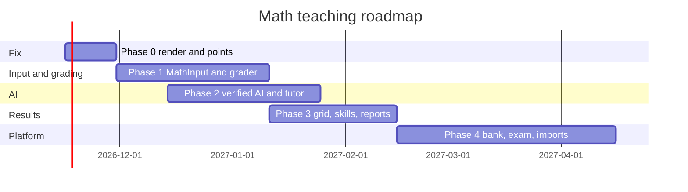

# Math Teaching PRD

## Status

Draft (November 12, 2026)

> **UI reference:** the clickable prototype at [`prototypes/math-teaching/`](../../prototypes/math-teaching/index.html) shows math authoring (Type, Photo, Draw, Ask AI), the student quiz with per-question keypads, and the teacher results grid with answer clusters. Grading in the prototype runs the real Compute Engine; AI conversions are sample data.

## Purpose

Make ClassroomIO the most capable and most customisable LMS for math teaching businesses: tutoring centres, exam-prep academies, homeschool programmes and online math schools. A teacher must be able to write any math question in seconds, students must be able to answer in real math notation from any device, the system must grade those answers correctly, AI must help on both sides without getting the math wrong, and the teacher must see what every student got wrong and why, at a glance.

## Problem Statement

A customer put it plainly:

> The problem with math is that students need to be able to write math problems easily, use artificial intelligence, and I need to be able to view their results easily, etc.

That sentence names four jobs, and today we fail each one:

1. **Writing math.** Teachers can only put math in lesson notes and question descriptions. Question titles, options and accepted answers are plain strings, and student answers are plain strings or numbers, except paragraph (TEXTAREA) answers, which are editor HTML that the teacher's submission view shows without rendering math.
2. **Answering in math.** Students have no math input. They can pick an option, type a JavaScript number, or type free text that a teacher has to grade by hand.
3. **AI.** The course agent writes math in lesson notes, but writes questions as plain text, never checks its own answer keys, and cannot grade working. The AI tutor's chat does not render math.
4. **Results.** Teachers get a per-exercise submission list and a gradebook of totals. There is no student × question view, no common-wrong-answer view, no skill mastery, and partial credit is silently rounded away.

## Current-State Audit

Everything below was checked in the code on `main` (commit `8805c0f05`).

### Authoring and rendering

| Area | What exists | Gap for math |
| --- | --- | --- |
| Rich-text editor | TipTap with `@tiptap/extension-mathematics` and a `$$…$$` input rule (`packages/ui/src/custom/editor/editor.ts`, `extensions/InlineMathReplacer.ts`) | Used wherever rich text is edited: lesson notes, exercise and question descriptions, community posts, newsfeed, course landing pages, email settings and the student answer box of paragraph (TEXTAREA) questions. The toolbar buttons insert a placeholder `a^2 + b^2 = c^2`, and clicking a formula to edit it opens the browser's `prompt()` asking for raw LaTeX, so only teachers who already know LaTeX can use it. The paste handler (`getHandlePaste` in `editor/utils.ts`) only handles images, so pasted LaTeX, Word equations and MathML are not turned into math nodes |
| Math display | `renderMathInElement` in `packages/ui/src/tools/render-math.ts` renders `[data-type="inline-math"]` / `[data-type="block-math"]` with KaTeX | Called from exactly one place: `apps/dashboard/src/lib/features/ui/html-render.svelte` (lesson notes in the dashboard, the course preview modal and landing-page pricing). Views that use `SafeHtmlContent` instead, such as the public course lesson view (`public-course/lesson-view.svelte`) and `block-note.svelte`, never render math, although the help page `use-math-in-editor.mdx` says students see formatted math |
| Question title | `question.title` is `varchar`; rendered as `<h4>{title}</h4>` in `packages/ui/src/custom/exercise-question/question-title.svelte` | No math at all. `x^2` shows as `x^2` |
| Question description | Rich HTML in `settings.description`, edited with the TipTap editor | In take, review and submission modes it goes through `ZoomableHtmlContent`, which never calls `renderMathInElement`. Math is stored only in the `data-latex` attribute of `` (the markup the AI block recipes also emit), with no text content, so without a KaTeX pass the student sees **nothing** where the formula was |
| Options | `option.label` plain string | No math in multiple-choice options, which is where most math MCQs live |
| Fill in the blank | `settings.acceptedAnswers` is a comma-separated string, split on `,` in `scoreFillBlank` (`packages/question-types/src/question-scoring.ts`) | Any answer containing a comma breaks: `1,000`, `(2, 3)`, `{1, 2}` |
| AI chat | `apps/dashboard/src/lib/features/ai-assistant/utils/markdown.ts` | No math rendering, so `$\frac{1}{2}$` shows raw |
| Exercise templates | `exercise_template.questionnaire` jsonb blob | Not a question bank: no per-question reuse, tags, difficulty or skills |
| Tags | `tag` / `tag_assignment` tables | Attach to courses only, not to questions |

### Answering and grading

| Area | What exists | Gap for math |
| --- | --- | --- |
| Question types | 14 enabled types in `packages/question-types/src/question-type-registry.ts`, append-only ids, MATCHING and HOTSPOT built but disabled | No expression, equation, graph, multi-part or working-shown type |
| Numeric | `NumericAnswerData = { value: number }`, absolute tolerance only (`scoreNumeric`) | No fractions (`3/4`), mixed numbers, `π`, surds, relative tolerance, significant figures or units |
| Short answer / paragraph | Always manual grading | Every non-trivial math answer becomes a manual grading job |
| Text comparison | `normalizeText` = trim + lowercase, then string equality | `2x+1`, `1+2x` and `2 x + 1` are three different answers |
| Partial credit | Computed as a float, then `Math.round(...)` in `scoreSubmissionAnswers` | A 1-point question with 2 of 3 parts right scores 1 or 0, never 0.67 |
| Storage | `question_answer.point` and `submission.total` are `bigint` (`packages/db/src/schema.ts`) | Fractional points cannot be stored even if the rounding is removed |
| AI grading | AI-generated grading feedback is a v1 non-goal in `prd/exercise-question-types [DONE]` | Teachers grade every worked solution by hand |

### AI

| Area | What exists | Gap for math |
| --- | --- | --- |
| Course agent | `packages/ai-assistant/src/tools/teacher.ts`: `create_exercise`, `add_questions`, `update_questions`; block recipes for `inline_math` / `block_math` in notes (`tools/block-recipes.ts`) | Questions are `z.string()` text with no math convention; answer keys are never verified, so a wrong key ships silently |
| AI tutor | `packages/ai-assistant/src/tutor-config` with `assessmentMode` (`direct_answer`, `hint_only`, `block_during_exercise`), Socratic persona, `revealSolutionsAfterAttempts`; student tools `read_exercise`, `read_my_submissions` | Strong base, but the tutor does its own arithmetic (LLMs get this wrong), cannot see the student's current working, and its replies do not render math |
| MCP / public API | `packages/mcp`, `apps/api/src/routes/v1` | Will need the new types and fields exposed |

### Results

| Area | What exists | Gap for math |
| --- | --- | --- |
| Exercise submissions | `apps/dashboard/src/lib/features/course/components/exercise/submissions/` (summary by question, individual by student) | No student × question grid, no grouping of identical wrong answers, no "accept this answer for everyone and regrade" |
| Gradebook | `apps/api/src/services/mark/gradebook.ts` | Exercise totals only |
| Analytics | `prd/analytics-dashboards` plans a metric registry, cohort/course/org dashboards and a "hardest questions" widget | No skill or standard dimension, no time-on-question, no misconception data to feed it |

### What we can build on

The foundation is good, so this plan extends it instead of replacing it:

- `@cio/question-types` is pure TypeScript, shared by the dashboard, the API and the MCP server, with one scorer (`scoreAnswerForQuestion`) used by the API for grading and by the public course exercise view. A math grader slots in as one more case.
- Renderers are organised by mode (`edit`, `take`, `preview`, `review`, `view`, `submission`), in per-type folders under `packages/ui/src/custom/exercise-question/renderers/`, so a new type plugs into authoring, taking and grading in one place.
- `question.settings` and `question_answer.answer_data` are jsonb, so most new types need no schema change.
- The tutor already supports hint-only and Socratic modes, which is exactly what math teachers ask for.
- The analytics registry is the right place for mastery and item-analysis metrics.

## Primary Users

- **Math teacher / tutor**: writes questions, assigns practice, reviews results, gives feedback.
- **Academy owner**: wants a branded programme with its own curriculum, notation, grade levels and reporting to parents.
- **Student**: from primary school arithmetic to university calculus, often on a phone.
- **Parent** (later): wants a progress report, not a dashboard.

## Goals

1. Any math a teacher can write in LaTeX renders correctly everywhere a student or teacher can see it.
2. Students can type math on desktop and phone without knowing LaTeX.
3. At least 80% of a typical math worksheet is auto-gradable with correct equivalence checking, including expressions, equations, fractions and units.
4. AI never ships a wrong answer key and never does arithmetic the engine can do.
5. A teacher can see, on one screen, which students got which questions wrong, what the most common wrong answers were, and which skills each student has mastered.
6. Every math behaviour is configurable per organisation, per course and per question.

## Non-Goals (for this PRD)

- A full computer algebra system UI for students (we use one internally for grading).
- Proof grading beyond AI-assisted rubric suggestions that a teacher approves.
- Building our own graphing calculator; we embed one.

## Key Technology Choices

| Need | Choice | Why |
| --- | --- | --- |
| Display | Keep **KaTeX** (`katex@^0.16`, already in `@cio/ui` and the API) | Fast, already shipped, server-side rendering available |
| Student input | **MathLive** `<math-field>` (MIT) | Web component with a configurable virtual keyboard (`numeric`, `symbols`, `greek`, custom layouts), works on mobile, outputs LaTeX and MathJSON |
| Equivalence and grading | **Cortex Compute Engine** `@cortex-js/compute-engine` (MIT) | Parses LaTeX to MathJSON, simplifies and evaluates; runs in Node so grading stays server-side in `@cio/question-types` |
| Graphing calculator | **Desmos API** behind an org setting, with a built-in fallback | Commercial Desmos use needs a paid plan (Starter is Desmos-hosted embedding only; Enterprise adds saving, screenshots and programmatic grading), so it must be a paid-plan feature or bring-your-own-key |
| Graph-plotting questions | **JSXGraph** (open source) | Lets students plot points and lines we can grade without a Desmos Enterprise plan |

MathLive and the Compute Engine are large; both must be lazy-loaded only on pages that contain a math field, the way the editor already is in `renderers/textarea/take.svelte`.

## Math Authoring

Teachers write math where they are already typing, the same way in every text box, without needing to know LaTeX. Teachers who know LaTeX can still type it directly.

### Lessons and exercises

Both use one shared math box and one display path (`MathText` / KaTeX), so a teacher who learns it in a lesson already knows it in an exercise. They start from different places:

| Surface | Today | Change |
| --- | --- | --- |
| Lesson notes | TipTap math nodes exist; notes render math on the dashboard through `html-render.svelte` | Swap `prompt()` for the math box, add paste conversion, Photo and Draw, and render math on every page that shows a lesson |
| Question and exercise descriptions | Same TipTap editor as lessons | Get every lesson upgrade for free; also fix the take, review and submission views, which do not render the math today |
| Question titles and options | Plain inputs, plain `<h4>` display | New single-line editor with text and inline math only, saving `$…$` strings |
| Accepted answers | Plain inputs | The same `MathInput` students answer in, plus a "Try an answer" check |

### Ways to enter math

1. **Type it inline.** Typing `$` or `/math`, or clicking the toolbar button, opens the math box at the cursor. MathLive's shortcuts turn `x^2` into a superscript, `1/2` into a stacked fraction, `sqrt` into a root, and `pi`, `theta`, `<=` and `!=` into symbols. A palette above the box holds structures that are hard to type (fractions, powers, roots, matrices, systems of equations, piecewise functions, integrals, sums), filtered by the course's level. Tab or clicking outside closes the box; clicking the formula opens it again.
2. **Paste it.** LaTeX, Word equations and MathML become math nodes. This is how a teacher moves an existing question set in on day one.
3. **Ask AI.** In the math box, describe the expression ("a quadratic with roots 3 and −2, not factored") and get `x^2 - x - 6`, checked by the Compute Engine before insert.
4. **Photo or draw it.** See Photo and Draw to Math.
5. **Accepted answers.** Typed in the same `MathInput` students use. Below it the teacher picks the comparison mode, and a "Try an answer" field shows whether a sample student answer such as `2(x+1)` would be marked right and why, so teachers can trust the auto-grading before students see it.

### Storage

- Titles, options and accepted answers stay plain strings with `$…$` around the math (`Solve $x^2-5x+6=0$`). No migration, old questions keep working, and it is the format AI tools already write.
- Lesson notes and descriptions keep the editor's existing `` / `
` HTML.
- Every display goes through `MathText` / `renderMathInElement`.

## Photo and Draw to Math

Turns an image of math into editable math. Drawing and uploading are two ways of producing an image; one converter handles both.

### Experience

The math box has three tabs: **Type** (MathLive), **Photo** and **Draw**.

- **Photo.** Upload an image, paste a screenshot (Ctrl/Cmd+V), or take a picture with the phone camera: a textbook page, a worksheet, a whiteboard, a notebook. When the image holds more than one expression, the teacher drags a box around the part they want.
- **Draw.** A canvas for finger, stylus or mouse. The converted math appears under the canvas after a short pause in writing, so the teacher can fix a stroke before inserting.
- **Review before insert.** The original image sits next to the converted formula in an editable MathLive box. The teacher corrects anything wrong and clicks Insert. If the Compute Engine cannot parse the result (for example unbalanced brackets), the box says so instead of inserting it.

### How it works

1. The client sends the image (cropped region for Photo, rendered canvas for Draw) to a new API route.
2. The route calls a vision-capable model through the providers `packages/ai-assistant` already supports (OpenAI, Anthropic, Google), with an instruction to return only LaTeX.
3. The Compute Engine parses the LaTeX. A parse failure returns an error and the LaTeX for the teacher to fix.
4. The client shows the result in the review step. Nothing is stored server-side except usage counts; images in a question go through the existing media upload flow only if the teacher inserts the image itself.

### Where it is used

| Who | Where | Notes |
| --- | --- | --- |
| Teacher | Math box in lessons, descriptions, titles, options and accepted answers | One expression at a time |
| Teacher | Worksheet import (Phase 2) | The same converter over a full page, split into questions with proposed answers |
| Student | `WORKED_SOLUTION` working | Photo of paper or the Draw canvas. The teacher sees the original image; the converted text feeds AI-assisted marking |
| Student | Answer box | Off by default, per-question teacher setting, because typed answers grade more reliably |

### Accuracy and vendor choice

General vision models are strong on printed math and decent on neat handwriting; messy handwriting is where they slip. Specialist math OCR services such as Mathpix are an alternative at a higher per-image cost. Before building, run an accuracy spike: 100 real images (printed, neat handwriting, messy handwriting, from a math customer) through two or three models and Mathpix, comparing exact-match rate, Compute Engine equivalence rate, latency and cost. Start with the providers we already use unless the spike shows a large gap.

### Cost and limits

Each conversion is one model call. It counts against the same plan and fair-use limits as the AI tutor (`prd/ai-tutor-fair-use`), with a small monthly allowance on the free plan. Draw converts after a pause, never on every stroke.

## Plan

Five phases. Each one ships something a math customer can feel, and each later phase depends on the earlier ones.

### Phase 0: Math renders everywhere and points add up (1–2 weeks)

This fixes what is broken today. Nothing new is invented.

1. **One `MathText` primitive in `@cio/ui`.** It renders a plain string with `$…$` and `$$…$$` delimiters (and the existing TipTap `data-latex` spans) through KaTeX. It replaces `<h4>{title}</h4>` in `question-title.svelte` and every place an option label, accepted answer, fill-blank or word-bank token is printed, in all six renderer modes. Strings stay strings, so there is no migration; titles without `$` render exactly as before.
2. **Call `renderMathInElement` in `ZoomableHtmlContent` and `SafeHtmlContent`.** This makes question descriptions, exercise descriptions and the course-app render the math teachers already typed.
3. **Math in the AI chat.** Add a math pass to `ai-assistant/utils/markdown.ts` for `$…$`, `$$…$$`, `\(…\)` and `\[…\]`, and tell both the teacher and the tutor prompts to use that convention.
4. **Single-line math editor for titles and options.** Replace the plain title and option inputs with a one-line editor that allows text and inline math only (see Math Authoring). It saves the same `$…$` strings, so nothing else changes. Until the MathLive box lands in Phase 1, its math node opens a LaTeX field with a live KaTeX preview instead of `prompt()`.
5. **Fix partial credit.** Change `question_answer.point` and `submission.total` to `numeric(10,2)` in one migration (per the repo's one-migration-per-PR rule), remove the `Math.round` in `scoreSubmissionAnswers`, and update the gradebook and marks UI to show up to two decimals.
6. **Fix fill-blank accepted answers.** Store `settings.acceptedAnswers` as `string[][]` (blanks × alternatives) and keep reading the legacy comma string through a codec in `answer-codecs.ts`.
7. **Server-rendered math for email and PDF.** The route in `apps/api/src/routes/course/katex.ts` already renders MathML; reuse it for certificate and report output.

**Done when** a question with a fraction in the title, options and description renders correctly in edit, take, review and submission modes, on the dashboard and the course-app, and a 0.5-point answer is stored and shown as 0.5.

### Phase 1: Students write math, the system grades math (4–6 weeks)

1. **`MathInput` component** in `@cio/ui` wrapping MathLive, lazy-loaded. Keyboard layout is configurable per question (numeric only for arithmetic, full algebra, calculus, Greek, sets) with a default per course grade level. Output is `{ latex, mathjson }`.
2. **The shared math box in every editor.** The same component becomes the editing popover for the TipTap inline and block math nodes (replacing the `prompt()` calls in `editor.ts` and the placeholder insert in `toolbar-commands.ts`), for the single-line title and option editor, and for accepted answers. It opens on `$`, `/math` or the toolbar button, with a palette of structures for the course's level. Lessons and question descriptions get it together because they share the editor.
3. **Paste conversion.** Extend the editor's `handlePaste` so LaTeX in `$…$`, `$$…$$`, `\(…\)` and `\[…\]`, Word equations (OMML) and MathML become math nodes instead of plain text, in lessons, descriptions, titles and options.
4. **New question type `MATH_EXPRESSION`** (id 17, appended to the registry, plus a `question_type` row). Answer: `{ type: 'MATH_EXPRESSION', latex, mathjson }`. Settings:
   - `acceptedAnswers`: one or more LaTeX answers.
   - `compare`: `equivalent` (any algebraically equal form), `exact_form` (equal **and** in a required form: `simplified`, `factored`, `expanded`, `lowest_terms`, `rationalised_denominator`), `numeric` (with `relativeTolerance` / `absoluteTolerance` / `significantFigures`), or `set` (order-independent lists, roots, intervals).
   - `units`: expected unit and whether conversions are accepted (`2 m` = `200 cm`).
   - `variables`: which letters are variables, so `e`, `i` and `\pi` are interpreted correctly.
   - `wrongAnswerFeedback`: optional map of a known wrong answer to a hint ("You forgot to flip the inequality").
5. **Grader in `@cio/question-types`.** `scoreMathExpression` uses the Compute Engine: canonicalise both sides, check symbolic equality, and fall back to evaluating at random points over the variable domain when simplification is inconclusive. Equations are compared after moving everything to one side and normalising the constant factor. The grader returns a reason (`equivalent`, `not_simplified`, `wrong_units`, `wrong`) that review mode shows to the student and the results grid groups by.
6. **Upgrade `NUMERIC`.** Accept `3/4`, `1 1/2`, `\pi`, `\sqrt{2}` and scientific notation through the same parser; add relative tolerance and significant figures. Old answers (`{ value: number }`) keep grading unchanged.
7. **`WORKED_SOLUTION` question type** (id 18): a final answer graded like `MATH_EXPRESSION`, plus "show your work" as typed math lines, a drawing canvas, or a photo of paper. Points split between answer and working (for example 2 + 3). The answer part auto-grades; the working part goes to manual or AI-assisted grading (Phase 2), so the submission waits in `awaiting_manual` only for the working.
8. **Multi-part questions.** A shared stem with parts (a), (b), (c), each its own `MATH_EXPRESSION` / `NUMERIC` / choice with its own points. Model it as a `parent_question_id` on `question` so scoring, analytics and the API treat parts as normal questions.
9. **Calculator policy per exercise:** none, four-function, scientific or graphing, enforced in the take view (Desmos when the org has a key, otherwise a built-in scientific calculator).
10. **Enable `MATCHING`** (already built, id 15, but it still needs a `question_type` row) with math-aware labels; it is common in math (match the graph to the equation).

**Done when** a teacher can build a ten-question algebra worksheet in which nine questions auto-grade, `2(x+1)` is accepted for `2x+2` unless "expanded form" is required, and a student can do the whole thing on a phone.

### Phase 2: AI that does not get the math wrong (4–6 weeks, overlaps Phase 1)

The rule for every AI feature: **the language model writes and explains, the Compute Engine computes and checks.**

1. **AI question authoring with verified keys.** Extend the `create_exercise`, `add_questions` and `update_questions` schemas with the new types and a LaTeX convention (reconciled with the `inline_math` / `block_math` block recipes, which today tell the model to write LaTeX without `$` delimiters inside `data-latex`), and add a server-side check: before a question is saved, the engine evaluates the agent's stated answer; if it disagrees, the tool returns an error and the agent must fix it. A wrong answer key can no longer ship silently.
2. **Generate from a worksheet.** Upload a photo or PDF of a worksheet; a vision model extracts each question to LaTeX, picks a type and proposes an answer, and the engine verifies it. The teacher reviews a side-by-side preview before import. This is the fastest path from "my existing material" to "running in ClassroomIO".
3. **Photo and Draw to Math.** The Photo and Draw tabs in the math box, as described in Photo and Draw to Math below. Worksheet import (item 2) is the same converter run over a whole page.
4. **Variants and parameterised questions.** A question can define `variables` with ranges and an answer formula (for example `a ∈ [2, 9]`, `b ∈ [1, 20]`, answer `b / a`). Each student gets a seed stored with their answer, so every student sees different numbers, retakes get fresh numbers, and practice is unlimited. "Make 10 variants of this" in the agent is a thin layer on top.
5. **AI-assisted grading of working.** For `WORKED_SOLUTION` and `TEXTAREA`, a vision-capable model reads typed or handwritten working against a teacher rubric and returns per-step marks, the first wrong step and a comment. It is always a **suggestion** that a teacher accepts, edits or rejects in the grading view (with bulk accept for high-confidence ones). Store it in `question_answer.answer_data.aiReview` so it is auditable, and respect the limits in `prd/ai-tutor-fair-use`.
6. **Math mode for the AI tutor.** When a student opens the tutor during an exercise, it receives the current question and the student's current input (new student tool `read_current_attempt`). It checks the student's steps with the engine, points to the first incorrect step, and follows `assessmentMode`: in `hint_only` it gives the next nudge, never the answer. "Is this right?" is answered by the engine, not the model.
7. **Misconception feedback.** When a wrong answer matches a known pattern (sign error, forgot to distribute, inverted fraction), the grader's reason plus the teacher's `wrongAnswerFeedback` produce an immediate, specific hint after submission.

**Done when** the agent can turn a photographed worksheet into a graded exercise with no wrong keys, and a student stuck on a step gets a correct, non-revealing hint.

### Phase 3: Results a teacher can read in ten seconds (4–5 weeks)

1. **Exercise results grid.** Students down, questions across, each cell coloured by score, with the student's answer rendered as math on hover. Filters: wrong only, awaiting grading, by cohort. Clicking a cell opens the review renderer. Builds on `submissions/summary.svelte` and `individual.svelte`.
2. **Answer clusters per question.** Group answers by normalised MathJSON so teachers see "14 students answered `x = -3`, 6 answered `x = 3`". One click on a cluster marks it correct (or partially correct) for everyone and **regrades retroactively**, or attaches feedback to all of them.
3. **Skills and standards.** Add `skill` and `question_skill` tables (org-scoped, hierarchical, importable as CSV from Common Core, the UK National Curriculum, WAEC/NECO, IB and other syllabuses). Tag questions manually or by AI suggestion. Each student gets a mastery level per skill from their recent attempts.
4. **Mastery and item analysis in the analytics registry.** Add `skill_mastery`, `question_facility` (share correct), `question_discrimination` (how well it separates strong and weak students), `common_wrong_answers` and `time_on_question` as registry metrics, so they work at cohort, course and org scope with no bespoke charts. Time-on-question needs `startedAt` / `answeredAt` recorded in `answer_data` by the take view.
5. **Student and parent report.** A one-page PDF or share link per student per period: skills mastered, skills to work on, recent scores and a teacher comment, branded with the org's theme.
6. **"Assign practice" from results.** From a weak skill or a wrong-answer cluster, generate a short practice set (parameterised variants from Phase 2) and assign it to only those students. Depends on `prd/selective-exercise-assignment`.

**Done when** a teacher opens one screen after a quiz, knows who needs help and on what, and has assigned targeted practice in two clicks.

### Phase 4: The most customisable math platform (ongoing)

1. **Org-level question bank.** Move questions out of single exercises into a bank with skills, difficulty, tags and usage stats. Exercises include fixed questions or "draw N random questions from these skills at this difficulty". Replaces the `exercise_template` jsonb blob over time.
2. **Notation and locale settings** per org and course: decimal comma vs point, thousands separator, `×` vs `·`, unit system, keyboard layout per grade band. The grader and `MathText` read the same settings, so `0,5` is accepted in a decimal-comma academy.
3. **Exam mode.** Timer, question and option shuffling, attempt limits, calculator policy and a printable answer key. The exercise-question-types PRD already lists attempt and test controls as missing.
4. **Printable worksheets.** Export any exercise or bank selection to PDF with an answer key and worked solutions, for academies that still run paper classes.
5. **Imports and exports.** QTI, Moodle XML, the LaTeX `exam` class, and Word documents with equations (OMML to LaTeX), with exports in the same formats so customers are never locked in.
6. **Graph questions.** `GRAPH_PLOT` (plot points, lines and parabolas on a coordinate plane, graded geometrically) and `GRAPH_READ` (read a value off a provided graph), with JSXGraph. Re-enable `HOTSPOT` (id 16) for geometry diagrams.
7. **API, MCP and webhooks.** Every new type, setting and metric in the public API (`apps/api/src/routes/v1`) and MCP tools (`packages/mcp`), plus a graded-submission webhook payload with per-skill results.
8. **Packaging.** Math display, `MATH_EXPRESSION`, numeric upgrades and the results grid on every plan, so the free plan is already the best free math LMS. Parameterised questions, AI grading, the question bank, skill mastery, Desmos and parent reports on paid plans, via `PREMIUM_QUESTION_TYPE_KEYS` and plan gates.

## Data Model Changes

| Change | Phase | Notes |
| --- | --- | --- |
| `question_answer.point`, `submission.total` → `numeric(10,2)` | 0 | One migration; backfill is a cast |
| Fill-blank `settings.acceptedAnswers` → `string[][]` | 0 | jsonb; codec reads legacy strings |
| `question_type` rows 17 `MATH_EXPRESSION`, 18 `WORKED_SOLUTION` | 1 | Append-only ids per the registry rule |
| `question.parent_question_id` | 1 | Multi-part questions |
| `exercise.calculator_policy` | 1 | Or a new `exercise.settings` jsonb |
| `answer_data.aiReview`, `seed`, `startedAt` / `answeredAt` | 2–3 | jsonb, no migration |
| `skill`, `question_skill` | 3 | Org-scoped; mastery computed |
| Question bank | 4 | Decide in a Phase 4 design doc (bank table vs nullable `question.exercise_id`) |
| `organization` / `course` math settings | 4 | Notation, keyboards, calculator defaults |

## Sequencing

Phase 2 starts once the Phase 1 grader exists, because answer-key verification and the tutor's step checking both depend on it.

## Success Metrics

- Share of questions in math courses that are auto-gradable: from today's baseline to at least 80%.
- Median time from submission to grade for math exercises.
- Teacher time spent in manual grading per 100 submissions.
- Share of AI-created questions whose stored answer the engine confirms: 100% by construction.
- Weekly active teachers using the results grid and cluster regrade.
- Retention and expansion of organisations that teach math.

## Risks

| Risk | Mitigation |
| --- | --- |
| Equivalence false positives (different expressions that sample equal) or false negatives (domain issues such as `\sqrt{x^2}`) | Symbolic check first, sampling over many points second, a "needs review" outcome when they disagree, and a large fixture suite in `@cio/question-types` |
| Bundle size of MathLive and the Compute Engine | Lazy-load per page like the TipTap editor; grading runs on the server |
| AI cost of vision grading | Opt-in per exercise, plan limits, cache by answer hash |
| Photo and Draw misreads messy handwriting | Mandatory review step before insert, Compute Engine parse check, and the vendor choice made from the accuracy spike |
| Desmos licensing | Paid-plan or bring-your-own-key only; built-in scientific calculator for everyone |
| Breaking existing exercises | All changes are additive; legacy answers go through codecs in `answer-codecs.ts` |

## First Tickets

1. `MathText` primitive and its use in `question-title.svelte`, option labels and all renderer modes.
2. `renderMathInElement` in `ZoomableHtmlContent` / `SafeHtmlContent`; math in AI chat markdown.
3. Migration: `point` and `total` to `numeric(10,2)`; remove `Math.round` in `scoreSubmissionAnswers`.
4. Fill-blank `acceptedAnswers` as arrays with a legacy codec.
5. Spike: Compute Engine equivalence on 200 real worksheet answers from a customer, to size Phase 1 accuracy.
6. Spike: MathLive on a low-end Android phone in the course-app take view.
7. Spike: Photo and Draw to Math accuracy on 100 real images across two or three vision models and Mathpix.
8. Single-line math editor for question titles and options, and the editor's `prompt()` replaced by an inline LaTeX field with preview.
