# Zapier Integration PRD

**Prototype:** [clickable prototype](http://localhost:4748/index.html) (run locally from [`prototypes/zapier-integration`](../../prototypes/zapier-integration), start at `index.html?returning=1`) · **Demo video:** [watch the walkthrough](https://www.awesomescreenshot.com/video/57929349?key=6d5fe60a45237a8c6e4051cec3ca9777)

## Purpose

Let ClassroomIO admins connect ClassroomIO to the 6,000+ apps on Zapier (HubSpot, Slack, Zoom and more) without us building each integration. Zaps are built on Zapier. ClassroomIO helps admins discover an integration and get to Zapier.

## Problem

Customers keep asking for "ClassroomIO + {tool}" integrations: enrol a student when a CRM deal closes, post to Slack when a course is completed. Building these one by one doesn't scale. We already have a public API, so Zapier is the cheapest way to cover all of them.

## Decisions

| Area | Decision |
| --- | --- |
| Distribution | Private Zapier app via an invite link first, public Zapier listing once about 5 paying orgs use it. |
| Plans | Early Adopter and above. Basic sees an upgrade prompt. Downgrading revokes access immediately. |
| Auth | OAuth 2.0 with admin consent. No API-key paste. |
| Triggers | Polling in v1. Instant (webhook) triggers come later. |
| Scope | ClassroomIO does not build Zaps. Building, mapping, testing and publishing stay on zapier.com. |
| App Directory | A curated list of 20 apps inside ClassroomIO, for discovery only. |
| Code | The Zapier app lives in `apps/zapier`. It only packages the existing public API. |

## User flow

```mermaid
flowchart TD
    subgraph New["Not connected yet"]
        N1[Automation, Zapier: No Zaps yet] -->|Connect Apps| N2[App Directory]
        N2 -->|click an app| N3[ClassroomIO + App page]
        N3 -->|Continue to Zapier| N4[Zapier]
        N1 -->|Create a Zap| N4
    end
    subgraph Connected["Already connected"]
        C1[Automation, Zapier: connected apps] -->|View Connection| C2[Zapier: Connections page]
        C2 -->|Create connection| C3[Zapier: search for an app]
        C3 -->|click the app| C4[ClassroomIO + App page]
        C4 -->|Continue to Zapier| C5[Zapier editor]
    end
```

**Not connected**

1. The admin opens Automation, Zapier and sees "No Zaps yet".
2. `Connect Apps` opens the App Directory. Search or filter, then click an app.
3. The ClassroomIO + {App} page explains what the pairing does. `Continue to Zapier` opens Zapier.
4. `Create a Zap` skips the directory and opens Zapier directly.

**Already connected**

1. The Zaps page lists the connected apps. Each has a `View Connection` button.
2. `View Connection` opens Zapier's connections page ([zapier.com/app/assets/connections](https://zapier.com/app/assets/connections)).
3. `Create connection` opens an "Add new connection" search modal.
4. Picking an app should send the admin to that app's ClassroomIO + {App} page, then on to Zapier.
5. `Create More Zaps` opens the Zapier editor.

> [!NOTE]
> Steps 2 to 4 happen on zapier.com. The prototype simulates them so the redirect can be shown. See Open Questions.

## Screens ClassroomIO builds

- **Zaps page** (`/org/[slug]/automation/zapier`): empty state and connected-apps list, with admin and plan callouts.
- **App Directory** (`.../zapier/apps`): search, category filters, Popular / A-Z sort, 20 curated apps.
- **ClassroomIO + {App} page** (`.../zapier/apps/[slug]`): animated ClassroomIO and app windows joined by a Zapier node, a `Continue to Zapier` button, and tabs for the triggers and actions available for that app.
- **OAuth consent screen** (`/oauth/consent`): shown when Zapier starts the connection. Shows the org, the access requested (read, write), and Authorize / Deny. Admins can downgrade to read-only.

## What Zapier can do (v1)

**Triggers (polling):** new audience member, student enrolled in course, course completed, certificate issued, payment request created.

**Actions:** enrol student in course, add student, update student, remove student, tag student.

**Searches:** find student by email, find course.

## Access and limits

| Plan | Zapier | Active connections | Reads / min | Writes / min |
| --- | --- | --- | --- | --- |
| Basic | No | 0 | 0 | 0 |
| Early Adopter | Yes | 5 | 120 | 40 |
| Enterprise | Yes | 25 | 360 | 120 |

Only org admins can connect. Admins can revoke a connection at any time.

## Rollout

1. OAuth server and plan checks.
2. Consent screen and Zapier dashboard pages.
3. Public API additions (current org, tags, filters).
4. Zapier app (`apps/zapier`).
5. Private validation with real customers.
6. Public Zapier listing.
7. Later: instant triggers, more actions.

## Success metrics

- Orgs with at least one connected Zap.
- Zaps created per connected org.
- Share of connections started from the App Directory vs Zapier.

## Risks

- Zapier may not let us influence its connection modal (see below).
- Brand logos in the prototype are downloaded placeholders. Use approved vendor assets before shipping.
- Polling triggers are not instant. Set expectations in the UI.

## Open questions

1. **Redirect from Zapier's connections page.** Can picking an app in Zapier's "Add new connection" modal redirect to our ClassroomIO + {App} page? Confirm with Zapier, and agree a fallback if not.
2. **Connected apps list.** ClassroomIO cannot see which apps a Zap uses. Drop the list in v1 unless Zapier exposes it.
3. **App Directory timing.** v1 or v1.1? The invite link works without it.
4. **Revoke screen.** Do we ship a ClassroomIO page for revoking connections, or leave it to Zapier?
5. **Catalog ownership.** Who maintains the 20-app list and its brand assets?
