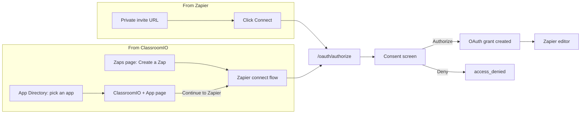
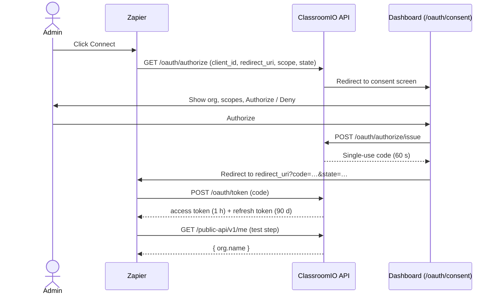
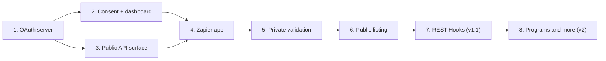

# Zapier Integration PRD


> [!NOTE]
> Draft, updated to match the clickable prototype in [`prototypes/zapier-integration`](../../prototypes/zapier-integration).

**Prototype:** [open the clickable prototype](http://localhost:4748/index.html) (run it locally from [`prototypes/zapier-integration`](../../prototypes/zapier-integration), e.g. `python3 -m http.server 4748`). Start at `index.html?returning=1`, click **View Connection**, then **Create connection** and pick an app to reach the ClassroomIO + app page.

**Demo video:** [watch the prototype walkthrough](https://www.awesomescreenshot.com/video/57929349?key=6d5fe60a45237a8c6e4051cec3ca9777)

## Table of Contents

- [Purpose](#purpose)
- [Problem Statement](#problem-statement)
- [Confirmed Decisions](#confirmed-decisions)
- [Current-State Audit](#current-state-audit)
- [Product Goals](#product-goals)
- [Non-Goals (v1)](#non-goals-v1)
- [User Stories](#user-stories)
- [UX Requirements](#ux-requirements)
- [Trigger, Action and Search Catalogs (v1)](#trigger-catalog-v1)
- [Authentication and Scopes](#authentication-and-scopes)
- [Polling Contract](#polling-contract)
- [Future REST Hooks Upgrade Path](#future-rest-hooks-upgrade-path)
- [Plan Gating](#plan-gating)
- [Technical Design](#technical-design)
- [API and Docs](#api-and-docs)
- [Rollout Plan](#rollout-plan)
- [Success Metrics](#success-metrics)
- [Risks and Mitigations](#risks-and-mitigations)
- [Build and Verification Commands](#build-and-verification-commands)
- [Open Questions](#open-questions)

## Purpose

Ship a Zapier integration that lets non-engineering teams connect ClassroomIO to the tools they already use (CRMs, HRIS, Slack, spreadsheets, email platforms, ticketing) without writing code. The integration must work today against the existing public API and silently upgrade to real-time delivery as the webhooks platform lands.

## Problem Statement

ClassroomIO already exposes a versioned public REST API at `/public-api/v1/*` and ships an MCP server, but those surfaces only serve engineering teams. The customers who run training programs (HR, customer success, sales enablement) cannot:

- Enroll learners automatically when a contact reaches a CRM stage.
- Sync course completions and certificates to HRIS, Drive, or BI warehouses.
- Trigger Slack/email workflows on learner activity.
- Connect ClassroomIO into the no-code stacks (Zapier, Make, n8n, Pipedream) that those teams already operate.

The dashboard already advertises Zapier as an `Automation` tab (`/org/[slug]/automation/zapier`) and the automation-key system supports `type: 'zapier'`, but the page is a coming-soon callout and no Zapier app exists. We have customers who need this integration shipped now.

## Confirmed Decisions

> [!IMPORTANT]
> These are locked before implementation begins.

| # | Decision | Detail |
| --- | --- | --- |
| 1 | **Distribution** | Ship as a private Zapier app via a single shared invite URL first. Promote to the public Zapier directory after ~5 paying orgs are using it and v1 is stable. |
| 2 | **Plan gating** | Early Adopter+ only. Access is binary: either your plan includes Zapier or it doesn't. No monthly task credits. Per-minute rate limits still apply as abuse protection. |
| 3 | **Plan downgrade behavior** | Hard cutoff. When an org drops below Early Adopter, all existing OAuth grants are revoked immediately. No grace period. |
| 4 | **Authentication** | OAuth 2.0 authorization code flow with refresh tokens, shipping in v1. No API-key-paste fallback for Zapier. Direct API consumers (Make, n8n, Pipedream, raw curl) keep using existing `type: 'api'` automation keys; Zapier exclusively uses OAuth. |
| 5 | **Scopes** | `zapier:read` and `zapier:write` exist as OAuth scopes. Zapier requests both at connection time; the consent screen lets admins downgrade to read-only. |
| 6 | **Triggers in v1** | Polling only. No webhook dependency. Real-time REST Hooks ship in v1.1 once the webhooks PRD lands. |
| 7 | **Trigger scope** | Org-wide by default, with optional `Course` and `Tag` dropdown filters per trigger. No separate per-course trigger duplicates. |
| 8 | **iPaaS parity** | The public REST API is the integration surface. Zapier connects via OAuth; Make / n8n / Pipedream can use OAuth too (all three support it) or `type: 'api'` keys for raw HTTP. The Zapier app is packaging only: no Zapier-specific endpoints or payloads. |
| 9 | **Repo location** | `apps/zapier`. The Zapier app is a deployable that gets `zapier push`-ed to Zapier's cloud. Nothing else in the monorepo imports from it, so it sits next to `apps/api` and `apps/dashboard` rather than in `packages/`. |
| 10 | **Revoke UX** | Per-grant revoke is available in the dashboard for the safety-net case (compromised Zapier account, employee offboarding). No bulk "Disconnect Zapier" button; customers managing their integration normally do so from inside Zapier. |
| 11 | **Two ways in, one OAuth flow** | An admin can start connecting from Zapier (private invite URL) or from the ClassroomIO Zapier tab (Zaps page, App Directory, per-app page). Every path ends in the same OAuth consent screen and the same grant. ClassroomIO never stores a Zapier credential outside that grant. |
| 12 | **ClassroomIO does not build Zaps** | Zap building, trigger and action pickers, field mapping, testing and publishing stay on zapier.com. The dashboard only helps an admin discover an integration, connect, and manage the grant. |
| 13 | **Dashboard hands off to Zapier, no ClassroomIO-hosted connect step** | "Create a Zap", "Connect Apps" and "View Connection" never show a ClassroomIO connect screen of their own. They send the admin to the ClassroomIO + {App} page or to Zapier. The OAuth consent screen only appears when Zapier calls `/oauth/authorize` during its connect handshake. |
| 14 | **Curated App Directory (20 apps)** | The in-dashboard directory is a static, curated list of 20 apps chosen in [`integration-research.md`](./integration-research.md), not Zapier's full 6,000+ catalog. It is a discovery aid and does not create per-app connections. |
| 15 | **Connection model** | A connection is one OAuth grant to one Zapier workspace for one org. Third-party apps such as HubSpot are connected inside Zapier, not in ClassroomIO. "View Connection" opens Zapier's own connections page (<https://zapier.com/app/assets/connections>). |
| 16 | **Zapier connections page hands back to ClassroomIO** | On Zapier's connections page, `Create connection` opens an "Add new connection" search modal. Choosing an app there should redirect the admin to that app's ClassroomIO + {App} page. This redirect happens on Zapier's side and must be confirmed with Zapier (see Open Questions). |

### How a connection starts



### User flow (as shown in the prototype)

The clickable prototype ([`prototypes/zapier-integration`](../../prototypes/zapier-integration)) demonstrates these two journeys. Zapier-hosted steps are marked; ClassroomIO builds everything else.

```mermaid
flowchart TD
    subgraph New["Not connected yet"]
        N1[Automation → Zapier: No Zaps yet] -->|Connect Apps| N2[App Directory: search and filter]
        N2 -->|click an app| N3[ClassroomIO + App page]
        N3 -->|Continue to Zapier| N4[Zapier: connect and build the Zap]
        N1 -->|Create a Zap| N4
    end
    subgraph Connected["Already connected"]
        C1[Automation → Zapier: connected apps list] -->|View Connection| C2["Zapier: Connections page (hosted by Zapier)"]
        C2 -->|Create connection| C3["Zapier: Add new connection modal, search for an app"]
        C3 -->|click the app| C4[ClassroomIO + App page]
        C4 -->|Continue to Zapier| C5[Zapier editor]
        C1 -->|Create More Zaps| C5
    end
```



1. **Connected apps list.** The Zaps page lists the apps already connected, each with a `View Connection` button.
2. **View Connection** opens Zapier's connections page in the same flow (<https://zapier.com/app/assets/connections>), where the admin sees every app connected to their Zapier account.
3. **Create connection** on that page opens an "Add new connection" modal with an app search.
4. **Choosing an app** (for example HubSpot) redirects to the ClassroomIO + {App} page at `/org/[slug]/automation/zapier/apps/[slug]`.
5. **Continue to Zapier** on that page opens the Zapier editor to build the Zap.

> [!NOTE]
> Steps 2 to 4 take place on zapier.com. The prototype simulates the connections page and the modal (`zapier-connections.html`) so the redirect in step 4 can be demonstrated. ClassroomIO does not build or control those two Zapier screens.

## Current-State Audit

| Capability | Current State | Notes |
| --- | --- | --- |
| Org-scoped automation keys | ✅ available | `organization_api_key` already supports `type: 'mcp' \| 'api' \| 'zapier'`. Rotation, revoke, last-used tracking all shipped. The `'zapier'` value becomes unused under the OAuth model (see [Technical Design](#technical-design)). |
| Bearer auth middleware | ✅ available | `automationKeyMiddleware` + `automationKeyScopesMiddleware` in `apps/api/src/middlewares/`. Will be extended to also accept OAuth access tokens. |
| OAuth 2.0 server | ❌ missing | No OAuth authorization-code flow exists on the API. Required for v1. |
| OAuth consent screen | ❌ missing | No dashboard consent screen for third-party app authorization. Required for v1. |
| Public REST API | 🟡 partial | `/public-api/v1/courses` and `/public-api/v1/audience` shipped. Tags, announcements, certificates, course clone, full audience update still missing. |
| Test-connection endpoint | ❌ missing | No `GET /public-api/v1/me` for Zapier's auth-test step. |
| Polling cursor / since filter | ❌ missing | List endpoints support `page/limit` but no `?since=` or `?cursor=` for stable Zapier polling. |
| Email/slug search filters | ❌ missing | Audience list does not accept `?email=`; courses list does not accept `?slug=` or `?title=`. |
| Webhooks delivery | ❌ missing | `prd/webhooks/README.md` written but unshipped. Not a v1 dependency. |
| Dashboard Zapier tab | 🟡 partial | `/org/[slug]/automation/zapier` route exists but renders a `coming_soon` callout. Will become an OAuth-grant management page, not a key-management page. |
| Automation usage tracking | ✅ available | `organization_automation_usage` already records `read \| write \| publish` per key. Will be extended to record per OAuth grant. |
| Plan gating utilities | ✅ available | `MCP_AUTOMATION_LIMITS_BY_PLAN` pattern in `packages/utils/src/plans/automation.ts` is the reference for Zapier rate limits. |
| Marketing positioning | 🟡 partial | `apps/website/src/routes/automation/+page.svelte` advertises API + Webhooks + MCP. Does not yet mention Zapier. |

<details>
<summary><strong>Data sources checked</strong></summary>

- `packages/db/src/schema.ts` (`organization_api_key`, `organization_automation_usage`)
- `packages/utils/src/validation/organization/automation-key.ts`
- `packages/utils/src/validation/public-api/audience.ts`
- `packages/utils/src/validation/public-api/course.ts`
- `packages/utils/src/plans/automation.ts`
- `apps/api/src/middlewares/automation-key.ts`
- `apps/api/src/middlewares/automation-key-scopes.ts`
- `apps/api/src/routes/v1/courses.ts`
- `apps/api/src/routes/v1/audience.ts`
- `apps/api/src/services/v1/course.ts`
- `apps/api/src/services/v1/audience.ts`
- `apps/api/src/services/organization/automation-key.ts`
- `apps/api/src/services/course/{invite,people,certificate,completion,clone,compliance}.ts`
- `apps/api/src/services/submission/submission.ts`
- `apps/api/src/services/newsfeed/newsfeed.ts`
- `apps/api/src/services/tag.ts`
- `apps/dashboard/src/lib/features/automation/pages/{mcp,zapier}.svelte`
- `apps/website/src/routes/automation/+page.svelte`
- `prd/public-api [DONE]/README.md`
- `prd/webhooks/README.md`

</details>

## Product Goals

1. An org admin can connect ClassroomIO to Zapier in under 60 seconds without copying or pasting any token, from either entry point.
   - **From Zapier:** click Connect → log into ClassroomIO → consent → done.
   - **From ClassroomIO:** Zapier tab → Create a Zap or Connect Apps → consent → continue to Zapier.
2. Non-engineering customers can build the three canonical Zaps without code:
   - CRM new customer → enroll in onboarding course.
   - Certificate issued → upload to HRIS / Drive.
   - Exercise submitted → notify tutor in Slack.
3. The Zapier app exposes a useful but small surface: **5 triggers, 5 actions, 2 searches** in v1.
4. Same OAuth flow and REST endpoints work for Make, n8n, and Pipedream. They support OAuth natively, so no additional development is needed beyond the Zapier package.
5. Connected Zapier instances are visible to admins in the dashboard, with per-grant revoke for the safety-net case, and a link out to the connection on Zapier.
6. The integration is forward-compatible with webhooks: when REST Hooks become available, high-volume triggers (exercise submitted, lesson completed) upgrade with no UX change for the Zapier user.

## Non-Goals (v1)

1. Public listing in the Zapier directory (deferred until v1 is validated with ~5 customers).
2. Real-time triggers via REST Hooks (deferred to v1.1, gated on `prd/webhooks`).
3. High-volume triggers (`exercise.submitted`, `lesson.completed`) that are impractical on polling.
4. Make / n8n / Pipedream apps as separate packaged listings (the REST API + OAuth supports them; no curated app yet).
5. Free / Basic plan access (gated to Early Adopter+).
6. Inbound webhooks from Zapier to ClassroomIO (Zapier writes via REST actions, not webhooks).
7. Monthly task credits or Zapier-specific credit budgets (Zapier is a binary plan feature; per-minute rate limits remain for abuse protection only).
8. Custom triggers / dynamic events authored by the customer.
9. PKCE / device-code / implicit OAuth grants (only `authorization_code` + `refresh_token` grants ship in v1).
10. OAuth dynamic client registration (Zapier is a hard-coded confidential client; other iPaaS vendors are added by hand in v1).
11. Bulk "Disconnect Zapier" button in the dashboard (customers disconnect from Zapier's side; admins use per-grant revoke for safety-net cases).
12. Branding review and Zapier marketplace screenshots (post-private validation).
13. A Zap builder, template gallery, trigger or action picker, field mapping or test step inside ClassroomIO.
14. Showing Zapier's full app catalog inside ClassroomIO (the directory is the curated 20).
15. Listing which apps an org's Zaps use. ClassroomIO has no visibility into Zap contents, and Zapier does not expose it to the app.

## User Stories

| # | As a... | I want... | So that... |
| --- | --- | --- | --- |
| 1 | HR ops admin | a new hire in BambooHR to auto-enroll in the onboarding course | I don't manage a spreadsheet |
| 2 | Sales engineer | a HubSpot deal moving to "Customer" to enroll the buyer in the product training | onboarding starts on day zero |
| 3 | L&D admin | every `certificate.issued` to upload a PDF to the employee's Google Drive folder | my audit trail lives in the source of truth |
| 4 | Tutor | every `exercise.submitted` for my course to DM me in Slack | I can grade quickly |
| 5 | Finance ops admin | every `payment_request.created` to create a HubSpot deal | I don't reconcile manually |
| 6 | Org admin | Zapier to connect through its own revocable grant, separate from my raw API keys | I can revoke Zapier without breaking my internal integrations |
| 7 | Org admin | my Zapier usage to count against the same plan limits as MCP and API | I'm not over-billed by tool sprawl |
| 8 | Org admin with no connection yet | to browse the apps ClassroomIO works with and start connecting from the dashboard | I don't have to find the Zapier invite first |
| 9 | Org admin | to see who connected Zapier, with what access, and when it was last used, and open the connection on Zapier | I can audit it |
| 10 | Non-admin member | a clear message that I need admin access | I know who to ask |

## UX Requirements

### Dashboard Zapier Tab

**Route:** `/org/[slug]/automation/zapier`

This diverges from the MCP page because Zapier authenticates via OAuth grants, not bearer keys. The tab has two states, driven by whether the org has an active grant. Shell, sidebar and breadcrumb follow the existing `Automation` group (MCP, API, Zapier).

The Automation hub card for Zapier shows:

| Org state | Card CTA | Opens |
| --- | --- | --- |
| No grant | `Connect` | The consent flow |
| Active grant | `Manage` | The connection screen |

#### Gates (shown above either state)

> [!WARNING]
> **Admin permission callout.** For non-admin users: "You need admin access to manage this integration". Connect and manage controls are disabled.

> [!WARNING]
> **Plan gating callout.** For orgs below Early Adopter, with copy "Upgrade to Early Adopter to use Zapier" and an upgrade CTA. Every connect link is hidden, including `Create a Zap`, `Connect Apps` and the invite link. The tab itself stays visible so the feature is discoverable.

#### State A: Not connected (Zaps page)

- Heading "Zaps" and an empty-state card: "No Zaps yet. Connect ClassroomIO to an app your team already uses, or jump straight into Zapier if you already know what you want to automate."
- Primary `Create a Zap` opens Zapier (<https://zapier.com/app/editor>) in a new tab.
- Secondary `Connect Apps` opens the App Directory. Choosing an app opens its ClassroomIO + {App} page.
- Text link "Or connect on Zapier with the private invite" → shared private invite URL (later the public listing).
- Returning from a denied consent shows a toast ("Access denied. Nothing was connected.") and stays here.

#### State B: Connected (Zaps page)

- Status banner "{N} apps connected to ClassroomIO": "Each one runs its Zaps automatically in Zapier whenever a ClassroomIO event fires."
- **Connected apps** list. One row per app with its logo, name, "Connected · {what the Zap does}" and a `View Connection` button.
  - `View Connection` opens Zapier's connections page (<https://zapier.com/app/assets/connections>), where the admin can create another connection. Picking an app in that page's search modal leads to the app's ClassroomIO + {App} page.
- `Create More Zaps` opens the Zapier editor (<https://zapier.com/app/editor>) in a new tab.

> [!NOTE]
> ClassroomIO cannot know which apps a Zap uses, so the app rows are only available if Zapier exposes them. See Open Questions.

#### Connection screen (revoke and admin detail)

> [!NOTE]
> The prototype no longer shows this screen: `View Connection` goes to Zapier's connections page instead. The screen below is the safety-net surface from decision 10 (per-grant revoke). Whether it ships in v1 is an open question.

Same route family, e.g. `/org/[slug]/automation/zapier/connection`.

Required sections, top to bottom:

1. **Admin and plan callouts** as above. On a plan downgrade the screen shows:
   > Zapier connections were turned off when this org dropped below Early Adopter. All Zapier connections were revoked immediately. Zaps that use them now fail with a plan-gated error. Upgrade to reconnect.
2. **Status banner** with the workspace and granted date.
3. **"Connect on Zapier" CTA** linking to the shared private invite URL, with:
   - `Manage your Zaps on Zapier` → <https://zapier.com/app/zaps>
   - `View connections on Zapier` → <https://zapier.com/app/assets/connections>
4. **Connected Zapier instances table.** One row per active OAuth grant.

   | Column | Content |
   | --- | --- |
   | Label | e.g. "Zapier workspace: acme-academy", plus "Authorized by {email}" |
   | Scopes | `read` / `read+write` |
   | Status | Active / revoked |
   | Last used | timestamp |
   | Connected at | timestamp |
   | Action | `Revoke`, behind a confirm dialog ("Any Zaps using it will stop running until reconnected") |

   Revoking the last grant returns the org to State A.
5. **Rate limit summary.** Active grants vs the plan cap (e.g. 1 / 5), and per-minute read and write caps for the org's plan (e.g. 120 / 40 on Early Adopter).
6. **Setup guide.** Four steps for the Connect flow: click Connect → log in → approve access → start building.
7. **Docs callout** linking to the `apps/docs` Zapier guide.

### App Directory and App Pages (discovery)

These screens help an admin find an integration and start connecting. They are optional shortcuts; the invite URL path stays fully supported.

| Surface | Route | Behavior |
| --- | --- | --- |
| **App Directory** | `/org/[slug]/automation/zapier/apps` | Reached from `Connect Apps`. Sidebar search, category filters with live counts, Popular / A–Z sort, `View more apps` pagination, and `?category=` / `?q=` query params to arrive pre-filtered. State (filters, sort, how far the user has paginated) lives in the query string. |
| **ClassroomIO + {App} page** | `/org/[slug]/automation/zapier/apps/[slug]` | Reached by clicking an app in the App Directory, and the redirect target when an admin picks the app in Zapier's "Add new connection" modal. See below. |

- **Catalog:** static config in the dashboard, 20 curated apps with category, brand color, one-line description and a detail blurb (source: [`integration-research.md`](./integration-research.md)). Category counts are the real count of apps in that category. When every app is visible, a closing card says the list is a sample of Zapier's 6,000+ apps and offers `Connect ClassroomIO to Zapier`.
- **Continue to Zapier:** the CTA on the ClassroomIO + {App} page opens Zapier in a new tab. ClassroomIO does not start its own consent step here.
- **Brand marks:** use licensed or official assets before shipping.

> [!CAUTION]
> The prototype uses hand-built approximations of brand logos. They must not ship.

### ClassroomIO + {App} page

Built by ClassroomIO. It is the one page the admin sees between choosing an app and landing in Zapier.

- **Hero:** headline "{Verb} in ClassroomIO. See it in {App}.", with a short line on what the pairing does.
- **Visual:** two animated app windows side by side, ClassroomIO on the left and {App} on the right, joined by a Zapier node showing an event travelling from one to the other. Real brand marks for ClassroomIO, Zapier and the app.
- **Primary CTA:** `Continue to Zapier` (opens the Zapier editor in a new tab). Secondary link back to the App Directory.
- **Trust list:** what the connection can and cannot do (read and write access, revocable from Zapier or ClassroomIO).
- **"More things you can do" section:** tabs for `Triggers` and `Actions` with the v1 catalogs for that app, and a `Load more` control. The 2 searches are not listed because Zapier generates "Find or Create" steps itself.
- **Similar apps:** links to other apps in the same category.
- **States:** a connected banner appears when the org is already connected.

> [!CAUTION]
> The prototype uses downloaded brand logos for every app. Replace them with approved assets from each vendor's press kit before shipping.

### Consent Screen

**Route:** `/oauth/consent` in the dashboard. Triggered by Zapier's `authorize` redirect. It is not part of the dashboard-initiated flow in the prototype, which hands off to Zapier first.

1. If the user is not logged in, redirect to the existing login flow with a `redirect_to=/oauth/consent?...` parameter so they return here after auth.
2. Render the consenting org's name, the requesting app (Zapier), the requested scopes (`zapier:read`, `zapier:write`), and the redirect URI. When the flow started from an App Directory page, also show a "Connecting {App}" chip as context only; it does not change the scopes or the grant.
3. For multi-org users, show an org picker. Only orgs where the user is admin **and** the plan is Early Adopter+ appear.
4. Show two buttons: `Authorize` and `Deny`.
   - On `Authorize`, the dashboard POSTs to the API to issue an authorization code, then redirects to Zapier's callback with `?code=…&state=…`.
   - On `Deny`, redirects to Zapier's callback with `?error=access_denied&state=…`.
5. Admins can untick `zapier:write` on the consent screen to grant a read-only connection. `zapier:read` is required and cannot be unticked.
6. A signed-in user who is not an admin on any Early Adopter+ org sees no org picker, a message, and only `Deny`:
   > You're not an admin on any organization eligible to connect Zapier. Ask an admin on an Early Adopter or above plan to connect it instead.
7. While redirecting after `Authorize`, show a short "Redirecting to Zapier… Finishing the connection" state.
8. Footer note: "You can revoke this connection at any time from Automation → Zapier in ClassroomIO."
9. When the flow starts from the dashboard (Create a Zap, Connect Apps, an app's ClassroomIO + {App} page), ClassroomIO sends the user into Zapier's connect flow, which calls `/oauth/authorize` and returns here. The dashboard never issues a code without that Zapier-initiated `state`.



### Zapier App UX

The Zapier app surface, as seen by a Zap author:

- **App name:** ClassroomIO
- **Auth flow:** OAuth 2.0. User clicks `Connect` in Zapier → Zapier opens our `/oauth/authorize` URL → user logs in (if needed) and consents → redirected back to Zapier with a code → Zapier exchanges for tokens silently. No copy-paste.
- **Test step:** after token exchange, Zapier calls `GET /public-api/v1/me` with the new access token. Shows `{org.name}` on Zapier's connections page.
- **Trigger picker** lists the 5 triggers below with one-line descriptions matching the website's voice.
- **Action picker** lists the 5 actions below.
- **Search picker** lists the 2 searches below.
- **Dynamic dropdowns:**
  - `Course` is powered by `GET /public-api/v1/courses?fields=id,title&limit=100`.
  - `Tag` is powered by `GET /public-api/v1/tags?limit=100` (new endpoint, see [Technical Design](#technical-design)).
- **Sample data:** every trigger ships a static sample record so Zap authors can build downstream steps without firing a real event.
- **Token refresh:** the Zapier app uses Zapier's built-in `refresh_token` handling. Zapier auto-refreshes access tokens via our `/oauth/token` endpoint when they expire.

### Marketing Surface

Update `apps/website/src/routes/automation/+page.svelte` and the home page automation band to mention Zapier alongside REST API + Webhooks + MCP. Add a `Connect via Zapier` row to the integrations section. Update the `automate-section.svelte` copy to name Zapier explicitly ("New hire joins BambooHR → enrolled via Zapier").

> [!NOTE]
> This marketing work is a follow-up PR after the integration is private-listed. It is tracked in this PRD but does not gate the v1 ship.

## Trigger Catalog (v1)

All triggers ship as polling. Each trigger emits `createdAt`-ordered records and dedupes by `id` on the Zapier side.

| Trigger | Description | Source endpoint | Optional filters |
| --- | --- | --- | --- |
| `new_audience_member` | New student added to the organization audience | `GET /public-api/v1/audience?sortBy=createdAt&sortOrder=desc` | none |
| `student_enrolled_in_course` | A student was added to a course (invite accepted or direct add) | `GET /public-api/v1/audience/enrollments?sortBy=createdAt&sortOrder=desc` *(new)* | `courseId`, `tagId` |
| `course_completed` | A student completed all required lessons in a course | `GET /public-api/v1/course-completions?sortBy=completedAt&sortOrder=desc` *(new)* | `courseId`, `tagId` |
| `certificate_issued` | A certificate was issued for a learner | `GET /public-api/v1/certificates?sortBy=issuedAt&sortOrder=desc` *(new)* | `courseId` |
| `payment_request_created` | A learner submitted a payment request form | `GET /public-api/v1/payment-requests?sortBy=createdAt&sortOrder=desc` *(new)* | `courseId` |

<details>
<summary><strong>Deferred triggers</strong></summary>

**Deferred to v1.1** (require webhooks for sane volume / latency):

- `exercise_submitted`
- `exercise_graded`
- `lesson_completed`
- `newsfeed_post_created`
- `community_question_created`
- `compliance_course_overdue`

**Deferred to v2** (no current customer ask):

- `program_completed`

</details>

## Action Catalog (v1)

Each action is a thin Zapier wrapper over an existing or new public API write endpoint.

| Action | Description | Endpoint | Scope |
| --- | --- | --- | --- |
| `enroll_student_in_course` | Find-or-create the student by email and assign to one or more courses | `POST /public-api/v1/audience` + `POST /public-api/v1/audience/assign-courses` | `zapier:write` |
| `add_student` | Create an audience member without course assignment | `POST /public-api/v1/audience` | `zapier:write` |
| `update_student` | Update audience member profile (name, email, custom attributes) | `PUT /public-api/v1/audience/:memberId` *(extend payload schema)* | `zapier:write` |
| `remove_student` | Remove a student from the organization | `DELETE /public-api/v1/audience/:memberId` | `zapier:write` |
| `tag_student` | Apply or remove a tag on an audience member | `POST /public-api/v1/audience/:memberId/tags` *(new)* | `zapier:write` |

<details>
<summary><strong>Deferred actions (v1.1)</strong></summary>

These need new public API routes that aren't critical-path:

- `send_announcement` (newsfeed post)
- `issue_certificate`
- `clone_course_from_template`
- `publish_course_draft` (already an MCP tool; trivial to expose later)
- `create_payment_request`

</details>

## Search Catalog (v1)

| Search | Description | Endpoint |
| --- | --- | --- |
| `find_student_by_email` | Look up audience member by exact email | `GET /public-api/v1/audience?email=…` *(new filter)* |
| `find_course` | Look up a course by slug or title | `GET /public-api/v1/courses?slug=…` or `?title=…` *(new filters)* |

Both searches power Zapier's find-or-create pattern. Together with the create actions, Zapier auto-generates "Find or Create Student" and "Find or Create Course" steps with no extra Zapier app code.

## Authentication and Scopes

### OAuth 2.0 server (new)

Implement the `authorization_code` + `refresh_token` grants from RFC 6749 only. No PKCE, implicit, device, or `client_credentials` grants in v1. Zapier is registered as a single confidential OAuth client.

Endpoints (hosted on the API):

| Endpoint | Method | Purpose |
| --- | --- | --- |
| `/oauth/authorize` | `GET` | Validates `client_id`, `redirect_uri`, `response_type=code`, `scope`, `state`. Redirects the browser to the dashboard consent screen `/oauth/consent`. |
| `/oauth/authorize/issue` | `POST` | Called by the dashboard consent screen after the admin clicks `Authorize`. Issues a single-use authorization code (TTL 60 seconds) bound to `org_id`, `client_id`, `scopes`, `redirect_uri`, and the consenting user. Returns the code to the dashboard, which redirects the browser to `redirect_uri?code=…&state=…`. |
| `/oauth/token` | `POST` | Exchanges an authorization code for an access token (TTL 1 hour) + refresh token (TTL 90 days). Also handles `grant_type=refresh_token`. |
| `/oauth/revoke` | `POST` | Revokes an access or refresh token (RFC 7009). |

Library choice: lean on `oauth4webapi` or roll a minimal implementation. The scope is narrow enough that hand-rolling is reasonable; pick during implementation kickoff.

### OAuth client registration

Zapier client credentials are stored as environment variables, not in the database, in v1:

- `ZAPIER_OAUTH_CLIENT_ID`
- `ZAPIER_OAUTH_CLIENT_SECRET`
- `ZAPIER_OAUTH_REDIRECT_URIS` (comma-separated list of allowed callbacks from Zapier's docs)

A `packages/utils/src/oauth/clients.ts` resolver returns the registered clients keyed by `client_id`. Adding Make / n8n / Pipedream later is a config-only change.

### Token storage

New tables (see [Technical Design](#technical-design)):

- `oauth_authorization_code`: short-lived single-use codes.
- `oauth_access_token`: hashed `Bearer` tokens.
- `oauth_refresh_token`: hashed long-lived tokens.

Every token row carries: `id`, `client_id`, `organization_id`, `granted_by_profile_id`, `scopes`, `created_at`, `expires_at`, `revoked_at`, `last_used_at`.

### Middleware integration

Extend `automationKeyMiddleware` to a unified `bearerAuthMiddleware` that:

1. Reads `Authorization: Bearer …`.
2. Tries to resolve the token as an OAuth access token (hash-and-lookup against `oauth_access_token`). If found and not expired or revoked, sets `c.set('orgId')`, `c.set('actorId', granted_by_profile_id)`, `c.set('authSource', 'oauth')`, `c.set('scopes', grant.scopes)`.
3. Falls back to the existing automation-key path (`organization_api_key`) for `type: 'api'` / `type: 'mcp'` consumers.
4. Returns `401` if neither path matches.

This means existing API keys keep working unchanged for Make / n8n / Pipedream users who prefer raw bearer tokens. Zapier-only consumers go through OAuth.

### Scopes

| Scope | Allows |
| --- | --- |
| `zapier:read` | List, get, search on courses, audience, submissions, certificates, tags, completions, payment requests. |
| `zapier:write` | Create, update, delete on audience, course assignments, tags. |

Scope-to-route map:

| Endpoint | Required scopes (OAuth) | Required scopes (API key fallback) |
| --- | --- | --- |
| `GET /public-api/v1/me` | `zapier:read` | `public_api:*` |
| All `GET /public-api/v1/*` triggers and searches | `zapier:read` | `public_api:*` |
| Audience / course / tag write endpoints | `zapier:write` | `public_api:*` |

`automationKeyScopesMiddleware` is extended to check whichever scope set applies based on `c.get('authSource')`.

### Dropping `type: 'zapier'` from API key types

Under the OAuth model, the dashboard never issues Zapier API keys. Update `ZOrganizationApiKeyType` in `packages/utils/src/validation/organization/automation-key.ts` to remove `'zapier'`. Existing rows are zero (the dashboard tab has always been a placeholder), so no migration is needed beyond the schema/enum change.

## Polling Contract

Every list endpoint exposed to Zapier triggers must guarantee:

1. **Stable sort:** `sortBy` and `sortOrder` defaulted to newest-first.
2. **Stable record ID:** each record returns an `id` that does not change across pages.
3. **`since` cursor:** accept an optional `?since=<ISO-8601>` query parameter so Zapier can request only records newer than the highest `createdAt` it has already seen. If `since` is absent, return the most recent page only.
4. **`limit` ≤ 100** with a default of 50.
5. **Idempotent:** identical query returns identical results within the polling window.

Zapier polls every 1–15 minutes depending on the customer's Zapier plan. Our endpoints must remain cheap to poll under that cadence.

## Future REST Hooks Upgrade Path

When `prd/webhooks/README.md` ships, we add to the Zapier app:

1. Replace the existing `subscribe` / `unsubscribe` no-ops with calls to the webhook management API (`POST /organization/webhooks` with a Zapier-managed endpoint).
2. Move the high-volume triggers (`exercise_submitted`, `lesson_completed`, `newsfeed_post_created`) to REST Hook mode and ship them in v1.1.
3. Keep the existing polling triggers as a fallback when the webhook URL is unreachable.

This is a Zapier-app-only change in v1.1. The public API surface does not change shape.

## Plan Gating

Zapier is a binary plan feature. No monthly credit budgets.

Add `ZAPIER_AUTOMATION_LIMITS_BY_PLAN` to `packages/utils/src/plans/automation.ts`:

| Plan | Zapier enabled | Max active grants | Per-org reads / min | Per-org writes / min |
| --- | --- | --- | --- | --- |
| Basic | no | 0 | 0 | 0 |
| Early Adopter | yes | 5 | 120 | 40 |
| Enterprise | yes | 25 | 360 | 120 |

**Enforcement points:**

1. **At `/oauth/authorize`:** reject the request with `error=access_denied` if the consenting org's plan does not include Zapier, or if `max active grants` is already reached.
2. **At `bearerAuthMiddleware`** for OAuth tokens: reject with `403` + `code: PLAN_GATED` if the org's plan has dropped below Early Adopter since the grant was issued.
3. **At route entry:** rate-limit against the per-minute caps using the existing rate-limiter middleware, keyed by `(org_id, scope_category)`.

**Usage tracking:** every Zapier API call still increments `organization_automation_usage` with category `read` or `write` for visibility, but no credits are deducted.

**Plan downgrade flow:**

1. The plan-change service emits an internal event `organization.plan.changed`.
2. A handler in `apps/api/src/services/oauth/` checks whether the new plan disables Zapier.
3. If yes, revoke all active OAuth grants for the org by setting `revoked_at` on every related access and refresh token.
4. The dashboard Zapier tab then shows the plan-gating callout with an upgrade CTA.

Basic / free plan users still see the dashboard Zapier tab so they understand the feature exists. The Connect CTA is replaced by an upgrade CTA. No connect link is rendered.

## Technical Design

### Schema additions

In `packages/db/src/schema.ts`:

#### `oauth_authorization_code`

| Column | Type | Notes |
| --- | --- | --- |
| `id` | UUID | primary |
| `code_hash` | string | indexed unique |
| `client_id` | string | |
| `organization_id` | UUID | FK |
| `granted_by_profile_id` | UUID | FK |
| `redirect_uri` | string | |
| `scopes` | text[] | |
| `created_at`, `expires_at` | timestamp | 60 s TTL |
| `consumed_at` | timestamp, nullable | codes are single-use |

#### `oauth_access_token`

| Column | Type | Notes |
| --- | --- | --- |
| `id` | UUID | primary |
| `token_hash` | string | indexed unique |
| `token_prefix` | string | first 6 chars for dashboard display |
| `client_id` | string | |
| `organization_id` | UUID | FK |
| `granted_by_profile_id` | UUID | FK |
| `refresh_token_id` | UUID | FK to `oauth_refresh_token` |
| `scopes` | text[] | |
| `created_at`, `expires_at` | timestamp | 1 h TTL |
| `revoked_at`, `last_used_at` | timestamp, nullable | |

#### `oauth_refresh_token`

| Column | Type | Notes |
| --- | --- | --- |
| `id` | UUID | primary |
| `token_hash` | string | indexed unique |
| `client_id` | string | |
| `organization_id` | UUID | FK |
| `granted_by_profile_id` | UUID | FK |
| `scopes` | text[] | |
| `label` | string | e.g. "Zapier — workspace abc.com", derived from the Zapier callback URI host |
| `created_at`, `expires_at` | timestamp | 90 d TTL, sliding |
| `revoked_at`, `last_used_at` | timestamp, nullable | |

Remove `'zapier'` from the `organization_api_key.type` enum (no migration since no rows use it).

### Validation Layer

Add new files:

- `packages/utils/src/validation/oauth/oauth.ts`: `ZOauthAuthorizeQuery`, `ZOauthIssueCodeBody`, `ZOauthTokenBody`, `ZOauthRevokeBody`, `ZOauthScope`.
- `packages/utils/src/validation/public-api/tag.ts`
- `packages/utils/src/validation/public-api/me.ts`
- `packages/utils/src/validation/public-api/enrollments.ts`
- `packages/utils/src/validation/public-api/completions.ts`
- `packages/utils/src/validation/public-api/certificates.ts`
- `packages/utils/src/validation/public-api/payment-requests.ts`

Extend:

- `packages/utils/src/validation/public-api/audience.ts`: accept `email` filter on `ZPublicApiAudienceQuery` and broaden `ZPublicApiUpdateAudience` to support full profile (name, locale, custom attributes).
- `packages/utils/src/validation/public-api/course.ts`: accept `slug` and `title` filters on the list query.
- `packages/utils/src/validation/organization/automation-key.ts`: remove `'zapier'` from `ZOrganizationApiKeyType`. The `'zapier:read'` / `'zapier:write'` scope strings live in the new OAuth scope enum, not in the automation-key scope enum.

### Query Layer

Add:

- `packages/db/src/queries/oauth/authorization-code.ts`: issue, consume, expire.
- `packages/db/src/queries/oauth/access-token.ts`: issue, lookup by hash, revoke, touch `last_used_at`.
- `packages/db/src/queries/oauth/refresh-token.ts`: issue, lookup by hash, revoke, list active grants per org.
- `packages/db/src/queries/course/completions.ts`: list completions ordered by `completedAt` with `since` cursor.
- `packages/db/src/queries/course/certificates.ts`: list issued certificates with `since` cursor.
- `packages/db/src/queries/course/payment-requests.ts`: list payment requests with `since` cursor.
- `packages/db/src/queries/organization/me.ts`: read org + grant metadata for the test-connection endpoint.

### Service Layer

New services:

- `apps/api/src/services/oauth/clients.ts`: load Zapier client config from env.
- `apps/api/src/services/oauth/authorize.ts`: validate authorize request, issue code on consent.
- `apps/api/src/services/oauth/token.ts`: exchange code for tokens, refresh tokens.
- `apps/api/src/services/oauth/revoke.ts`: revoke tokens.
- `apps/api/src/services/oauth/plan-guard.ts`: revoke all grants when an org drops below Early Adopter.
- `apps/api/src/services/v1/me.ts`
- `apps/api/src/services/v1/tag.ts`
- `apps/api/src/services/v1/enrollments.ts`
- `apps/api/src/services/v1/completions.ts`
- `apps/api/src/services/v1/certificates.ts`
- `apps/api/src/services/v1/payment-requests.ts`

Extend `apps/api/src/services/v1/audience.ts` to handle the broadened `update` payload and the `tag/untag` action.

Wire `oauth/plan-guard.ts` into the existing plan-change pathway in `apps/api/src/services/license.ts` so downgrades immediately revoke grants.

### Middleware Layer

- **New:** rename `automationKeyMiddleware` to `bearerAuthMiddleware` (or wrap it) so it tries OAuth tokens first, then falls back to `organization_api_key`.
- **Extend** `automationKeyScopesMiddleware` to honor `c.get('authSource')` and check OAuth scopes vs API-key scopes accordingly.

### Route Layer

New OAuth routes (mounted at the API root, not under `/public-api`):

- `GET /oauth/authorize`
- `POST /oauth/authorize/issue` (called by the dashboard consent screen with session auth, not bearer)
- `POST /oauth/token`
- `POST /oauth/revoke`

New public API routes (all under `/public-api/v1`):

- `GET /public-api/v1/me`
- `GET /public-api/v1/audience/enrollments`
- `GET /public-api/v1/course-completions`
- `GET /public-api/v1/certificates`
- `GET /public-api/v1/payment-requests`
- `GET /public-api/v1/tags`
- `POST /public-api/v1/audience/:memberId/tags`
- `DELETE /public-api/v1/audience/:memberId/tags/:tagId`

Public API routes follow the existing v1 pattern: `bearerAuthMiddleware` + `automationKeyScopesMiddleware` + `describeRoute` + `validator`. Each route returns a single response type per the routing rules in `AGENTS.md`.

### Dashboard Routes

| Route / file | Purpose |
| --- | --- |
| `apps/dashboard/src/routes/(app)/oauth/consent/+page.svelte` | Consent screen *(new)* |
| `apps/dashboard/src/routes/(app)/oauth/consent/+page.server.ts` | Load consent context: client, scopes, redirect URI, eligible orgs *(new)* |
| `apps/dashboard/src/routes/(app)/org/[slug]/automation/zapier/apps/+page.svelte` | App Directory *(new)* |
| `apps/dashboard/src/routes/(app)/org/[slug]/automation/zapier/apps/[slug]/+page.svelte` | Per-app page *(new)* |
| `apps/dashboard/src/routes/(app)/org/[slug]/automation/zapier/connection/+page.svelte` | Connection screen: grants table, rate limits, setup guide *(new)* |
| `apps/dashboard/src/lib/features/automation/utils/zapier-apps.ts` | The curated 20-app catalog, static config *(new)* |
| `apps/dashboard/src/lib/features/automation/pages/zapier.svelte` | Zaps page with the not-connected and connected states *(replace)* |
| `apps/dashboard/src/routes/(app)/org/[slug]/zapier/+page.svelte` and any associated `+page.server.ts` | Hydrate grants list and rate-limit data *(replace)* |
| `apps/dashboard/src/lib/features/automation/api/automation-oauth.svelte.ts` | API class: list grants, revoke a grant, consent action *(new)* |

### Zapier App (`apps/zapier`)

New workspace package:

```text
apps/zapier/
├── package.json
├── tsconfig.json
├── index.ts                    # Zapier app entry
├── authentication.ts
├── triggers/
│   ├── new-audience-member.ts
│   ├── student-enrolled.ts
│   ├── course-completed.ts
│   ├── certificate-issued.ts
│   ├── payment-request-created.ts
│   └── program-completed.ts
├── creates/                    # Zapier name for "actions"
│   ├── enroll-student-in-course.ts
│   ├── add-student.ts
│   ├── update-student.ts
│   ├── remove-student.ts
│   └── tag-student.ts
├── searches/
│   ├── find-student-by-email.ts
│   └── find-course.ts
├── utils/
│   └── client.ts              # shared fetch wrapper, base URL, headers
└── test/
    └── *.test.ts
```

Dependencies (not introduced into root):

- `zapier-platform-core` (Zapier-required runtime).
- `@cio/utils` for typed payload schemas via workspace protocol.

Build/release flow:

```bash
pnpm --filter @cio/zapier build          # typechecks the app
pnpm --filter @cio/zapier zapier:push    # uploads to Zapier under a private app version
pnpm --filter @cio/zapier zapier:promote # manual step to promote a tested version
```

> [!NOTE]
> No CI auto-push. Promotion is a manual step gated on the on-call engineer.

## API and Docs

1. Every new `/public-api/v1/*` route added under this PRD is annotated with `describeRoute` so it lands in the existing OpenAPI generator.
2. Run `pnpm --filter @cio/api upload:openapi` after route additions.
3. Add a Zapier guide in `apps/docs`:
   - Connecting your account (click Connect on Zapier or from the ClassroomIO Zapier tab, approve access, done).
   - Trigger catalog with sample payloads.
   - Action catalog with required fields.
   - Search catalog.
   - Rate limits and plan limits.
   - Troubleshooting (connection revoked, scope missing, plan downgrade).
4. Update `apps/website/src/routes/automation/+page.svelte` to add a Zapier section alongside REST API + Webhooks + MCP. Include the canonical Zaps as copy.
5. Add a `Connect on Zapier` button to `apps/website/src/lib/components/automate-section.svelte`.

## Rollout Plan



### Phase 1: OAuth server foundation

- [ ] Schema: `oauth_authorization_code`, `oauth_access_token`, `oauth_refresh_token`.
- [ ] Queries, services, validation for OAuth.
- [ ] Routes: `/oauth/authorize`, `/oauth/authorize/issue`, `/oauth/token`, `/oauth/revoke`.
- [ ] Extend `bearerAuthMiddleware` to resolve OAuth tokens before falling back to automation keys.
- [ ] Add `zapier:read` / `zapier:write` scope enforcement to `automationKeyScopesMiddleware`.
- [ ] Plan-guard hook into `license.ts` for downgrade revocation.
- [ ] Drop `'zapier'` from `organization_api_key.type` enum.

### Phase 2: Consent screen + dashboard

- [ ] Build `/oauth/consent` page in the dashboard with org picker, scope-edit, Authorize / Deny, and the non-admin state.
- [ ] Replace `pages/zapier.svelte` placeholder with the Zaps page (not-connected and connected states) and add the connection screen with per-grant Revoke, rate limits, setup guide and docs callout.
- [ ] Add the admin-permission and plan-gating callouts, and hide every connect link on Basic.
- [ ] Build the App Directory and the ClassroomIO + {App} pages from the static 20-app catalog. These can ship after the consent screen and connection screen without blocking them.
- [ ] Add `automation.zapier.*` translations (followed by `pnpm translate`).

### Phase 3: Public API surface

- [ ] Add `GET /public-api/v1/me`.
- [ ] Extend audience update payload + add `?email=` filter.
- [ ] Add course list `?slug=` / `?title=` filters.
- [ ] Add tag list + tag/untag audience endpoints.
- [ ] Add `enrollments`, `course-completions`, `certificates`, `payment-requests` list endpoints with `?since=` cursors.
- [ ] Build and upload OpenAPI spec.

### Phase 4: Zapier app

- [ ] Scaffold `apps/zapier` with `zapier-platform-core` configured for OAuth 2.0.
- [ ] Implement triggers, creates, searches against the public API.
- [ ] Add dynamic dropdowns powered by `/courses` and `/tags`.
- [ ] Add sample data for each trigger.
- [ ] `zapier push` private app version 1.0.0.

### Phase 5: Private validation

- [ ] Distribute the shared private invite URL to paying orgs.
- [ ] Collect usage data via `organization_automation_usage`.
- [ ] Iterate on copy, scopes UX, and field defaults based on Zap author feedback.
- [ ] Update docs and marketing.

### Phase 6: Public listing

- [ ] Submit to Zapier directory review.
- [ ] Promote app version once approved.
- [ ] Update marketing site and announce.

### Phase 7 (v1.1): REST Hooks upgrade

- [ ] Wait for `prd/webhooks` ship.
- [ ] Wire `subscribe` / `unsubscribe` to the webhook management API.
- [ ] Promote `exercise_submitted`, `lesson_completed`, `newsfeed_post_created` to instant triggers.

### Phase 8 (v2): Programs, more actions, more iPaaS apps

- [ ] Add `program_completed` trigger and `apps/zapier` integration.
- [ ] Add `send_announcement`, `issue_certificate`, `clone_course_from_template`, `publish_course_draft`, `create_payment_request` actions.
- [ ] Register Make / n8n / Pipedream as additional OAuth clients (config-only).
- [ ] Consider native Make and Pipedream packages if customers ask.

## Success Metrics

| # | Metric | Target |
| --- | --- | --- |
| 1 | Orgs with an active Zapier grant | ≥ 5 within 30 days of private invite |
| 2 | Zap runs | ≥ 100 / week within 60 days of private invite |
| 3 | p95 trigger latency on Early Adopter | < 5 minutes (Zapier polling cadence) |
| 4 | Zap runs failing due to API errors (excluding user misconfiguration) | < 2% |
| 5 | Connected orgs using at least one trigger **and** one action | ≥ 80% (the integration is bidirectional, not one-way data export) |
| 6 | Security incidents related to leaked or misused Zapier grants or tokens | 0 |
| 7 | Connected orgs that started from the dashboard (Create a Zap, Connect Apps or an app page) rather than the invite URL, once the directory ships | ≥ 50% |

## Risks and Mitigations

| # | Risk | Mitigation |
| --- | --- | --- |
| 1 | **OAuth server is a new attack surface.** | Keep the implementation minimal (`authorization_code` + `refresh_token` only). Hash tokens at rest. Single-use authorization codes with 60-second TTL. Server-side scope validation. Add OAuth-specific security tests. Run a security review of the implementation before public listing. |
| 2 | **Polling latency dissatisfies customers expecting real-time.** | Set expectation in dashboard and docs ("delivered within ~5 minutes on polling, instant after webhooks v1.1"). Prioritize the webhooks PRD ship. |
| 3 | **`exercise_submitted` demand on polling.** | Do not ship it in v1. Document that it lands with v1.1 / webhooks. |
| 4 | **Zapier's marketplace review rejects public listing.** | Stay private until v1 is polished. Use the private validation period to fix UX issues Zapier reviewers commonly flag (sample data, error messages, dropdown UX, OAuth flow edge cases). |
| 5 | **Plan gating frustrates Basic users who see the tab but cannot use it.** | Clear upgrade CTA copy, and a docs link explaining why Zapier sits on Early Adopter+. |
| 6 | **Plan downgrade silently revokes grants and breaks live Zaps.** | Surface a banner in the dashboard 7 days before a known billing-driven downgrade fires (where the billing system gives notice). For immediate downgrades, send a notification email naming each revoked grant and the Zaps that may be affected. |
| 7 | **Drift between Zapier app schema and public API schema.** | `apps/zapier` consumes types from `@cio/utils/validation/public-api` directly, so a schema change at the API breaks the Zapier build at CI time. |
| 8 | **Shared private invite URL leaks publicly.** | Enforce plan gating at the `/oauth/authorize` step regardless of who clicks Connect. Leakage of the invite URL is harmless because the OAuth flow still verifies the user is an admin of an Early Adopter+ org. |

## Build and Verification Commands

```bash
pnpm --filter @cio/utils build
pnpm --filter @cio/db build
pnpm --filter @cio/api build
pnpm --filter @cio/api upload:openapi
pnpm --filter @cio/dashboard build
pnpm --filter @cio/zapier build
pnpm --filter @cio/zapier zapier:push   # manual, gated
```

### Manual verification

<details>
<summary><strong>17-step checklist</strong></summary>

- [ ] **1. Logged-out install.** Install the Zapier app via the private invite URL while logged out. Confirm Zapier prompts for ClassroomIO login during the OAuth handshake.
- [ ] **2. Admin on Early Adopter.** Complete the OAuth flow as an org admin on Early Adopter. Confirm `Test Connection` in Zapier shows the org name returned by `GET /public-api/v1/me`.
- [ ] **3. Non-admin.** Try the OAuth flow as a non-admin of the same org. Confirm `Authorize` is hidden or disabled and Deny redirects with `error=access_denied`.
- [ ] **4. Basic plan.** Try the OAuth flow on a Basic-plan org. Confirm `/oauth/authorize` rejects with the upgrade CTA visible.
- [ ] **5. Read-only scope.** Untick `zapier:write` on the consent screen. Confirm the resulting token only allows read endpoints and returns `403` on write endpoints.
- [ ] **6. Zap: audience → Slack.** Build `New audience member` → Slack message. Add an audience member; receive the Slack message within 5 minutes.
- [ ] **7. Zap: HubSpot → enroll.** Build HubSpot deal → `Enroll student in course`. Add a deal; confirm the audience member appears and is assigned.
- [ ] **8. Zap: certificate → Drive.** Build `Certificate issued` → Google Drive upload. Issue a cert; confirm the file appears.
- [ ] **9. Revoke.** Revoke the grant from the dashboard. Confirm all three Zaps surface authentication errors on next run and Zapier shows a re-connect prompt.
- [ ] **10. Downgrade.** Downgrade the org to Basic. Confirm the dashboard tab shows the upgrade CTA, the existing grants are revoked immediately, and Zaps fail with a `PLAN_GATED` error.
- [ ] **11. Token refresh.** Force an access token expiry. Confirm Zapier transparently refreshes via `/oauth/token` without user interaction.
- [ ] **12. Dashboard entry points.** As an admin on a not-connected org, click `Create a Zap` (opens Zapier) and `Connect Apps` → choose an app → confirm the ClassroomIO + {App} page shows and `Continue to Zapier` opens Zapier. Confirm that Deny during Zapier's OAuth handshake returns to the Zaps page with the "Access denied" toast and no grant.
- [ ] **13. Connected org links.** On a connected org, confirm `Create More Zaps` opens the Zapier editor without a consent step and `View Connection` opens `https://zapier.com/app/assets/connections`. On that page, `Create connection` → search an app → choosing it lands on that app's ClassroomIO + {App} page (once Zapier supports the redirect).
- [ ] **14. Revoke last grant.** Revoke the only grant from the connection screen. Confirm the org returns to the not-connected state and the Automation hub card shows `Connect` again.
- [ ] **15. Non-admin member.** Switch to a non-admin member. Confirm the admin callout shows and connect, manage and revoke controls are disabled.
- [ ] **16. Basic plan UI.** On a Basic-plan org, confirm the plan callout shows, the tab stays visible, and no connect, directory or invite link is rendered.
- [ ] **17. App Directory.** Confirm search, category filters with real counts, sort and `View more apps` work, and that filters and pagination survive a reload through the query string.

</details>

## Open Questions

1. **OAuth library.** Use `oauth4webapi` (lighter, OAuth-spec-compliant), `node-oauth2-server` (heavier but battle-tested), or hand-roll the minimal `authorization_code` + `refresh_token` grants? Decide at implementation kickoff.
2. **Refresh-token rotation.** Rotate on every refresh (safer, more complex) or keep the same refresh token across refreshes (simpler, Zapier-compatible)? Zapier supports both. Confirm with Zapier docs during build.
3. **Cross-org consent.** Should the consent screen support cross-org consent in a single screen (one Zapier connection covers multiple orgs), or strictly one OAuth grant per org? v1 is one grant per org; cross-org is a v2 question if multi-org admins ask for it.
4. **`last_used_at` surface.** Display it inside the dashboard grants table only, or also in an email digest? v1 is dashboard-only.
5. **OAuth telemetry.** Do we expose token issue / refresh / revoke counts to the internal admin tooling, or rely on database queries on demand?
6. **App Directory timing.** Is the in-dashboard App Directory v1 or v1.1? It is not required by the OAuth flow, and the invite URL path works without it. Decide before Phase 2 scoping.
7. **Catalog ownership.** Who owns the curated 20-app list and its brand assets, and how often is it reviewed against [`integration-research.md`](./integration-research.md)?
8. **"Apps your Zaps use" chips.** The prototype's connected state shows these chips. ClassroomIO cannot know which apps a Zap uses, so v1 should drop this section unless Zapier exposes it. Confirm.
9. **"Create a Zap" on a not-connected org.** Does it send the user to the private invite URL or to a ClassroomIO-initiated Zapier connect URL? The prototype opens the Zapier editor directly. Confirm what Zapier supports for a private app before build.
10. **Redirect from Zapier's connections page.** In Zapier's "Add new connection" modal, can choosing ClassroomIO's partner apps redirect the admin to a ClassroomIO-hosted page (the ClassroomIO + {App} page)? This is shown in the prototype by a simulated Zapier page. Confirm with Zapier whether a private or public app can influence that modal, and what the fallback is if it cannot.
