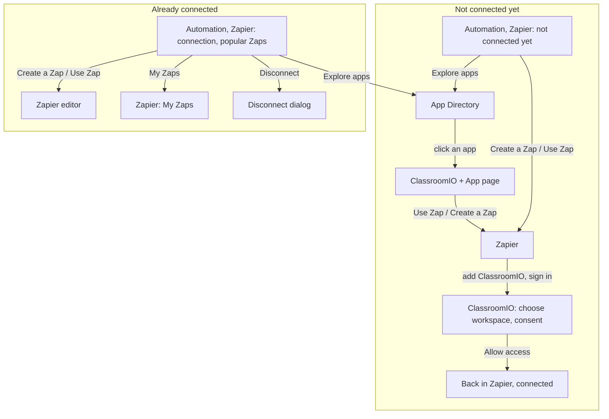

# Zapier Integration PRD

## Status

- In progress (built; the Zapier app is not published yet, so the private invite has not gone out)

**Prototype:** [`prototypes/zapier-integration`](../../prototypes/zapier-integration) in this repo. Run it locally (`python3 -m http.server 4748` from that folder) and open `index.html?returning=1`. · **Demo video:** [watch the walkthrough](https://www.awesomescreenshot.com/video/57929349?key=6d5fe60a45237a8c6e4051cec3ca9777)

## Purpose

Let ClassroomIO admins connect ClassroomIO to the thousands of apps on Zapier (HubSpot, Slack, Zoom and more) without us building each integration. Zaps are built on Zapier. ClassroomIO helps admins discover an integration and get to Zapier.

Non-engineering teams connect ClassroomIO to the tools they already use (CRMs, HRIS, Slack, spreadsheets, email platforms, ticketing) without writing code. Triggers fire instantly from the shipped webhooks platform. Actions call the existing public REST API.

## Problem

Customers keep asking for "ClassroomIO + {tool}" integrations: enrol a student when a CRM deal closes, post to Slack when a course is completed. Building these one by one doesn't scale. We already have a public API, so Zapier is the cheapest way to cover all of them.

ClassroomIO exposes a versioned public REST API at `/public-api/v1/*`, an MCP server, and a webhooks platform. All three serve engineering teams. The customers who run training programs (HR, customer success, sales enablement) cannot, without one:

- Enroll learners automatically when a contact reaches a CRM stage.
- Sync course completions and certificates to HRIS, Drive, or BI warehouses.
- Trigger Slack/email workflows on learner activity.
- Connect ClassroomIO into the no-code stacks (Zapier, Make, n8n, Pipedream) those teams operate.

## At a Glance

### Triggers (ClassroomIO → Zapier: "when this happens in ClassroomIO, start a Zap")

| # | Trigger | What it does | Webhook event | Optional filter |
| --- | --- | --- | --- | --- |
| 1 | New Course Enrollment | Fires when a student is added to a course, however it happened (invite, invite link, self-enroll, import, API, SSO, payment, admin, cohort). Includes the source. | `course.member.added` | Course, Source |
| 2 | Student Removed From Course | Fires when a student is removed from a course. Includes their progress at removal. | `course.member.removed` | Course |
| 3 | Course Completed | Fires when a student completes all required lessons in a course. | `course.completed` | Course |
| 4 | New Certificate | Fires when a certificate is issued to a learner. Includes certificate id, issue/expiry dates. | `course.certificate.issued` | Course |
| 5 | New Exercise Submission | Fires when a student submits an exercise. | `course.submission.created` | Course |
| 6 | Submission Status Changed | Fires when a submission is graded or its status changes. Includes previous and new status. | `course.submission.status_changed` | Course |
| 7 | Lesson Completed | Fires when a student marks a lesson complete. | `lesson.completion.updated` (`isComplete: true`) | Course |
| 8 | Course Invite Accepted | Fires when a student accepts a course invite. | `course.invite.accepted` | Course |
| 9 | New Payment Request | Fires when a learner submits a payment request for a course. | `course.payment_request.created` | Course |
| 10 | New Organization Member | Fires when someone joins the organization (student, tutor, or admin). | `organization.member.added` | Role |
| 11 | Compliance Status Changed | Fires when a learner's compliance record changes (compliant, overdue, expired, and so on). Includes due date and valid-until. | `compliance.record.status_changed` | Course |
| 12 | Course Published | Fires when a course is published. | `course.published` | — |
| 13 | Live Session Scheduled | Fires when a lesson session is scheduled or rescheduled. Includes start time and call URL. | `lesson.session.scheduled` | Course |
| 14 | New Cohort Member | Fires when a student is added to a cohort. | `cohort.member.added` | Cohort |

`Course` and `Cohort` filters are applied by ClassroomIO when the event is sent, so filtered-out events never reach Zapier. `Source` and `Role` filters are applied in the Zapier app.

### Actions (Zapier → ClassroomIO: "do this in ClassroomIO")

| # | Action | What it does | Endpoint |
| --- | --- | --- | --- |
| 1 | Enroll Student in Course | Enrolls a student in a course by email, inviting them first if they are new. Safe to retry. | `POST /courses/:courseId/enrollments` |
| 2 | Add Student to Organization | Invites a student to the organization without enrolling them in a course. | `POST /audience` |
| 3 | Update Student | Updates a student's name, or the email of an invite that hasn't been accepted. | `PUT /audience/:memberId` |
| 4 | Remove Student From Organization | Removes a student from the organization. | `DELETE /audience/:memberId` |
| 5 | Remove Student From Course | Removes a student from one course and keeps them in the organization. | `DELETE /courses/:courseId/members/:memberId` |
| 6 | Send Course Invite | Emails an invite to join a course. | `POST /courses/:courseId/invites` |
| 7 | Revoke Course Invite | Cancels a pending invite so its link stops working. | `POST /courses/:courseId/invites/:inviteId/revoke` |
| 8 | Reset Student Course Progress | Clears a student's progress in a course and keeps them enrolled. | `POST /courses/:courseId/members/:memberId/reset-progress` |
| 9 | Mark Lesson Complete | Marks a lesson complete on a student's behalf. | `PUT /courses/:courseId/members/:memberId/lessons/:lessonId/completion` |
| 10 | Add Student to Cohort | Adds a student to a cohort. | `POST /cohorts/:cohortId/members` |
| 11 | Post to Cohort Feed | Posts an announcement to a cohort's newsfeed. | `POST /cohorts/:cohortId/newsfeed` |

### Searches (find a record so later steps can use it)

| # | Search | What it does | Endpoint |
| --- | --- | --- | --- |
| 1 | Find Student | Looks up an audience member by exact email. Powers "Find or Create Student". | `GET /audience?email=` |
| 2 | Find Course | Looks up a course by slug or exact title. | `GET /courses?slug=` / `?title=` |

### Deferred (not in v1)

- Triggers: `exercise.completion.updated`, invite created/revoked (course and organization), `organization.member.removed`, `organization.member.updated`, `compliance.record.waived`, `course.unpublished`, `cohort.member.removed`, `program_completed` (no webhook event yet).
- **Tag Student.** Tags attach to courses today, not to students. The action ships once student tags exist.
- **Grade Submission.** Grading takes a per-question answers payload that a Zapier form can't collect sensibly. It needs an overall-score endpoint first.
- **Clone Course.** It would need the `course:write` scope, which also allows editing course content.
- **Issue Certificate and Create Payment Request.** No public API route yet.
- Create Course, Update Course, Publish Course.

## Decisions

| Area | Decision |
| --- | --- |
| Distribution | Private Zapier app via an invite link first (early access), public Zapier listing once v1 is stable and the directory review is approved. |
| Plans | Early Adopter and above. Basic sees an upgrade prompt. Access is binary: no monthly task credits. Per-minute rate limits apply as abuse protection. |
| Plan downgrade | Zapier pauses. Every call returns `403 UPGRADE_REQUIRED`, trigger deliveries stop, and the dashboard explains why. Connections and subscriptions stay in place, so upgrading resumes every Zap without reconnecting. |
| Auth | OAuth 2.0 with admin consent. No API-key paste. Admins can grant read-only access on the consent screen. |
| Triggers | Instant. Every trigger is a REST Hook delivered by the webhooks platform. No polling triggers in v1. |
| Trigger scope | Org-wide by default, with optional `Course` / `Cohort` / `Source` / `Role` filters. No separate per-course trigger duplicates. |
| Scope | ClassroomIO does not build Zaps. Building, mapping, testing and publishing stay on zapier.com. |
| App Directory | A curated list of 20 apps inside ClassroomIO, for discovery only. |
| Code | The Zapier app lives in `apps/zapier`. It only packages the existing public API and the generic subscription endpoint. Nothing else in the monorepo imports from it. |
| iPaaS parity | The public REST API plus webhooks is the integration surface. No Zapier-specific payloads. The subscription endpoint is generic so other iPaaS vendors can use it. |
| Revoke UX | Per-connection revoke in the dashboard for the safety-net case (compromised Zapier account, employee offboarding). No bulk "Disconnect Zapier" button. |
| Self-hosted | Zapier is a ClassroomIO Cloud feature. Self-hosted installs use Webhooks with Zapier's "Webhooks by Zapier" trigger, and API keys for actions. |

## Product Goals

1. An org admin connects ClassroomIO from inside Zapier in under 60 seconds, with no token copy-paste: Connect → log in → consent → done.
2. Non-engineering customers can build the canonical Zaps without code:
   - CRM new customer → Enroll Student in Course.
   - New Certificate → upload to HRIS / Drive.
   - New Exercise Submission → notify the tutor in Slack.
3. 14 instant triggers, 11 actions, and 2 searches in v1.
4. The same OAuth flow, REST endpoints, and subscription endpoint work for Make, n8n, and Pipedream.
5. Connected Zapier accounts are visible to admins in the dashboard, with per-connection revoke.
6. A Zap fires within seconds of the event, not on a polling cadence.

## Non-Goals (v1)

1. Polling triggers (superseded by webhooks).
2. Make / n8n / Pipedream curated app listings.
3. Free / Basic plan access.
4. Inbound webhooks from Zapier to ClassroomIO (Zapier writes via REST actions).
5. Monthly task credits.
6. Customer-authored custom triggers.
7. A cap on the number of Zapier connections. Trigger subscriptions are capped instead.
8. Bulk "Disconnect Zapier" button.
9. Branding review and Zapier marketplace screenshots (before directory submission).
10. Zapier on self-hosted installs.
11. Deferred triggers and actions listed in At a Glance.

## User Stories

1. As an HR ops admin, I want a new hire in BambooHR to auto-enroll in the onboarding course so I don't manage a spreadsheet.
2. As a sales engineer, I want a HubSpot deal moving to "Customer" to enroll the buyer in product training so onboarding starts on day zero.
3. As an L&D admin, I want every certificate issued to upload a PDF to the employee's Google Drive folder so my audit trail lives in the source of truth.
4. As a tutor, I want every exercise submission in my course to DM me in Slack so I can grade quickly.
5. As a finance ops admin, I want every payment request to create a HubSpot deal so I don't reconcile manually.
6. As a compliance lead, I want an overdue or expired compliance record to open a ticket so nothing slips.
7. As an org admin, I want to revoke Zapier access without breaking my other integrations.
8. As a cautious admin, I want to connect Zapier with read-only access so it can watch events without changing anything.

## User Flow

**Not connected**

1. The admin opens Automation, Zapier and sees "Zapier isn't connected yet" with **Create a Zap** and **Explore apps**, followed by popular Zaps.
2. **Explore apps** opens the App Directory. Search or pick a category, then click an app.
3. The ClassroomIO + {App} page lists ready-made Zaps for the pairing. **Use Zap** opens Zapier with both apps already chosen.
4. **Create a Zap** opens the Zapier editor directly.
5. While the Zapier app is private, the first **Create a Zap** or **Use Zap** opens a two-step dialog: accept the ClassroomIO invite on Zapier once, then continue to the Zap. Until the admin has a connection, the Zaps page also shows a short note with a link to the invite, so an admin who skipped it can get back to it. Closing the note hides it for that organization in that browser.
6. When the admin adds ClassroomIO to a Zap, Zapier sends them to ClassroomIO to sign in, choose a workspace and allow access, then returns them to Zapier.

**Already connected**

1. The **Connection** section shows each Zapier connection: its access (Read and write or Read only), who connected it and when, and a **Disconnect** button.
2. When events from the last 24 hours failed to reach Zapier while the trigger is still active, a warning offers **Resend failed events**.
3. When repeated failures have turned a trigger off, a separate warning explains there is nothing to resend: the admin fixes the receiving end in Zapier and turns the Zap back on to resubscribe it.
4. **Popular Zaps** stay on the page, with an **Explore apps** link beside the heading that opens the App Directory.
5. **My Zaps** opens the admin's Zaps on Zapier ([zapier.com/app/zaps](https://zapier.com/app/zaps)), where Zaps and their run history are managed.

> [!NOTE]
> Zapier's connections page and its "Add new connection" modal are hosted by Zapier. The prototype simulates them to show the intended redirect back to the ClassroomIO + {App} page. See Open Questions.

## Screens ClassroomIO Builds

- **Zaps page** (`/org/[slug]/automation/zapier`): header actions **Create a Zap**, **My Zaps** (once connected) and **Read docs**. Not connected: a full-width empty state with **Create a Zap** and **Explore apps**, then popular Zaps. Connected: the connection list with **Disconnect**, a failed-events or disabled-triggers warning when needed, and popular Zaps with an **Explore apps** link. While the app is private, a dismissible invite note sits above both. Plans without Zapier get an upgrade empty state; non-admins, a paused plan and self-hosted installs get callouts.
- **App Directory** (`.../zapier/apps`): a sidebar with search and categories with counts (All apps first); every curated app in one A–Z grid with its logo, description and ways to use; and a closing card linking to Zapier.
- **ClassroomIO + {App} page** (`.../zapier/apps/[app]`): a header with both logos, **Create a {App} Zap** and **My Zaps**; a one-line connected status; popular Zaps grouped "From ClassroomIO" and "Into ClassroomIO"; and related apps.
- **Workspace picker** (`/oauth/select-organization`): shown during connection unless the admin has exactly one workspace and its plan includes Zapier. Only workspaces where they are an admin are listed; a workspace whose plan excludes Zapier is shown but can't be chosen, and when none qualifies the page shows **No eligible workspace**.
- **OAuth consent screen** (`/oauth/consent`): shown when Zapier starts the connection. Shows the app (with a Verified badge for Zapier), the workspace, what the app will be able to do, the redirect host, and Allow / Deny. Admins can turn off "Allow Zapier to make changes" to connect read-only.
- **Disconnect dialog** on the Zaps page.

App logos are bundled with the dashboard, so no logo is loaded from a third-party site. The MCP tab lists other connected apps and leaves Zapier to the Zapier tab.

## Consent and Workspace Selection

1. Logged-out users sign in first and return to the authorization request.
2. The admin chooses a workspace. A single eligible workspace is chosen automatically.
3. The consent screen shows the app name, the workspace, the permissions grouped by area (View or Add and manage), "Stay connected until you remove access", and the redirect host.
4. **Allow {app} to make changes** is on by default. Turning it off grants read-only access: every scope that changes workspace data is dropped, and the permission list updates to match. The connection keeps the scopes it needs to read data and subscribe to triggers.
5. `Allow access` returns to Zapier with an authorization code. `Deny` returns with `error=access_denied`.
6. Reconnecting with the same access skips the consent screen. Asking for more access than the admin granted shows it again.

## Trigger Delivery (REST Hooks)

Each trigger is a Zapier REST Hook trigger:

1. **subscribe**: Zapier calls `POST /public-api/v1/webhooks/subscriptions` with its unique `targetUrl`, the trigger's event type, and an optional `courseId` or `cohortId`. The API creates a Zapier-managed webhook endpoint bound to the connection and returns its id.
2. **perform**: ClassroomIO delivers the standard webhook envelope to `targetUrl`. The Zapier app unwraps `data`, applies the optional `Source` / `Role` filter, and returns the record.
3. **unsubscribe**: Zapier calls `DELETE /public-api/v1/webhooks/subscriptions/:subscriptionId` when a Zap is turned off.
4. **performList**: Zapier calls `GET /public-api/v1/webhooks/samples` to populate the Zap editor with the latest real payload of that event type for the org, or a static sample when none exists. It never runs in a live Zap.

Envelope, headers and signing are those of `prd/webhooks`. Delivery is at-least-once; the Zapier app dedupes on the envelope `id`.

- **Hosts**: Zapier targets are unguessable HTTPS URLs on `hooks.zapier.com`. Subscribe rejects any other host. Signing stays on.
- **Retries**: 6 attempts over roughly 2.6 hours (immediately, then after 10 s, 1 min, 5 min, 30 min and 2 hours).
- **Give-up**: after the last failure the delivery is marked `GAVE_UP`. The trigger's health degrades after repeated give-ups, and the endpoint is auto-disabled at the threshold.
- **Redelivery**: when events from the last 24 hours failed, the Zaps page shows a warning that resends every failed trigger in one call.
- **410 Gone**: when Zapier reports the Zap was turned off or deleted, the managed subscription is deleted.
- **Isolation**: Zapier-managed subscriptions are not shown in the Webhooks tab and do not count toward its 20-endpoint cap. They have their own per-plan cap. Removing a connection deletes its subscriptions.

## Authentication and Scopes

ClassroomIO's OAuth 2.1 authorization server is shared by MCP clients, Zapier and future connected apps.

- **Grants**: authorization code with PKCE, plus refresh tokens.
- **Tokens**: 10-minute JWT access tokens bound to the public API resource, carrying the workspace in `org_id`. Rotating refresh tokens last 90 days, with a 60-second reuse window so Zapier's parallel tasks don't invalidate each other.
- **Client**: Zapier is registered once by ops as a confidential client and marked trusted, which shows the Verified badge on consent.
- **Per-request checks**: every call re-checks that the connecting user is still an admin of the workspace and that the plan includes Zapier. Losing admin rights removes that user's connections.
- **Actor**: actions run as the admin who connected the account.
- **Connection test**: `GET /public-api/v1/me` returns the workspace, the connection's granted scopes and the actor. Zapier labels the connection with the workspace name, adding "(read-only)" for a read-only connection.

### Scopes

Zapier requests exactly:

| Scope | Used for |
| --- | --- |
| `offline_access` | Refresh tokens |
| `audience:read`, `audience:write` | Find Student; add, update and remove students |
| `course:read` | Find Course, course dropdowns |
| `course:member:read`, `course:member:write` | Enrollments, removals, invites, progress reset |
| `course:student:write` | Mark Lesson Complete |
| `course:certificate:read` | Certificate payloads |
| `cohort:read`, `cohort:write` | Cohort dropdowns, Add Student to Cohort, Post to Cohort Feed |
| `webhook:subscription:read`, `webhook:subscription:write` | Trigger subscribe, unsubscribe and samples |

No `course:write`, team or organization scopes.

A read-only connection keeps every `:read` scope plus `webhook:subscription:read` and `webhook:subscription:write`, so triggers and searches work. An action on a read-only connection returns `403 INSUFFICIENT_SCOPE` naming the missing scope, and the Zapier app explains that the connection is read-only and how to reconnect with changes allowed.

Automation keys of type `zapier` can no longer be created. Zapier connects only through OAuth.

## Access and Limits

| Plan | Zapier | Trigger subscriptions | Reads / min | Writes / min |
| --- | --- | --- | --- | --- |
| Basic | No | 0 | 0 | 0 |
| Early Adopter | Yes | 50 | 120 | 40 |
| Enterprise | Yes | 250 | 360 | 120 |

- Read and write limits are shared by every Zapier connection in the workspace, so connecting more Zapier accounts does not raise them. Reads are `GET` requests; every other request, including trigger subscribe and unsubscribe, is a write.
- Over the limit, the API returns `429` with `Retry-After`, and Zapier retries the step.
- The number of connections is not capped.
- Only org admins can connect. Admins can revoke a connection at any time.

## Technical Design

| Layer | What ships |
| --- | --- |
| Validation (`packages/utils`) | Subscription, enrollment and `/me` schemas; `?email=`, `?slug=` and `?title=` filters; the trigger, action and search catalog; Zapier plan limits; read-only scope rules. |
| Queries (`packages/db`) | Managed webhook endpoints bound to an OAuth grant (deleted with the grant); connection and trigger listings; failed-delivery lookups. |
| API (`apps/api`) | `GET /public-api/v1/me`; `POST /public-api/v1/courses/:courseId/enrollments`; `POST` and `DELETE /public-api/v1/webhooks/subscriptions`; `GET /public-api/v1/webhooks/samples`; `GET /organization/automation/zapier` and `POST /organization/automation/zapier/triggers/redeliver` (one batch of trigger ids, one rate-limit slot) for the dashboard; per-plan Zapier rate limits; connected apps listed by kind so the MCP tab excludes Zapier. |
| Dashboard (`apps/dashboard`) | The Zaps page, App Directory and ClassroomIO + {App} page under the Automation → Zapier tab; workspace picker and consent changes. |
| Zapier app (`apps/zapier`) | Zapier Platform CLI app with OAuth, 14 REST Hook triggers, 11 actions, 2 searches, course and cohort dropdowns, and error mapping (plan, read-only, rate limit, validation). Built, tested and validated in CI; pushed manually. |

## API and Docs

1. Annotate every new route with `describeRoute`; run `pnpm --filter @cio/api upload:openapi`.
2. Add Zapier guides to the help center: connect your account, read-only connections, trigger catalog with sample payloads, action catalog with required fields, searches, limits, managing connections, and troubleshooting (connection removed, read-only, plan paused, rate limited).
3. Name Zapier alongside REST API, Webhooks and MCP on the website's automation pages (done: Zapier section with the canonical Zaps as copy on `apps/website/src/routes/automation/+page.svelte`, fourth Zapier lane in the home page automation band, SEO meta; `automate-section.svelte` left untouched — it is exported but unrendered. The section CTA reads "How to connect" → help guide until the listing is live, then "Connect on Zapier" → directory URL). Does not gate the integration itself.

## Rollout Plan

1. **Authorization**: OAuth server, consent and workspace picker, plan and admin checks, read-only consent.
2. **Public API and subscriptions**: `/me`, filters, enrollment endpoint, subscription and samples routes, per-plan limits, OpenAPI upload.
3. **Dashboard**: Zaps page, App Directory, ClassroomIO + {App} page, translations.
4. **Zapier app**: 14 triggers, 11 actions, 2 searches, dropdowns, `zapier push`.
5. **Early access (pre-listing)**: share the invite link with early orgs until the listing is approved, watch usage and delivery logs, iterate, update docs.
6. **Public listing**: submit for directory review, promote, announce.
7. **Later**: deferred triggers and actions, other iPaaS clients.

### Going public

The dashboard has no public mode. Everything it does works the same for a private and a public integration, except the invite, and pre-filled Zaps open Zapier's `webintent` editor in both: Zapier's documented embed URL for a public app redirects there. Plan these together when the listing is approved:

1. Clear `PUBLIC_ZAPIER_CONNECT_URL`. The invite dialog and the invite note on the Zaps page only appear while it is set.
2. Point the Zapier docs and help articles at the public listing instead of the private invite.
3. Decide which Workflow API features to build, since they all need the published integration, Embed credentials and a per-admin Zapier link: listing an admin's Zaps, detecting connections deleted in Zapier, and removing the Zapier-side connection on **Disconnect**.
4. Swap the bundled app logos for Zapier's `/v2/apps` images, if wanted.

## Success Metrics

1. At least 5 orgs connect via OAuth within 30 days of the private invite.
2. Orgs with at least one connected Zap, and Zaps created per connected org.
3. At least 100 Zap runs per week within 60 days.
4. p95 event-to-Zap latency under 30 seconds.
5. Under 2% of Zap runs fail on API errors (excluding misconfiguration).
6. At least 80% of connected orgs use one trigger and one action.
7. Share of connections started from the App Directory vs Zapier.
8. Zero security incidents involving OAuth tokens.

## Risks and Mitigations

1. **The OAuth server is an attack surface.** Short-lived JWT access tokens, rotating refresh tokens, PKCE, server-side scope checks, per-request admin and plan checks, and a security review before public listing.
2. **Subscription volume.** Each Zap trigger is one subscription. Separate per-plan caps from the 20-endpoint webhook limit, delete on Zap-off and on revoke, and show counts in the dashboard.
3. **A Zapier outage longer than the retry window loses events.** Retry for about 2.6 hours, show failed deliveries on the Zaps page, and let admins resend the last 24 hours.
4. **Auto-disable.** Failing endpoints are degraded or disabled by the webhook health logic. Show failures on the Zaps page; a new subscribe recovers the trigger.
5. **Plan mismatch.** Zapier and webhook entitlement drifting apart. Both derive from the same public API plan check.
6. **Downgrade breaks live Zaps.** Zaps pause rather than disconnect, the dashboard explains the pause, and upgrading resumes everything without reconnecting.
7. **Directory review rejects the listing.** Stay private until sample data, errors, dropdowns and OAuth edge cases are polished.
8. **Invite link leaks.** Plan and admin checks apply during authorization regardless of who clicks Connect.
9. **Schema drift between the Zapier app and the API.** `apps/zapier` imports `@cio/utils` types and catalog.
10. **Zapier may not let us influence its connection modal.** Keep the App Directory and ClassroomIO + {App} page as the entry points inside ClassroomIO.
11. **App logos are third-party trademarks.** The 20 logos ship as files in the dashboard, taken from the CC0 `@iconify-json/logos` set where it has a clean mark and from vendor files otherwise. A logo that fails to load falls back to a monogram. Swap in Zapier's `/v2/apps` images once the integration is public.

## Open Questions

1. **Redirect from Zapier's connections page.** Can picking an app in Zapier's "Add new connection" modal redirect to our ClassroomIO + {App} page? Confirm with Zapier, and agree a fallback if not.
2. **Your Zaps inside ClassroomIO.** Listing an admin's Zaps and the apps they use needs Zapier's Workflow API: the integration must be published, Embed credentials configured on the API server, and each admin must link their Zapier account. Until then **My Zaps** opens Zapier.
3. **Catalog ownership.** Who maintains the 20-app list and its brand assets?
4. **Cohort and compliance triggers.** Keep both in v1, or hold them until a customer asks?

## Build and Verification Commands

1. `pnpm --filter @cio/utils build`
2. `pnpm --filter @cio/db build`
3. `pnpm --filter @cio/api build`
4. `pnpm --filter @cio/api upload:openapi`
5. `pnpm --filter @cio/zapier build`
6. `pnpm --filter @cio/zapier zapier:push` (manual, gated)

Manual verification:

1. Install via the invite link while logged out; Zapier prompts for ClassroomIO login.
2. Complete OAuth as an Early Adopter admin; the Test step shows the org name from `/me`.
3. Try OAuth as a non-admin; no workspace can be chosen and access is not granted.
4. Try OAuth on a Basic org; the workspace is marked as needing an upgrade and can't be chosen.
5. Turn off "Allow Zapier to make changes"; the connection is labelled read-only, actions return a read-only error, and triggers and searches still work.
6. Zap: New Exercise Submission → Slack. Submit an exercise; the message arrives within seconds.
7. Zap: HubSpot deal → Enroll Student in Course. The student appears and is enrolled.
8. Zap: New Certificate → Google Drive upload.
9. Turn a Zap off; confirm its subscription is deleted. Turn it on; confirm a new one is created.
10. Remove access in the dashboard; Zaps show re-connect, and its subscriptions are gone.
11. Downgrade to Basic; the Zaps page shows the paused callout, calls return `UPGRADE_REQUIRED`, and deliveries stop. Upgrade; Zaps resume without reconnecting.
12. Force access token expiry; Zapier refreshes silently.
13. Make the target return 500 repeatedly; confirm retries, the failed delivery on the Zaps page, redelivery, and the health state.
14. Exceed the plan's write limit; Zapier receives `429` with `Retry-After` and retries.
