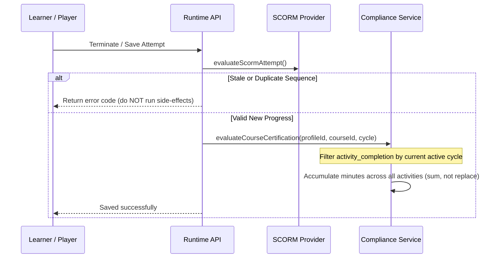

# SCORM Feature Bugfixes: Exhaustive Implementation Plan

This implementation plan addresses all verified SCORM bug reports across the High, Medium, and Low severity tiers. Every item in the audit has been investigated against the active codebase on branch `feats/scorm-integration` and confirmed **valid**.

---

## 1. Audit Verification Matrix

| Category | Claimed Bug | Status | Primary Location | Root Cause Summary |
| :--- | :--- | :--- | :--- | :--- |
| **High** | Completion modules "graded only" never saved | **Valid** | [scorm/index.ts](file:///Users/user/Documents/ClassroomIO/Dev/classroomio/packages/core/src/services/activity/providers/scorm/index.ts#L151-L156) | `completionModules` omitted from `getEditorData`, `updateSettings`, and `copy`. |
| **High** | Package can't be deleted once launched | **Valid** | [schema.ts](file:///Users/user/Documents/ClassroomIO/Dev/classroomio/packages/db/src/schema.ts#L4711), [0033_scorm_activities.sql](file:///Users/user/Documents/ClassroomIO/Dev/classroomio/packages/db/src/migrations/0033_scorm_activities.sql#L83) | Foreign keys `scorm_attempt.package_version_id` and `scorm_sco_attempt.unit_id` use `ON DELETE RESTRICT`. |
| **High** | Closing package creates empty module record | **Valid** | [activity-player.svelte](file:///Users/user/Documents/ClassroomIO/Dev/classroomio/apps/dashboard/src/lib/features/activities/components/activity-player.svelte#L130-L154) | Calls `activityApi.launch` on terminate; lacks `event.source === iframe.contentWindow` verification. |
| **High** | Player boot failure causes infinite skeleton | **Valid** | [main.ts](file:///Users/user/Documents/ClassroomIO/Dev/classroomio/apps/activity-player/src/main.ts#L114-L124), [activity-player.svelte](file:///Users/user/Documents/ClassroomIO/Dev/classroomio/apps/dashboard/src/lib/features/activities/components/activity-player.svelte#L483-L485) | Player catches boot error without sending parent `postMessage`; dashboard never cancels loading state. |
| **High** | iPhone focus mode trapped for single module | **Valid** | [activity-player.svelte](file:///Users/user/Documents/ClassroomIO/Dev/classroomio/apps/dashboard/src/lib/features/activities/components/activity-player.svelte#L68) | `showMenu` is `false` when `units.length <= 1`, hiding the only exit button in iOS focus mode. |
| **High** | Unsanitized instructions rendered as raw HTML | **Valid** | [activity-player.svelte](file:///Users/user/Documents/ClassroomIO/Dev/classroomio/apps/dashboard/src/lib/features/activities/components/activity-player.svelte#L384) | Uses `{@html instructions}` directly without calling HTML sanitizer. |
| **High** | Students receive full author editor data | **Valid** | [activity.ts](file:///Users/user/Documents/ClassroomIO/Dev/classroomio/apps/api/src/routes/course/activity.ts#L49-L55) | `GET /:activityId` returns `getActivityWithEditorData` for all roles including students. |
| **High** | Compliance renewals & reporting corrupted | **Valid** | [runtime-scorm.ts](file:///Users/user/Documents/ClassroomIO/Dev/classroomio/apps/api/src/routes/activity/runtime-scorm.ts#L472-L480), [compliance.ts](file:///Users/user/Documents/ClassroomIO/Dev/classroomio/packages/core/src/services/compliance.ts#L379) | Non-cycle-aware completion rows; duplicate saves re-trigger certification; minutes overwritten rather than summed. |
| **High** | Large progress data dropped / char count | **Valid** | [runtime/index.ts](file:///Users/user/Documents/ClassroomIO/Dev/classroomio/packages/activity-packages/src/scorm/runtime/index.ts#L317), [runtime-scorm.ts](file:///Users/user/Documents/ClassroomIO/Dev/classroomio/apps/api/src/routes/activity/runtime-scorm.ts#L40) | UTF-16 character length used instead of byte length; `sendBeacon` limit exceeded; duplicate saves disguised as success. |
| **High** | Upload gets permanently stuck | **Valid** | [packages.ts](file:///Users/user/Documents/ClassroomIO/Dev/classroomio/packages/core/src/services/activity/packages.ts#L192), [package-upload.svelte](file:///Users/user/Documents/ClassroomIO/Dev/classroomio/apps/dashboard/src/lib/features/activities/components/package-upload.svelte#L268-L318) | Queue failures leave version in `processing`; attachment failures fail to set `phase = 'failed'`; copy misleads users. |
| **High** | Unsaved-changes guard traps internal tabs | **Valid** | [activity.svelte](file:///Users/user/Documents/ClassroomIO/Dev/classroomio/apps/dashboard/src/routes/(app)/courses/[courseId]/activities/[activityId]/+page.svelte#L280-L297) | Switching view/edit or opening history uses `goto(...)`, tripping `<UnsavedChanges>` dirty form guard. |
| **Medium** | Undercounted resumed time / total_time ignored | **Valid** | [runtime/index.ts](file:///Users/user/Documents/ClassroomIO/Dev/classroomio/packages/activity-packages/src/scorm/runtime/index.ts#L639) | `Math.max` used instead of accumulating session durations; ignores `cmi.core.total_time`. |
| **Medium** | Floating-point score precision (29, 57, 58) | **Valid** | [runtime/index.ts](file:///Users/user/Documents/ClassroomIO/Dev/classroomio/packages/activity-packages/src/scorm/runtime/index.ts#L667) | Direct IEEE-754 comparison `attemptScore * 100 >= minScorePercent` suffers precision error. |
| **Medium** | SCORM 1.2 max score raw fallback | **Valid** | [runtime/index.ts](file:///Users/user/Documents/ClassroomIO/Dev/classroomio/packages/activity-packages/src/scorm/runtime/index.ts#L400) | `scaledScore12` only checks `min !== null && max !== null`; if `min` is omitted, defaults to `raw / 100`. |
| **Medium** | Rule change does not recompute completion | **Valid** | [scorm/index.ts](file:///Users/user/Documents/ClassroomIO/Dev/classroomio/packages/core/src/services/activity/providers/scorm/index.ts#L187-L195) | `updateSettings` modifies rules without recalculating `activity_completion` for historical attempts. |
| **Medium** | Results summary query runs 3x; export mutates UI | **Valid** | [results.ts](file:///Users/user/Documents/ClassroomIO/Dev/classroomio/packages/core/src/services/activity/results.ts#L80-L95), [activity-results-panel.svelte](file:///Users/user/Documents/ClassroomIO/Dev/classroomio/apps/dashboard/src/lib/features/activities/components/activity-results-panel.svelte#L75) | Summary query executed repeatedly; CSV export modifies reactive store array. |
| **Medium** | Learner sheet missing device placeholder | **Valid** | [en.json](file:///Users/user/Documents/ClassroomIO/Dev/classroomio/apps/dashboard/src/lib/utils/translations/en.json#L3747) | Missing `{device}` placeholder; duplicate attempts show as `"Error"`; unlocalized status. |
| **Medium** | Review mode lacks `credit`, threshold, & empty try | **Valid** | [runtime-scorm.ts](file:///Users/user/Documents/ClassroomIO/Dev/classroomio/apps/api/src/routes/activity/runtime-scorm.ts#L273-L310) | Does not inject `credit = 'no-credit'`; throws 404 when no prior try exists; lacks `completion_threshold`. |
| **Medium** | Manifest 2004 4th-ed attributes & 1.2 prereqs ignored | **Valid** | [manifest.ts](file:///Users/user/Documents/ClassroomIO/Dev/classroomio/packages/activity-packages/src/scorm/manifest.ts#L104-L125) | `minProgressMeasure` unhandled; prerequisites dropped; `"SCORM 1.2"` string rejected in `detectFormat`. |
| **Medium** | Worker duplicate module ID & XML memory | **Valid** | [process-package.ts](file:///Users/user/Documents/ClassroomIO/Dev/classroomio/packages/core/src/workers/process-package.ts#L150-L210) | Duplicate `unit_identifier` triggers unhandled DB conflict; XML parser lacks max file size guards. |
| **Medium** | Org copy omits case-index & runs in DB transaction | **Valid** | [asset-transfer.ts](file:///Users/user/Documents/ClassroomIO/Dev/classroomio/packages/core/src/services/asset-transfer.ts#L179-L210) | `${prefix}.index.json` not copied; network S3 copies block Postgres transaction. |
| **Medium** | Media library missing size & broken download link | **Valid** | [packages.ts](file:///Users/user/Documents/ClassroomIO/Dev/classroomio/packages/core/src/services/activity/packages.ts#L80) | Asset `byteSize` left `null`; `storageKey` is a folder prefix instead of archive path. |
| **Medium** | Non-atomic course creation & newsfeed HTML | **Valid** | [courses.ts](file:///Users/user/Documents/ClassroomIO/Dev/classroomio/packages/core/src/services/activity/courses.ts#L111-L112) | Individual transactions per course; hardcoded English HTML saved to newsfeed. |
| **Medium** | LMS upload scan ignores main entry point | **Valid** | [lms-detector.ts](file:///Users/user/Documents/ClassroomIO/Dev/classroomio/packages/activity-packages/src/scorm/lms-detector.ts#L30-L50) | Scans raw zip entry order capped at 100 files; skips files > 512 KB including launch HTML. |
| **Medium** | Runtime reads body before token; rate limit bypass | **Valid** | [runtime-scorm.ts](file:///Users/user/Documents/ClassroomIO/Dev/classroomio/apps/api/src/routes/activity/runtime-scorm.ts#L18-L45) | `c.req.json()` called prior to `verifyRuntimeToken`; client token used as rate-limit key. |
| **Medium** | Long User-Agent causes 500 error | **Valid** | [runtime-scorm.ts](file:///Users/user/Documents/ClassroomIO/Dev/classroomio/apps/api/src/routes/activity/runtime-scorm.ts#L525) | User-Agent > 512 characters triggers database column overflow. |
| **Medium** | Double URL decoding in content router | **Valid** | [content.ts](file:///Users/user/Documents/ClassroomIO/Dev/classroomio/apps/api/src/routes/activity/content.ts#L32) | Path already decoded by Hono router; secondary `decodeURIComponent` breaks percent literals. |
| **Medium** | Iframe sandbox missing `allow-modals` & `allow-downloads` | **Valid** | [activity-player.svelte](file:///Users/user/Documents/ClassroomIO/Dev/classroomio/apps/dashboard/src/lib/features/activities/components/activity-player.svelte#L398) | Missing sandbox tokens cause `confirm()` to return `false` and blocks legitimate downloads. |
| **Medium** | Admin UI visual & layout glitches | **Valid** | [version-history.svelte](file:///Users/user/Documents/ClassroomIO/Dev/classroomio/apps/dashboard/src/lib/features/activities/components/package-version-history.svelte), [package-details.svelte](file:///Users/user/Documents/ClassroomIO/Dev/classroomio/apps/dashboard/src/lib/features/activities/components/package-details.svelte#L191) | Missing `ui:` prefix; inverted current version badge; translated `{score}` placeholder in Spanish. |
| **Low** | Dead retention code & missing FK indexes | **Valid** | [schema.ts](file:///Users/user/Documents/ClassroomIO/Dev/classroomio/packages/db/src/schema.ts), [packages.ts](file:///Users/user/Documents/ClassroomIO/Dev/classroomio/packages/core/src/services/activity/packages.ts) | Unreferenced retention routines; missing indexes on FKs; unlocalized UI labels. |

---

## 2. Implementation Rules & Repository Constraints

1. **Database Migration Policy (`AGENTS.md`)**:
   - **One migration file per PR**. The active migration file on branch `feats/scorm-integration` is:
     [0033_scorm_activities.sql](file:///Users/user/Documents/ClassroomIO/Dev/classroomio/packages/db/src/migrations/0033_scorm_activities.sql).
   - All schema modifications (changing `ON DELETE RESTRICT` to `ON DELETE CASCADE`, adding FK indexes) **must be folded directly into `0033_scorm_activities.sql`**. Do **NOT** create `0034_*.sql`.
   - Update [packages/db/src/schema.ts](file:///Users/user/Documents/ClassroomIO/Dev/classroomio/packages/db/src/schema.ts) and snapshot JSON in lockstep.
2. **Comment Policy (`skills/writing-code/SKILL.md`)**:
   - Default to **no comments**.
   - Use JSDoc strictly for function contracts. Never leave inline rationale comments.
3. **Frontend Typing & Boundaries**:
   - Never import from `@cio/db/queries` into `apps/dashboard`.
   - Never define types in `.svelte.ts` files; place them in `{domain}/utils/types.ts` inferred from Hono RPC.
   - All theme utility classes in `@cio/ui` or dashboard components must use the `ui:` prefix (e.g. `ui:text-foreground`).
4. **Translations**:
   - Zero hardcoded English strings in markup or user-facing logs.
   - Placeholders wrapped in `{}` (e.g. `{score}`, `{device}`) must remain unaltered across all locale files (`en.json`, `es.json`, etc.). Run `pnpm translate` and format.

---

## 3. Detailed Architecture & Fix Specifications

```mermaid
flowchart TD
    subgraph Client ["Dashboard & Player Client"]
        P[activity-player.svelte]
        U[package-upload.svelte]
        VH[package-version-history.svelte]
        ACT[activity.svelte]
    end

    subgraph API ["Hono API Layer"]
        CA[routes/course/activity.ts]
        RS[routes/activity/runtime-scorm.ts]
        CR[routes/activity/content.ts]
    end

    subgraph Core ["Core Services & Worker"]
        SC[providers/scorm/index.ts]
        COMP[services/compliance.ts]
        RES[services/activity/results.ts]
        PROC[workers/process-package.ts]
    end

    subgraph DB ["PostgreSQL (Migration 0033)"]
        ATT[scorm_attempt (CASCADE)]
        SCO[scorm_sco_attempt (CASCADE)]
        ACTCOMP[activity_completion (cycle-aware)]
    end

    P -->|postMessage / refreshProgress| RS
    RS -->|validateToken FIRST| ATT
    RS -->|sum session times| SCO
    RS -->|side-effects only on valid save| ACTCOMP
    ACTCOMP -->|cycle-scoped query| COMP
    CA -->|student vs author split| SC
    PROC -->|atomic transaction| DB
```

---

### Phase 1: Database Schema & Migration Folding

#### 1.1 Cascade Package Deletions
- **Location**: [schema.ts:L4711, L4748](file:///Users/user/Documents/ClassroomIO/Dev/classroomio/packages/db/src/schema.ts#L4711-L4748), [0033_scorm_activities.sql](file:///Users/user/Documents/ClassroomIO/Dev/classroomio/packages/db/src/migrations/0033_scorm_activities.sql)
- **Problem**: When a package version is replaced or removed, deleting the asset cascades to `content_package_version`. However, `scorm_attempt.package_version_id` and `scorm_sco_attempt.unit_id` are defined with `ON DELETE RESTRICT`, causing raw database foreign key constraint errors and leaving orphaned files in S3.
- **Action**:
  1. In `packages/db/src/schema.ts`:
     - Change `packageVersionId: uuid('package_version_id').notNull().references(() => contentPackageVersion.id, { onDelete: 'cascade' })`.
     - Change `unitId: uuid('unit_id').notNull().references(() => contentPackageUnit.id, { onDelete: 'cascade' })`.
  2. In `packages/db/src/migrations/0033_scorm_activities.sql`:
     - Update foreign key constraint definitions to `ON DELETE cascade ON UPDATE no action`.

#### 1.2 Foreign Key Index Additions
- **Location**: [schema.ts](file:///Users/user/Documents/ClassroomIO/Dev/classroomio/packages/db/src/schema.ts), [0033_scorm_activities.sql](file:///Users/user/Documents/ClassroomIO/Dev/classroomio/packages/db/src/migrations/0033_scorm_activities.sql)
- **Problem**: Missing indexes on critical foreign keys cause sequential table scans on deletion and join operations.
- **Action**:
  - Add index `scorm_attempt_profile_id_idx` on `scorm_attempt(profile_id)`.
  - Add index `activity_completion_profile_id_idx` on `activity_completion(profile_id)`.
  - Add index `course_activity_section_id_idx` on `course_activity(section_id)`.
  - Fold corresponding `CREATE INDEX IF NOT EXISTS ...` into `0033_scorm_activities.sql`.

---

### Phase 2: Security & API Hardening

#### 2.1 Student vs. Author Data Segregation
- **Location**: [apps/api/src/routes/course/activity.ts:L49-L55](file:///Users/user/Documents/ClassroomIO/Dev/classroomio/apps/api/src/routes/course/activity.ts#L49-L55)
- **Problem**: `GET /courses/:courseId/activities/:activityId` invokes `getActivityWithEditorData(courseId, activityId)`, exposing package versions, internal SHA hashes, and learner progress metrics to enrolled students.
- **Action**:
  - Check the user's role in the organization/course.
  - If the caller is a student, call `getActivityForStudent(courseId, activityId)` returning only public activity metadata, title, instructions, and `allowRetakes`.
  - Only return `getEditorData` if the user is an admin or tutor.

#### 2.2 Token Validation Before Body Parsing & Rate Limiter Fix
- **Location**: [apps/api/src/routes/activity/runtime-scorm.ts:L18-L45](file:///Users/user/Documents/ClassroomIO/Dev/classroomio/apps/api/src/routes/activity/runtime-scorm.ts#L18-L45)
- **Problem**:
  1. `c.req.json()` is parsed before calling `verifyRuntimeToken(c)`. An attacker can exhaust API memory with arbitrary payloads without valid credentials.
  2. The rate limiter key is derived from the client-supplied token rather than `profile_id` or authenticated session, allowing bad actors to rotate tokens and bypass rate limits.
- **Action**:
  - Run `verifyRuntimeToken(c)` before parsing JSON body or handling query parameters.
  - Key the rate limiter by the verified `tokenPayload.profileId` and IP address.

#### 2.3 User-Agent Truncation & Double URL Decoding
- **Location**:
  - [runtime-scorm.ts:L525](file:///Users/user/Documents/ClassroomIO/Dev/classroomio/apps/api/src/routes/activity/runtime-scorm.ts#L525)
  - [content.ts:L32](file:///Users/user/Documents/ClassroomIO/Dev/classroomio/apps/api/src/routes/activity/content.ts#L32)
- **Action**:
  - Truncate `userAgent` to 512 characters before writing to `scorm_session_events` to prevent database string overflow.
  - In `content.ts`, remove redundant `decodeURIComponent(filePath)`. Hono's route engine already decodes route parameters.

#### 2.4 Instructions HTML Sanitization
- **Location**: [activity-player.svelte:L384](file:///Users/user/Documents/ClassroomIO/Dev/classroomio/apps/dashboard/src/lib/features/activities/components/activity-player.svelte#L384)
- **Action**:
  - Wrap `instructions` with `sanitizeHtml` from `@cio/core/utils/sanitize-html` before rendering `{@html sanitizeHtml(instructions)}`.

---

### Phase 3: Runtime Engine & SCORM Standard Precision

#### 3.1 Session Time Undercounting & Total Time
- **Location**: [packages/activity-packages/src/scorm/runtime/index.ts:L639](file:///Users/user/Documents/ClassroomIO/Dev/classroomio/packages/activity-packages/src/scorm/runtime/index.ts#L639)
- **Problem**: `accumulateTryTime` does `Math.max(currentSeconds, sessionTimeSeconds)`, which discards earlier session time on resumed attempts. Furthermore, `cmi.core.total_time` is ignored.
- **Action**:
  - Maintain `accumulatedTimeSeconds` across sessions for the try:
    ```typescript
    const sessionSeconds = parseScormTime(sessionTime);
    const newTotalSeconds = (previousAccumulatedSeconds ?? 0) + sessionSeconds;
    ```
  - If the package explicitly provides a valid `cmi.core.total_time` greater than accumulated session time, use `Math.max(newTotalSeconds, parseScormTime(cmiTotalTime))`.

#### 3.2 Floating-Point Score Rounding (29, 57, 58)
- **Location**: [packages/activity-packages/src/scorm/runtime/index.ts:L667](file:///Users/user/Documents/ClassroomIO/Dev/classroomio/packages/activity-packages/src/scorm/runtime/index.ts#L667)
- **Problem**: `attemptScore * 100 >= minScorePercent` produces `28.999999999999996 < 29`, failing learners who achieved the exact threshold.
- **Action**:
  - Use epsilon-safe comparison:
    ```typescript
    const scaledScore = Math.round(attemptScore * 10000) / 100;
    const isMet = scaledScore + 1e-9 >= minScorePercent;
    ```

#### 3.3 SCORM 1.2 Max Score Fallback
- **Location**: [packages/activity-packages/src/scorm/runtime/index.ts:L400](file:///Users/user/Documents/ClassroomIO/Dev/classroomio/packages/activity-packages/src/scorm/runtime/index.ts#L400)
- **Problem**: When a package defines `raw` and `max` (e.g. 8 out of 10) but omits `min`, `scaledScore12` falls back to `raw / 100` (evaluating to 8% instead of 80%).
- **Action**:
  - If `max !== null && max > 0`, assume `min = 0` if omitted, yielding:
    ```typescript
    const effectiveMin = min ?? 0;
    const scaled = (raw - effectiveMin) / (max - effectiveMin);
    ```

#### 3.4 Review Mode Integrity & Sandbox Permissions
- **Location**:
  - [runtime-scorm.ts:L273-L310](file:///Users/user/Documents/ClassroomIO/Dev/classroomio/apps/api/src/routes/activity/runtime-scorm.ts#L273-L310)
  - [activity-player.svelte:L398](file:///Users/user/Documents/ClassroomIO/Dev/classroomio/apps/dashboard/src/lib/features/activities/components/activity-player.svelte#L398)
- **Action**:
  - Set `cmi.core.credit = 'no-credit'` (SCORM 1.2) and `cmi.credit = 'no-credit'` (SCORM 2004) when `mode === 'review'`.
  - Inject SCORM 2004 `cmi.completion_threshold` from unit metadata.
  - If review mode is opened for a module without an existing try, initialize read-only mock attempt state rather than returning 404.
  - Add `allow-modals` and `allow-downloads` to iframe `sandbox` attribute.

#### 3.5 Large Progress Payloads & Exit Beacon
- **Location**:
  - [runtime/index.ts:L317](file:///Users/user/Documents/ClassroomIO/Dev/classroomio/packages/activity-packages/src/scorm/runtime/index.ts#L317)
  - [runtime-scorm.ts:L40](file:///Users/user/Documents/ClassroomIO/Dev/classroomio/apps/api/src/routes/activity/runtime-scorm.ts#L40)
- **Action**:
  - Calculate payload size using `new TextEncoder().encode(JSON.stringify(normalized)).length` rather than `.length`.
  - When payload exceeds 60 KB, use `fetch` with `keepalive: true` on termination instead of `navigator.sendBeacon`.
  - When `result.saved === false` (sequence conflict or duplicate), return `{ result: false, errorCode: 101 }` rather than masquerading as success.

---

### Phase 4: Compliance Engine & Renewal Lifecycle



#### 4.1 Cycle-Aware Activity Completion & Renewal Reset
- **Location**:
  - [services/compliance.ts:L379](file:///Users/user/Documents/ClassroomIO/Dev/classroomio/packages/core/src/services/compliance.ts#L379)
  - [runtime-scorm.ts:L472-L480](file:///Users/user/Documents/ClassroomIO/Dev/classroomio/apps/api/src/routes/activity/runtime-scorm.ts#L472-L480)
- **Problem**:
  1. `activity_completion` records are not scoped to compliance cycles. When a compliance cycle expires and a renewal starts, past completions remain, allowing immediate re-certification without retaking.
  2. Duplicate save requests run `runActivityCompletionSideEffects`, repeatedly issuing certificates.
  3. `timeSpentMinutes` is overwritten by the last completed activity instead of summing all activities in the course.
- **Action**:
  - In `runActivityCompletionSideEffects`, check if `saveResult.isDuplicate`. If true, bypass side-effects.
  - When evaluating compliance cycles, query attempts filtered by `created_at >= cycle.started_at`.
  - In `compliance.ts`, calculate total course time as `SUM(activity_time)` across all activities within the cycle:
    ```typescript
    const totalMinutes = activities.reduce((sum, act) => sum + (act.timeSpentMinutes ?? 0), 0);
    ```

---

### Phase 5: Package Ingestion & Worker Pipeline

#### 5.1 Worker Duplicate Unit Identifier & XML Protection
- **Location**: [process-package.ts:L150-L210](file:///Users/user/Documents/ClassroomIO/Dev/classroomio/packages/core/src/workers/process-package.ts#L150-L210)
- **Problem**:
  1. Manifests with duplicate `<item identifier="...">` crash with unhandled unique constraint violations, failing after 3 retries with no actionable error.
  2. Massive XML manifests cause excessive memory allocation in `fast-xml-parser`.
  3. Database writes for units, assets, and version status are not wrapped in a single transaction.
- **Action**:
  - Deduplicate item identifiers during parsing by appending unique sequence suffixes (`item-1`, `item-1-dup2`).
  - Set `fast-xml-parser` entity limits and cap manifest parsing memory.
  - Wrap unit insertion, asset links, and status transition to `ready` in `db.transaction(...)`.

#### 5.2 Storage Transfer & Asset Metadata
- **Location**:
  - [asset-transfer.ts:L179-L210](file:///Users/user/Documents/ClassroomIO/Dev/classroomio/packages/core/src/services/asset-transfer.ts#L179-L210)
  - [packages.ts:L80](file:///Users/user/Documents/ClassroomIO/Dev/classroomio/packages/core/src/services/activity/packages.ts#L80)
- **Action**:
  - In `copyOrgPackageAssets`, ensure `${prefix}.index.json` (case sensitivity index) is copied alongside package objects.
  - Execute S3/R2 copy operations **outside** the database transaction to prevent connection pool exhaustion.
  - When creating the asset record, populate `byteSize` from the zip archive and store the archive download key rather than the extracted folder prefix.

#### 5.3 Upload Error State Recovery
- **Location**:
  - [packages.ts:L192](file:///Users/user/Documents/ClassroomIO/Dev/classroomio/packages/core/src/services/activity/packages.ts#L192)
  - [package-upload.svelte:L268-L318](file:///Users/user/Documents/ClassroomIO/Dev/classroomio/apps/dashboard/src/lib/features/activities/components/package-upload.svelte#L268-L318)
- **Action**:
  - Wrap BullMQ `startActivityPackageJob` in `try / catch`. If queuing fails, mark `content_package_version.status = 'failed'` and record the error reason.
  - In `package-upload.svelte`, add error handlers around `attachPackage` and `makeCurrent` to transition UI state to `phase = 'failed'` on failure.
  - Remove misleading "you can leave this page" text from `en.json`.

---

### Phase 6: Player UX, Navigation & Admin Interface

#### 6.1 iPhone Focus Mode Exit Button
- **Location**: [activity-player.svelte:L68](file:///Users/user/Documents/ClassroomIO/Dev/classroomio/apps/dashboard/src/lib/features/activities/components/activity-player.svelte#L68)
- **Action**:
  - Render an explicit exit button in the header when `isFocusMode` is true, regardless of `units.length`.
  - Ensure the exit button is accessible with `aria-label={$t('activity.player.exit_focus')}`.

#### 6.2 Player Boot Failure & Skeleton Timeout
- **Location**:
  - [main.ts:L114-L124](file:///Users/user/Documents/ClassroomIO/Dev/classroomio/apps/activity-player/src/main.ts#L114-L124)
  - [activity-player.svelte:L483-L485](file:///Users/user/Documents/ClassroomIO/Dev/classroomio/apps/dashboard/src/lib/features/activities/components/activity-player.svelte#L483-L485)
- **Action**:
  - In `activity-player`, emit `postMessage({ type: 'cio:boot-error', error: err.message })` when initialization fails.
  - In `activity-player.svelte`, handle `cio:boot-error` and add an 8-second timeout that resets `isLoading = false` and displays an actionable error card with a retry button.

#### 6.3 Player Terminate vs. Launch Loop
- **Location**: [activity-player.svelte:L130-L154](file:///Users/user/Documents/ClassroomIO/Dev/classroomio/apps/dashboard/src/lib/features/activities/components/activity-player.svelte#L130-L154)
- **Action**:
  - Verify message origin AND frame source: `event.source === iframeElement?.contentWindow`.
  - Replace `activityApi.launch(...)` on package close with read-only `activityApi.refreshProgress(courseId, activityId)`.

#### 6.4 Unsaved Changes Guard on Internal Tabs
- **Location**: [activity.svelte:L280-L297](file:///Users/user/Documents/ClassroomIO/Dev/classroomio/apps/dashboard/src/routes/(app)/courses/[courseId]/activities/[activityId]/+page.svelte#L280-L297)
- **Action**:
  - In `setModeQueryParam` and `setHistoryQueryParam`, update query parameters with `replaceState: true` and pass `{ noScroll: true, keepFocus: true }`, or bypass `<UnsavedChanges>` when only the internal sub-view changes and form fields are pristine.

#### 6.5 Admin UI Version History, Translations & Tailwind Prefixes
- **Location**:
  - [package-version-history.svelte](file:///Users/user/Documents/ClassroomIO/Dev/classroomio/apps/dashboard/src/lib/features/activities/components/package-version-history.svelte)
  - [package-details.svelte:L191](file:///Users/user/Documents/ClassroomIO/Dev/classroomio/apps/dashboard/src/lib/features/activities/components/package-details.svelte#L191)
  - [es.json:L2906](file:///Users/user/Documents/ClassroomIO/Dev/classroomio/apps/dashboard/src/lib/utils/translations/es.json#L2906)
  - [en.json:L3747](file:///Users/user/Documents/ClassroomIO/Dev/classroomio/apps/dashboard/src/lib/utils/translations/en.json#L3747)
- **Action**:
  - Add missing `ui:` prefixes to all Tailwind classes in `package-version-history.svelte`.
  - Scope unit metrics in version history to the selected historical version rather than global `packageDetails.units`.
  - Fix inverted current version badge condition in `package-details.svelte`.
  - Fix Spanish translation placeholder `{puntuación}` -> `{score}`.
  - Add `{device}` placeholder to `"session_device"` in `en.json`.
  - Bind `disabled` attribute to the minimum score input in settings.

---

### Phase 7: Dead Code Removal & Accessibility

#### 7.1 Dead Retention Code Cleanup
- **Location**:
  - [packages/core/src/services/activity/packages.ts](file:///Users/user/Documents/ClassroomIO/Dev/classroomio/packages/core/src/services/activity/packages.ts)
  - [packages/activity-packages/src/storage/s3.ts](file:///Users/user/Documents/ClassroomIO/Dev/classroomio/packages/activity-packages/src/storage/s3.ts)
- **Action**:
  - Remove dead functions: `deleteS3Prefix`, `deleteScormPackage`, `_unpinnedVersionDays`.
  - Remove references to unused `archived` package version status.

#### 7.2 Results Summary Query Deduplication
- **Location**: [packages/core/src/services/activity/results.ts:L80-L95](file:///Users/user/Documents/ClassroomIO/Dev/classroomio/packages/core/src/services/activity/results.ts#L80-L95)
- **Action**:
  - Combine the three separate count queries (`totalLearners`, `completedLearners`, `averageScore`) into a single aggregated SQL query using conditional aggregation:
    ```sql
    SELECT
      COUNT(DISTINCT profile_id) AS total_learners,
      COUNT(DISTINCT CASE WHEN status = 'completed' THEN profile_id END) AS completed_learners,
      AVG(score) AS average_score
    FROM scorm_attempt
    WHERE activity_id = $1;
    ```

#### 7.3 Accessibility Enhancements
- **Location**:
  - [activity-player.svelte](file:///Users/user/Documents/ClassroomIO/Dev/classroomio/apps/dashboard/src/lib/features/activities/components/activity-player.svelte)
  - [package-version-history.svelte](file:///Users/user/Documents/ClassroomIO/Dev/classroomio/apps/dashboard/src/lib/features/activities/components/package-version-history.svelte)
- **Action**:
  - Add `aria-label` to all icon-only buttons.
  - Link `Switch` controls to labels using `id` and `for` attributes.
  - Implement focus trapping and `Escape` key listeners in the Version History drawer.

---

## 4. Verification & Testing Playbook

Execute the following verification sequence before staging and committing:

### 1. Database Migration Integrity
```bash
# Verify migration journal ordering
git show origin/main:packages/db/src/migrations/meta/_journal.json | python3 -c "import json,sys; print(max(e['when'] for e in json.load(sys.stdin)['entries']))"
python3 -c "import json; print(max(e['when'] for e in json.load(open('packages/db/src/migrations/meta/_journal.json'))['entries']))"
```

### 2. Format & Prefix Verification
```bash
# Verify Tailwind prefix rules across UI components
pnpm --filter @cio/ui prefix:check:staged

# Check code formatting
pnpm format:check
```

### 3. Application Builds
```bash
export PATH="$HOME/.nvm/versions/node/v20.19.3/bin:$PATH"

# Verify API build
pnpm --filter @cio/api^... build && pnpm --filter @cio/api build

# Verify Dashboard build
test -f apps/dashboard/.env || cp apps/dashboard/.env.example apps/dashboard/.env
pnpm --filter @cio/dashboard^... build && pnpm --filter @cio/dashboard build

# Run activity-packages test suite
pnpm --filter @cio/activity-packages test
```
