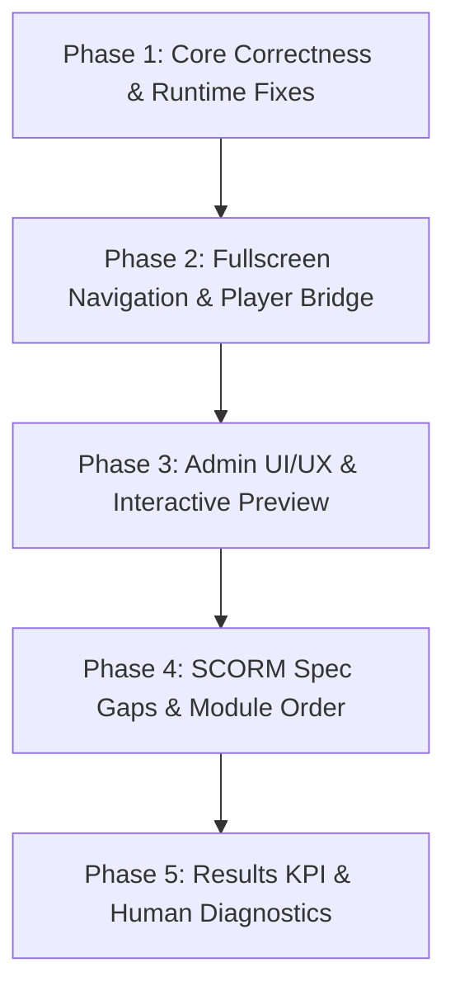

# SCORM Support Comprehensive Implementation Plan

This document establishes the exhaustive, production-grade implementation plan to address all findings, architectural bugs, SCORM standard gaps, and UI/UX refinements identified in the SCORM integration review. It serves as the authoritative blueprint for engineering implementation.

---

## 1. Executive Summary & Core Architectural Decisions

| Area | Current Issue / Finding | Proposed Solution | Target Files / Scope |
| :--- | :--- | :--- | :--- |
| **0. Critical Bug** | Resumed sessions have all progress dropped due to sequence restart | Initialize `scorm-again` `_commitSequence` from DB `commitSeq` on launch; update server commit response with completion status | `apps/activity-player/src/main.ts`, `scorm/adapter.ts`, `apps/api/src/services/activity/runtime-scorm.ts` |
| **1. S3 Storage & Retention** | Scheduled background deletion deletes files while leaving orphan records; redundant delete endpoint | Drop scheduled 30-day S3 file deletion cron job; keep asset deletion on explicit user delete; keep 90-day diagnostic event cleanup; remove redundant endpoint | `packages/core/src/services/activity/retention.ts`, `apps/jobs/src/workers/maintenance.ts`, `apps/api/src/routes/activity/packages.ts` |
| **2. Non-LMS Stub Packages** | Manifest validates but package makes zero LMS calls; learner gets author-directed error | Add pre-flight script AST / regex scan during processing; display admin warning badge on upload; show student-friendly failure copy; clear warning on late connect | `packages/activity-packages/src/scorm/manifest/index.ts`, `apps/jobs/src/processors/activity-package/process-scorm.ts`, `apps/dashboard/src/lib/features/course/components/activity/activity-player.svelte` |
| **3. Database Tests & CI** | DB tests necessary for SQL rollups & constraints, but shouldn't block PRs prematurely | Consolidate 21 DB test files into focused shared test suites; do not split CI into separate PR now; document migration and testing procedure for final merge | `apps/api/src/__tests__/*`, `.github/workflows/package-build-check.yml` |
| **4. Upload Size Formatting** | 3.6 KB shows "0.0 MB" during upload; media library shows "–" | Use `formatPackageBytes` across dropzone, upload card, and media manager; persist `zipBytes` to `asset.size` | `package-upload.svelte`, `packages/core/src/services/activity/packages.ts`, `apps/dashboard/src/lib/features/media/*` |
| **5. Results KPI Cards** | "Completed" vs "Passed" conflated; 5 overlapping cards confuse admins | Redesign to 4 clear KPI cards: Enrolled, In Progress, Completed (with % of enrolled), and Average Score (best score; graded only) | `activity-results-panel.svelte`, `packages/db/src/queries/scorm/report.ts` |
| **6. Retakes Disabled UX** | Button "Start new attempt" shows even when retakes are disabled; review mode doesn't load student answers | Hide "Start new attempt" when retakes are disabled; load student CMI in review mode; display "Review Mode" banner with clear non-recording notice | `activity-player.svelte`, `apps/api/src/services/activity/runtime-scorm.ts`, `apps/activity-player/src/main.ts` |
| **7. Launch Modes & Fullscreen** | New-window mode broken (severed opener); fullscreen traps user in module | Drop new-window mode select; implement floating auto-hide module navigation bar on hover inside fullscreen; wide player container | `activity-player.svelte`, `package-settings.svelte`, `apps/activity-player/src/bridge.ts` |
| **8. Diagnostics Presentation** | Raw JSON with internal UUIDs and sequence numbers shown in learner sheet | Convert events to friendly human timeline ("Launched Module", "Progress saved", "Connection failed: Chrome on macOS"); technical details behind collapsible drawer | `learner-attempts-sheet.svelte`, `packages/db/src/queries/scorm/session-event.ts` |
| **9. "In Progress" Completion Lag** | Activity badge stays "In progress" even after finishing | Real-time `postMessage` bridge event on completion commit; immediately update badge and trigger `openCourseCompletionIfDone`; fix preview badge | `apps/activity-player/src/bridge.ts`, `activity-player.svelte`, `runtime-scorm.ts` |
| **10. Sequencing & SCORM Gaps** | Multi-module free navigation breaks prerequisites; 10 SCORM data specs ignored | Add `moduleOrder` setting ('sequential' vs 'free'); add `completionModules` filter; supply learner ID/name, pass mark, parameters, and time | `packages/activity-packages/src/scorm/runtime/index.ts`, `packages/activity-packages/src/scorm/manifest/index.ts`, `package-settings.svelte` |
| **11. Admin Interactive Preview** | Admins cannot test package without enrolling as student | Embed live preview player directly in Package tab with "Admin Preview · Not recorded" indicator; toggle between editor and preview | `apps/dashboard/src/lib/features/course/pages/activity.svelte`, `package-details.svelte` |
| **12. UI/UX Button Clutter & Navigation** | "Buttons everywhere" on admin page; awkward horizontal scrolling module menu | Top header with title & "⋯" menu; standard save bar; replace horizontal scroll with accessible popover selector on desktop, bottom sheet on mobile, hover bar in fullscreen | `activity.svelte`, `activity-player-module-menu.svelte`, `package-settings.svelte` |
| **13. SCORM Course Types** | Admin forced to pick Self-paced vs Compliance when creating SCORM course | Remove type selection step during SCORM course creation; default to Self-paced; provide optional "Track as compliance" toggle; badge as "SCORM · N modules" | `new-course-modal.svelte`, `scorm-course-create.svelte`, `card.svelte`, `course-list-row.svelte` |

---

## 2. Detailed Technical Solutions by Item

### Item 0: Resume Save Loss & Sequence Counter Desynchronization
- **Root Cause**: `scorm-again` resets its internal `this._commitSequence = 0` whenever instantiated. On the server, `runtime-scorm.ts` rejects any commit where `commit.seq <= chain.scoAttempt.commitSeq`. When a student reopens an in-progress module, their previous `commitSeq` (e.g. 14) causes the first 14 commits of the new session (`seq: 1..14`) to be rejected as `stale_sequence`.
- **Solution**:
  1. In `apps/api/src/services/activity/runtime-scorm.ts`:
     Add `commitSeq: number` to `ScormRuntimeState`. In `getScormRuntimeState`, return `scoAttempt.commitSeq ?? 0`.
  2. In `apps/activity-player/src/scorm/adapter.ts` and `main.ts`:
     Upon receiving `LaunchState`, initialize `adapter._commitSequence = state.commitSeq || 0`.
     Subsequent commits will naturally be numbered `state.commitSeq + 1`, `+ 2`, etc.
  3. In `runtime-scorm.ts` line 232:
     Keep the monotonically increasing check `commit.seq <= chain.scoAttempt.commitSeq` as an anti-tamper / idempotency guard, knowing that client starts at `server_seq + 1`.
  4. Write unit and database tests verifying:
     - Session 1 commits up to sequence 3.
     - Session 2 launches and commits sequence 4, 5. All are persisted without rejection.

---

### Item 1: S3 Deletion, Retention Policy & Package Replacement Lifecycle

#### What happens when an Admin replaces a package?
When an admin uploads a new version for an existing package:
1. `content_package_version` row for Version 2 is inserted (`status: 'processing'`).
2. Worker extracts Version 2 into a distinct prefix: `scorm/{assetId}/v2/`.
3. When ready, `makeScormPackageVersionCurrent(organizationId, assetId, versionId, { closeOpenAttempts })` executes:
   - Sets Version 2 `is_current = true`.
   - Sets Version 1 `is_current = false` and records `replaced_at = now()`.
   - If admin chose **"Move everyone to this version"** (`closeOpenAttempts: true`): open attempts on Version 1 are closed with `close_reason = 'replaced'`. Next time these students launch, `resolveAttempt` starts Attempt 2 on Version 2.
   - If admin chose **"Keep existing progress"** (`closeOpenAttempts: false`): learners currently in an active attempt stay pinned to Version 1 until they complete it. New learners or subsequent attempts launch Version 2.

#### Database Columns: `replaced_at` vs Scheduled S3 Deletion
- **Recommendation**:
  - **KEEP `replaced_at`**: It is an essential audit timestamp recording when a version was superseded.
  - **DROP the automated 30-day S3 file deletion cron job** in `packages/core/src/services/activity/retention.ts` (`listVersionsDueForRetention` / `deleteS3Prefix`).
  - **Rationale**: Replaced video and document assets in ClassroomIO are never deleted on a background timer. Deleting extracted files after 30 days breaks learners who review past courses, causes storage discrepancy, and introduces orphan files. Storage quotas do not exist for self-hosted or standard packages.
  - **Explicit Deletion**: When an admin deletes a package from the Media Library or deletes the activity, `deleteAssetService` cascades cleanly to delete all S3 prefixes (`scorm/{assetId}/*`).
  - **Session Events**: Keep the 90-day retention cleanup for `scorm_session_event` as it only touches database rows and bounds log table growth.
  - **Unused Endpoint**: Remove `DELETE /activity/packages/:assetId` and client helper; standardize package deletion through `/organization/assets/:assetId`.

---

### Item 2: Non-LMS / Single-SCO Package Detection & User Messaging

#### Detection Strategy (Package Processing)
In `apps/jobs/src/processors/activity-package/process-scorm.ts`:
1. During ZIP extraction, inspect the entry point HTML file and bundled `.js` files.
2. Search for SCORM API discovery tokens:
   - SCORM 1.2: `LMSInitialize`, `API.LMS`, `pipwerks.SCORM`, `doLMSInitialize`
   - SCORM 2004: `API_1484_11`, `Initialize`, `pipwerks`
3. If zero occurrences are discovered across all script/HTML files, add warning code `no_lms_api_detected` to `version.warnings`.
4. Do **not** reject or abort the upload. Some enterprise packages dynamically construct API references or load wrappers at runtime.

#### Admin Upload Warning
In `package-upload.svelte` and `package-details.svelte`:
- Display an Amber Warning Banner:
  > **No LMS communication detected**
  > This package does not appear to report progress or scores to an LMS. Learners can view the content, but completion and scores cannot be tracked automatically.

#### Learner-Facing Experience
In `activity-player.svelte` and `apps/activity-player/src/main.ts`:
1. Change timeout copy from technical author instructions (`Re-export it with an LMS...`) to learner-appropriate copy:
   > **Content could not be started**
   > This package is taking longer than expected to connect. Please reload the page. If this continues, contact your instructor.
2. **Late Connection Handling**: If `watchForConnection` resolves or `Initialize` event fires after the 30-second timer, immediately clear `didNotConnect = false` and remove the warning banner without forcing a manual reload.
3. In Results tab summary, display warning badge if `not_initialized` events exceed threshold.

---

### Item 3: Database Tests, Migrations & CI Separation

1. **Migration Policy**:
   - Schema changes fold strictly into `packages/db/src/migrations/0033_scorm_activities.sql`.
   - Adhere to the single-migration rule in `AGENTS.md`. No new migration file (`0034`) will be created.
   - Run journal high-water-mark verification before merge.
2. **Database Testing Strategy**:
   - Database tests (`*.db.test.ts`) are necessary to validate complex SQL rollups (`scormAttemptRollupSql`), cascading deletions, and constraint enforcements that mock units cannot simulate.
   - **CI Integration**: Per user requirement, do not create an isolated PR for CI database tests now. Keep the test suite hermetic and consolidated into fewer test suites (`activity-scorm-results.db.test.ts`, `activity-schema-constraints.db.test.ts`, `activity-runtime-db.test.ts`) so they run in under 45 seconds locally and in CI. Document the DB test runner configuration for final merge.

---

### Item 4: Upload Size Formatting & Media Storage Bytes

1. **Upload Card Formatting**:
   In `package-upload.svelte` line 351:
   - Replace:
     ```svelte
     <p class="ui:text-muted-foreground text-sm">{(file.size / (1024 * 1024)).toFixed(1)} MB</p>
     ```
   - With:
     ```svelte
     <p class="ui:text-muted-foreground text-sm">{formatPackageBytes(file.size)}</p>
     ```
2. **Media Library Storage Size**:
   In `packages/core/src/services/activity/packages.ts`:
   - When creating or finalizing `asset` record for SCORM, update `asset.size` with `version.zipBytes + (version.extractedBytes ?? 0)`.
   - Ensure media library list queries read this value rather than defaulting to `–`.

---

### Item 5: Results Tab KPI Cards Redesign

#### Analysis of "Completed" vs "Passed"
- In SCORM 2004, `completion_status` (completed/incomplete) and `success_status` (passed/failed) are independent. A learner can be `completed` and `failed` (read all material but failed quiz).
- Having separate "Completed" and "Passed" cards confusingly overlaps and makes "Passed" show 0 for ungraded packages.

#### New KPI Card Structure
Replace the current 5 cards with 4 contextual cards using `@cio/ui/base/card`:
1. **Enrolled**: Total learners in the cohort/course.
2. **In Progress**: Count of learners who have started but not completed (`status === 'in_progress'`), with percentage of enrolled (e.g., `8 · 27%`).
3. **Completed**: Count of learners who met the activity completion rule (`completed === true`), with percentage of enrolled (e.g., `21 · 70%`).
4. **Average Score** (Context-aware):
   - For **Graded packages** (manifest contains pass mark or quizzes report scores): Shows average best-score percent (e.g., `84.5%`).
   - For **Ungraded packages**: Replaced with **Not Started** count (`enrolled - started`).

In the table, status column displays:
- `Completed` (Green badge)
- `In Progress` (Blue/Neutral badge)
- `Not Passed` (Amber badge, only when failed an attempt and rule not met)
- `Not Started` (Outline badge)

---

### Item 6: Retakes Disabled UX & Review Mode Gating

1. **Button Visibility**:
   In `activity-player.svelte`:
   - Only render the `<Button onclick={startNewAttempt}>` when:
     `launch.mode === 'review' && (activityApi.editor?.settings.allowRetakes ?? false)`
   - When retakes are disabled, omit the button entirely.
2. **Review Mode Experience**:
   - In `apps/api/src/services/activity/runtime-scorm.ts`:
     When `mode === 'review'`, return the learner's recorded `cmi` state in `getScormRuntimeState`.
   - In `apps/activity-player/src/main.ts`:
     Set `cmi.core.lesson_mode = 'review'` (SCORM 1.2) or `cmi.mode = 'review'` (SCORM 2004). This instructs authoring packages (Storyline/Rise/Captivate) to render their quiz review screens showing learner's previous answers.
   - Replace the player's autosave hint:
     > **Review mode active** · Progress and answers in this session are not saved.

---

### Item 7 & 8: Fullscreen Mode with Hover/Floating Module Navigation

#### Fullscreen Module Navigation (Addressing User's Core Query)
- **Problem**: When a learner toggles fullscreen, `frameWrap.requestFullscreen()` only expands the `<iframe>` container. The module list (`ActivityPlayerModuleMenu`) is outside `frameWrap`, leaving the learner trapped in the current module until they exit fullscreen.
- **Solution: Floating Auto-Hide Top Control Bar**:
  1. Mount the module controls **inside** `frameWrap`.
  2. In non-fullscreen mode: Rendered as standard clean bar above the iframe.
  3. In fullscreen mode (`isFullscreen = true`):
     - Styles become an overlay pinned to the top:
       `absolute top-0 left-0 right-0 z-50 bg-background/85 backdrop-blur-md border-b px-6 py-3 transition-opacity duration-300`
     - **Auto-Hide Logic**:
       - When the mouse moves inside `frameWrap`, show the bar (`opacity-100`).
       - If no mouse movement occurs for 2.5 seconds, smoothly fade out (`opacity-0 pointer-events-none`).
       - Hovering within 60px of the top edge immediately reveals the bar.
     - **Controls Included**:
       - `Previous Module` & `Next Module` buttons.
       - Module selection Popover button: `"Module 2 of 5: Safety Procedures ▾"`.
       - Checkmark icons for completed modules.
       - Exit Fullscreen toggle button.
  4. **iOS Safari Fallback**:
     On iPhone where Element Fullscreen is disallowed for iframes by WebKit, toggle a full-viewport CSS "Focus Mode" class (`fixed inset-0 z-50 bg-background`) providing an identical seamless experience.
  5. **Wide Container**:
     Widen the player container from `max-w-3xl` to full available width (`max-w-6xl` or responsive 16:9 container) with proper minimum height.
  6. **Launch Mode Cleanup**:
     Remove the `launchMode` select (`embedded` vs `window`) from `package-settings.svelte` and database default to `embedded`.

---

### Item 8: Human-Readable Diagnostics & Audit Timeline

In `apps/dashboard/src/lib/features/course/components/activity/learner-attempts-sheet.svelte`:
1. Replace raw JSON string dumps with translated, human-friendly timeline rows:
   - `launch`: "Started module session"
   - `initialize`: "Connected to SCORM API"
   - `commit`: "Progress saved (Score: {score}%, Status: {status})"
   - `terminate`: "Exited module"
   - `beacon`: "Saved on window close"
   - `not_initialized`: "Did not connect within 30 seconds"
   - `error`: "Save error: {reason}"
2. Format device/browser:
   Parse `user_agent` to readable summary (e.g. "Chrome 128 on macOS").
3. Technical Details Collapsible:
   Place raw event payloads, UUIDs, and sequences inside a `<Collapsible>` or "Technical details" dropdown intended for developer debugging and support tickets.

---

### Item 9: Student Player "In Progress" Completion Desync

1. **Root Cause**:
   When a student completes the final module, the activity row in `activity_completion` is written on the server during the `commit` transaction, but the front-end dashboard does not receive immediate notification unless the iframe exits or page reloads.
2. **Real-Time Notification Pipeline**:
   - In `apps/api/src/services/activity/runtime-scorm.ts`:
     When `commitScormAttempt` sets `completedActivity: true`, include `completedActivity: true` in the HTTP JSON response to `scorm-again`.
   - In `apps/activity-player/src/bridge.ts`:
     Add outbound message type:
     ```ts
     export type PlayerOutboundMessage =
       | { type: 'ready' }
       | { type: 'terminated'; navRequest: string | null }
       | { type: 'completed' }
       | { type: 'did-not-connect' };
     ```
   - In `apps/activity-player/src/main.ts`:
     Listen to adapter commit success. If server signaled activity completion, dispatch `postMessage({ type: 'completed' }, parentOrigins)`.
   - In `activity-player.svelte`:
     Listen for `message.type === 'completed'`.
     Immediately update the local state:
     - Set activity status pill to `Completed`.
     - Refresh course progress store.
     - Call `openCourseCompletionIfDone(courseId)`.
3. **Admin Preview Badge**:
   When an admin launches the player in preview mode, display badge `<Badge variant="outline">Preview</Badge>` instead of `In progress`.

---

### Item 10: SCORM Sequencing, Module Ordering & Spec Gaps

#### Pragmatic Sequencing Solution
Building a full IMS Simple Sequencing state machine from scratch is out-of-scope for v1, but ignoring module order breaks prerequisites. We solve this with two clean, robust settings:

1. **Module Order Setting**:
   In `package-settings.svelte` and `activity_scorm`:
   - `moduleOrder`: `'sequential' | 'free'` (Default `'sequential'` if package contains sequencing rules or multiple modules; `'free'` otherwise).
   - When `'sequential'`, the server and UI lock module `N` until module `N-1` is completed. Locked modules appear with a lock icon in the module menu and cannot be launched.
2. **Completion Modules Filter**:
   - Add setting `completionModules`: `'all' | 'graded_only'`.
   - Prevents ungraded diagnostic pre-tests or introductory assets from preventing course completion.
3. **Closing SCORM Specification Gaps**:
   In `apps/api/src/services/activity/runtime-scorm.ts` and `launch.ts`:
   - **Learner Identity**: Supply `cmi.core.student_id` and `cmi.core.student_name` (1.2) / `cmi.learner_id` and `cmi.learner_name` (2004) formatted as `"LastName, FirstName"`.
   - **Pass Mark & Threshold**: Pass `cmi.student_data.mastery_score` (1.2) and `cmi.scaled_passing_score` (2004) from unit metadata into launch state.
   - **URL Parameters**: Ensure `scormLaunchUrl` properly joins `href` with manifest `parameters` (e.g. `?content=module1`).
   - **XML Base**: Manifest parser respects `xml:base` on `<manifest>` and `<resources>`.
   - **Visibility**: Exclude items with `isvisible="false"` from the module menu and completion counts.
   - **Accurate Time Tracking**: Accumulate session time from `cmi.core.session_time` / `cmi.session_time` instead of calculating calendar elapsed time between visits.

---

### Item 11: Admin Interactive Preview

1. **Direct Package Tab Integration**:
   In `apps/dashboard/src/lib/features/course/pages/activity.svelte`:
   - On the **Package** tab, provide an interactive **Preview** button or toggle.
   - When clicked, mount `ActivityPlayer` in `isPreview={true}` mode.
   - API mints a launch token with `mode: 'preview'`.
   - Displays a prominent banner:
     > **Preview Mode** · You are testing this activity as an instructor. No attempts, completions, or scores are recorded.
2. **Self-Hosted Support**:
   Ensure `resolveLaunchHosts` permits localhost and self-hosted content hosts for admin preview without requiring student enrollment.

---

### Item 12: Admin Editor UI/UX Overhaul & Standard Design System

#### Elimination of "Buttons Everywhere"
Redesign `apps/dashboard/src/lib/features/course/pages/activity.svelte`:

```
┌────────────────────────────────────────────────────────────────────────┐
│ ← Back to Course   Activity: [ Safety Compliance 2026 ]      [ Locked ⏻ ] [ ⋯ ] │
├────────────────────────────────────────────────────────────────────────┤
│ [ Package ]     [ Instructions ]     [ Results ]     [ Settings ]      │
├────────────────────────────────────────────────────────────────────────┤
│                                                                        │
│  ┌─ Package Summary Card ────────────────────────────────────────────┐ │
│  │ Title: Workplace Safety 101       Format: SCORM 2004 4th Ed      │ │
│  │ Modules: 4 SCOs                   Size: 12.4 MB                  │ │
│  │ Pass Mark: 80%                    Status: [ Ready ]              │ │
│  └───────────────────────────────────────────────────────────────────┘ │
│                                                                        │
│  [ Preview Activity ]                                                  │
│                                                                        │
└────────────────────────────────────────────────────────────────────────┘
```

1. **Header**:
   - Single clean title input with subtle border on hover.
   - Locked toggle switch with tooltip.
   - Single "⋯" dropdown menu containing:
     - *Replace Package Version*
     - *Swap with Different Package*
     - *Remove Package from Activity*
     - *Delete Activity*
2. **Standard Save Bar**:
   - Use ClassroomIO standard `UnsavedChanges` bottom floating save bar across Settings and Instructions tabs, removing individual save buttons littered across pages.
3. **Destructive Action Dialogs**:
   - Every deletion/removal prompts a confirmation modal showing student impact counts (`"This will affect N active learners"`).

---

### Item 13: SCORM Course Simplification (No Course Types Picker)

1. **Streamlined Creation Flow**:
   In `new-course-modal.svelte` and `scorm-course-create.svelte`:
   - When the user selects **"Upload a SCORM package"**:
     - Do NOT ask them to choose between "Self-paced" and "Compliance".
     - Only ask for Course Title, optional Description, and Package upload.
     - Automatically set `course.type = 'SELF_PACED'` and `course.format = 'single_activity'` behind the scenes.
2. **Optional Compliance Tracking**:
   - In course Settings (or as an optional secondary checkbox during creation):
     `[ ] Track as compliance training (due dates, recurring renewals, certificates)`
   - Checking this sets `course.type = 'COMPLIANCE'`.
3. **Card & Navigation Badges**:
   - On course cards (`card.svelte`) and list rows (`course-list-row.svelte`):
     - Hide the generic "Self-paced" badge for SCORM courses.
     - Display: `<Badge variant="secondary">SCORM · 4 modules</Badge>`.
     - If marked as compliance, show the `<Badge variant="warning">Compliance</Badge>`.

---

## 3. Implementation Phases & Work Breakdown



### Phase 1: Core Correctness & Runtime Fixes (Days 1–2)
- [ ] Initialize `adapter._commitSequence` in `activity-player` using `state.commitSeq` from `getScormRuntimeState`.
- [ ] Drop scheduled 30-day S3 file deletion cron job in `retention.ts` and `maintenance.ts`. Keep 90-day event cleanup.
- [ ] Remove unused `DELETE /activity/packages/:assetId` route.
- [ ] Update `package-upload.svelte` with `formatPackageBytes`.
- [ ] Hide "Start new attempt" when `allowRetakes` is false; initialize review mode with stored answers.
- [ ] Fix pre-flight scan for non-LMS packages and add upload warning.

### Phase 2: Fullscreen Navigation & Player Bridge (Days 3–4)
- [ ] Mount module menu inside `frameWrap` with auto-hiding top bar in fullscreen on mouse move.
- [ ] Add `completed` postMessage from player to parent dashboard on completion commit.
- [ ] Update dashboard listener to refresh course completion immediately upon receiving `completed`.
- [ ] Drop `launchMode` selection from settings and API defaults to `embedded`.

### Phase 3: Admin UI/UX & Interactive Preview (Days 5–6)
- [ ] Streamline `new-course-modal.svelte` to remove course type selection step for SCORM courses.
- [ ] Overhaul `apps/dashboard/src/lib/features/course/pages/activity.svelte`:
  - Consolidated header with "⋯" actions menu.
  - Standard floating save bar for instructions and settings.
  - Integrated interactive Preview player with "Admin Preview" banner.
- [ ] Replace horizontal module buttons with responsive popover/drawer menu.

### Phase 4: SCORM Spec Gaps & Module Order (Days 7–8)
- [ ] Add `moduleOrder` ('sequential' vs 'free') setting and server validation.
- [ ] Pass `student_id`, `student_name`, `mastery_score`, and `scaled_passing_score` to package.
- [ ] Respect `isvisible="false"` on manifest items.
- [ ] Fix manifest `parameters` concatenation in `scormLaunchUrl`.

### Phase 5: Results KPI & Diagnostics (Days 9–10)
- [ ] Redesign Results tab KPI cards to 4 clear cards: Enrolled, In Progress, Completed, Average Score.
- [ ] Transform diagnostic event dump into human-friendly audit timeline in learner sheet.
- [ ] Update unit and database tests.
- [ ] Run `pnpm format:check` and verification suites.

---

## 4. Verification & Testing Matrix

| Test Suite | Commands | Criteria |
| :--- | :--- | :--- |
| **Runtime Persistence** | `pnpm --filter @cio/api test apps/api/src/__tests__/activity-runtime-db.test.ts` | Resumed sessions commit sequentially without `stale_sequence` rejections; completion updates `activity_completion`. |
| **Storage & Retention** | `pnpm --filter @cio/api test apps/api/src/__tests__/activity-scorm-retention.test.ts` | 90-day diagnostic events are pruned; package files are untouched by retention cron. |
| **Manifest & Detection** | `pnpm --filter @cio/activity-packages test` | Non-LMS packages flag warning `no_lms_api_detected`; `parameters` join correctly; XML base honored. |
| **Dashboard Check** | `cd apps/dashboard && npx svelte-check --threshold error` | Zero new svelte-check errors introduced; reactive bindings pass. |
| **Full Build Verification** | `pnpm --filter @cio/api^... build && pnpm --filter @cio/api build` | API, packages, and types build clean on Node 20. |

---

## 5. Sync with Existing Documentation

- **`prd/scorm-support/v2/README.md`**:
  - Update Section 10 to reflect that package version files remain in S3 until package deletion; automated 30-day file purge is retired.
  - Update Section 2 (Settings) to remove `Launch Mode: window` and document `Module Order: sequential | free`.
  - Update Section 6 to document simplified single-activity creation without course type selector.
- **`prd/scorm-support/v2/schema-improvements.md`**:
  - Document that `replaced_at` is preserved for version auditing, while `archived_at` and scheduled cron deletions are decoupled from runtime stability.
