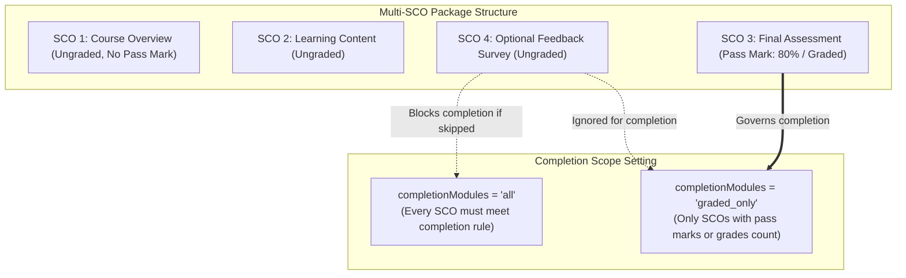
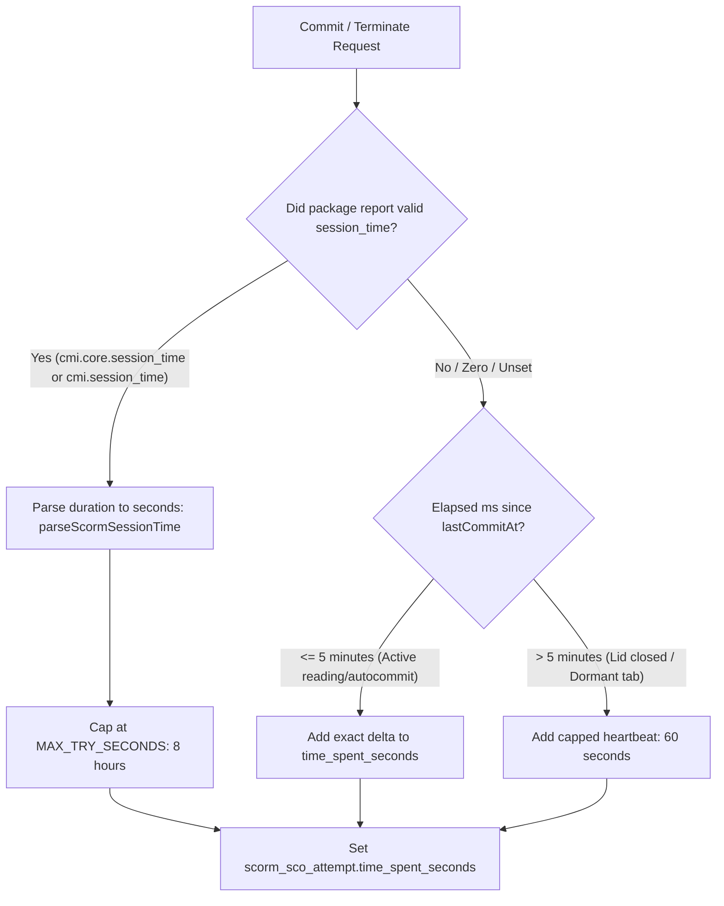

# SCORM Phase 4 Pushbacks: Comprehensive Architectural & Implementation Plan

This document provides an objective, deep architectural review and exhaustive implementation plan for the four pushbacks/deferred items from Phase 4 of the SCORM integration:

1. **`completionModules` (`all` vs `graded_only`) Filter** — Unifying completion semantics across the TypeScript evaluator and SQL rollup CTE with 100% parity.
2. **Session-Time-Based Time Tracking** — Replacing vulnerable wall-clock calculations with bounded hybrid session time tracking and persistent storage.
3. **Package Navigation Buttons (`adl.nav.request`)** — Expanding the player bridge and dashboard player to support `continue`, `previous`, `choice`, and `exit` navigation requests.
4. **Time Limits (`maxTimeAllowed`, `timeLimitAction`) & Spec Non-Goals** — Feeding manifest time limits into SCORM 2004 CMI and displaying informative UI badges, while maintaining pragmatic boundaries around IMS Simple Sequencing and `adl.data`.

---

## 1. Deep Analysis of the Pushback Items

### Item 1: `completionModules` (`all` vs `graded_only`)



#### The Real-World Need
Most multi-SCO SCORM packages (e.g., Articulate Rise/Storyline, Captivate) comprise introductory modules, learning content, an assessment quiz, and an optional post-course survey or glossary.
- Under the existing `completionRule: 'passed'` or `'auto'`, every single SCO in the package must satisfy the rule.
- If a course includes an optional feedback survey or glossary that never reports `passed` (or is skipped by the learner), the learner is permanently blocked from completing the course.
- Adding `completionModules: 'graded_only'` allows course authors to declare that only graded modules (assessments/quizzes) gate activity completion.

#### The Parity Challenge
ClassroomIO evaluates completion in two distinct places that are contractually bound by tests to never diverge:
1. **TypeScript Engine (`packages/activity-packages/src/scorm/runtime/index.ts`)**: Evaluates `isScormRuleMet()` inside the database transaction on each commit to trigger `completeActivityOnce()`.
2. **PostgreSQL Rollup CTE (`packages/db/src/queries/scorm/report.ts`)**: Computes `rule_met` in `attempt_rollup` across all enrolled learners for the Results tab, learner status, and summary KPIs.
3. **Test Suite (`apps/api/src/__tests__/activity-scorm-results.db.test.ts`)**: Validates that TypeScript and SQL yield identical outcomes for all fixtures and edge cases.

#### The Semantic Contract & Fallback Safeguard
- **Graded Module Definition**:
  A module is graded if:
  $$\text{isGraded} = \text{hasPassMark} \lor (\text{success} \neq \text{'unknown'}) \lor (\text{scaledScore} \neq \text{null})$$
  - In manifest/DB: `masteryScoreRaw IS NOT NULL` (1.2) or `passingScoreScaled IS NOT NULL` (2004).
  - In runtime CMI: explicitly reported `passed`/`failed` or scaled score.
- **Empty Candidate Safeguard**:
  If an author sets `completionModules: 'graded_only'` on an informational package that has **no graded modules at all**, filtering down to graded modules would yield an empty set. An empty set must **never** automatically complete the activity on launch. In this scenario, the engine safely falls back to evaluating all modules (`candidates = modules`).
- **Rule Matrix under `graded_only`**:
  - `auto`: Graded modules must be `passed`.
  - `completed`: Graded modules must be `completed`.
  - `passed`: Graded modules must be `passed`.
  - `score`: Graded modules must be `completed` and their average score must meet `minScorePercent`.

---

### Item 2: Session-Time-Based Time Tracking



#### Why Current Wall-Clock Tracking Fails
ClassroomIO currently evaluates try duration on-the-fly in queries:
```sql
EXTRACT(EPOCH FROM (COALESCE(t.terminated_at, t.last_commit_at, t.started_at) - t.started_at))::int AS try_seconds
```
- **The Dormant Tab / Weekend Glitch**: A learner opens a module on Friday at 5:00 PM, reads for 10 minutes, closes their laptop lid, and opens it Monday at 9:00 AM. Wall-clock logs **64 hours** of study time for a 10-minute module. In corporate compliance training (healthcare, OSHA, financial services), this corrupts audit reporting.
- **Why Naive Accumulation Fails**:
  - SCORM packages send `cmi.core.session_time` (1.2) or `cmi.session_time` (2004).
  - Some packages send `session_time` on every 30s commit as the **cumulative** time in the current session (not an incremental delta). Adding it on every commit causes time to exponentially explode.
  - Some packages only send `session_time` upon `LMSFinish` / `Terminate`.
  - Many packages send `00:00:00` or corrupt strings.

#### The Ideal Solution: Bounded Hybrid Session Tracking
1. **Persistent Column**: Add `time_spent_seconds integer DEFAULT 0 NOT NULL` to `scorm_sco_attempt`. This records the true active duration per SCO try.
2. **Parser**: Create `parseScormSessionTime(raw, format)` supporting both SCORM 1.2 `HH:MM:SS[.SS]` / `HHHH:MM:SS` and SCORM 2004 ISO 8601 durations (`PT1H30M15S`).
3. **Commit Update Logic**:
   - **Case A: Package reports `session_time`**:
     The SCORM standard specifies that `session_time` is the total duration of the current learner session for this SCO. Set `time_spent_seconds = min(parseScormSessionTime(session_time), MAX_TRY_SECONDS)` (where `MAX_TRY_SECONDS = 8 * 3600`).
   - **Case B: Package does not report `session_time` (or reports 0)**:
     Use bounded heartbeat accumulation:
     $$\Delta t = \text{now} - \text{last\_commit\_at}$$
     - If $\Delta t \le 300\text{s}$ (active browsing between 30s autocommits), accumulate $\Delta t$.
     - If $\Delta t > 300\text{s}$ (dormant tab or resume after weekend), cap the credited delta at $60\text{s}$ (2 autocommit intervals).
4. **Reporting Queries**:
   In `report.ts` and `results.ts`, replace `EXTRACT(EPOCH FROM ...)` with `COALESCE(t.time_spent_seconds, 0)`.

---

### Item 3: Package Navigation Buttons (`adl.nav.request`)

#### Current State
- The player bridge (`apps/activity-player/src/bridge.ts`) already captures `adl.nav.request` and sends `{ type: 'terminated', navRequest }` to the parent window.
- In `apps/dashboard/.../activity-player.svelte`, `handleTerminated` only handles `navRequest === 'continue'`:
  ```ts
  if (navRequest === 'continue') {
    const nextIncomplete = nextIncompleteModule();
    if (nextIncomplete && nextIncomplete.identifier !== currentUnitIdentifier) {
      await selectUnit(nextIncomplete.identifier);
    }
  }
  ```
- All other navigation requests (`previous`, `choice.{target=<identifier>}`, `exit`, `exitAll`) are ignored!

#### The Ideal Experience
Expand `handleTerminated` to support standard SCORM 2004 navigation targets:
- `continue` / `_next_`: Advance to the next incomplete module (or next sequential module).
- `previous` / `_previous_`: Navigate to the preceding module in manifest order.
- `choice.{target=<id>}` or `choice.<id>`: Navigate directly to the chosen module (if it exists and is not locked).
- `exit` / `exitAll`: Keep the player on the finished screen without auto-navigation.

---

### Item 4: Time Limits (`maxTimeAllowed`, `timeLimitAction`) & Non-Goals

#### Time Limits
- ClassroomIO already extracts `<imsss:maxTimeAllowed>` and `<imsss:timeLimitAction>` during manifest parsing and stores them in `content_package_unit.format_details`.
- **The Gap**: In `runtime-scorm.ts`, `withLearnerFields()` initializes `cmi.learner_id`, `learner_name`, and `scaled_passing_score`, but **never** initializes `cmi.max_time_allowed` or `cmi.time_limit_action`. Consequently, packages querying their time limits receive empty strings.
- **The Fix**: Initialize `cmi.max_time_allowed` and `cmi.time_limit_action` from `unit.formatDetails` at launch time.
- **UI Guidance**: Pass `maxTimeAllowed` in the launch payload and display a subtle badge in the module navigation bar (e.g., `<Badge variant="outline"><ClockIcon /> Suggested: 45 min</Badge>`). Following SCORM Cloud best practices, ClassroomIO avoids disruptive forced logouts that cause learner data loss.

#### Clarification on Spec Non-Goals
| Feature | Evaluation & Strategic Decision |
| :--- | :--- |
| **Simple Sequencing Engine** | **Keep as Non-Goal.** SCORM 2004 Simple Sequencing is a 200+ page state machine. ClassroomIO's `moduleOrder: 'sequential'` enforces linear prerequisites without disproportionate maintenance overhead. |
| **Shared `adl.data`** | **Keep as Non-Goal.** Used by $<0.05\%$ of authoring packages. Building a multi-SCO persistent key-value store offers negligible real-world utility. |

---

## 2. Step-by-Step Implementation Plan

### Step 1: Database Schema & Migration Update

#### 1.1 Update Constants & Types
- **File**: `packages/utils/src/constants/activity.ts`
  ```ts
  export const SCORM_COMPLETION_MODULES = ['all', 'graded_only'] as const;
  export type TScormCompletionModules = (typeof SCORM_COMPLETION_MODULES)[number];
  ```
- **File**: `packages/utils/src/validation/activity/scorm.ts`
  Add `completionModules` to `ZScormSettings`:
  ```ts
  completionModules: z.enum(SCORM_COMPLETION_MODULES).default('all')
  ```

#### 1.2 Update Drizzle Schema
- **File**: `packages/db/src/schema.ts`
  - Define enum:
    ```ts
    export const scormCompletionModules = pgEnum('SCORM_COMPLETION_MODULES', [...SCORM_COMPLETION_MODULES]);
    ```
  - In `activityScorm`:
    ```ts
    completionModules: scormCompletionModules('completion_modules').default('all').notNull(),
    ```
  - In `scormScoAttempt`:
    ```ts
    timeSpentSeconds: integer('time_spent_seconds').default(0).notNull(),
    ```

#### 1.3 Fold into Migration `0033_scorm_activities.sql`
Per repo rules (one migration per PR):
- Add `CREATE TYPE "public"."SCORM_COMPLETION_MODULES" AS ENUM('all', 'graded_only');`
- Add `"completion_modules" "SCORM_COMPLETION_MODULES" DEFAULT 'all' NOT NULL` to table `activity_scorm`.
- Add `"time_spent_seconds" integer DEFAULT 0 NOT NULL` to table `scorm_sco_attempt`.

---

### Step 2: Runtime Engine & Time Tracking in `@cio/activity-packages`

#### 2.1 Implement `parseScormSessionTime`
- **File**: `packages/activity-packages/src/scorm/runtime/index.ts`
  ```ts
  /**
   * Parses SCORM 1.2 (HH:MM:SS[.SS]) or SCORM 2004 (ISO-8601 duration) time to integer seconds.
   */
  export function parseScormSessionTime(raw: unknown, format: ScormPackageFormat): number | null
  ```
  - **SCORM 1.2**: Regex `/^(\d{2,4}):(\d{2}):(\d{2})(?:\.\d{1,2})?$/`.
  - **SCORM 2004**: Regex `/^P(?:(\d+)Y)?(?:(\d+)M)?(?:(\d+)D)?(?:T(?:(\d+)H)?(?:(\d+)M)?(?:(\d+(?:\.\d+)?)S)?)?$/`.
  - Return total seconds as non-negative integer, or `null` if invalid.

#### 2.2 Update `isScormRuleMet` for `completionModules`
- **File**: `packages/activity-packages/src/scorm/runtime/index.ts`
  - Update `ScormRuleSettings`:
    ```ts
    export interface ScormRuleSettings {
      rule: ScormCompletionRule;
      minScorePercent?: number | null;
      completionModules?: 'all' | 'graded_only';
    }
    ```
  - Update evaluation:
    ```ts
    export function isScormRuleMet(settings: ScormRuleSettings, modules: ScormModuleOutcome[]): boolean {
      if (modules.length === 0) return false;

      const { rule, completionModules = 'all' } = settings;
      const graded = modules.filter((m) => m.hasPassMark || m.success !== 'unknown' || m.scaledScore !== null);
      const targets = completionModules === 'graded_only' && graded.length > 0 ? graded : modules;

      if (rule === 'score') {
        const attemptScore = averageScaledScore(targets);
        const everyTargetCompleted = targets.every((m) => m.completion === 'completed');
        return everyTargetCompleted && attemptScore !== null && attemptScore * 100 >= (settings.minScorePercent ?? 100);
      }

      return targets.every((m) => isModuleRuleMet(rule, m));
    }
    ```

---

### Step 3: API Runtime Persistence & Time Handling

#### 3.1 Bounded Time Calculation & Time Limits at Launch
- **File**: `apps/api/src/services/activity/runtime-scorm.ts`
  - In `withLearnerFields()`:
    Extract `maxTimeAllowed` and `timeLimitAction` from `unit.formatDetails` when format is `scorm2004`.
    Populate `cmi.max_time_allowed` and `cmi.time_limit_action` on the launch CMI if not already present.
  - In `commitScormAttempt()`:
    Calculate `timeSpentSeconds`:
    ```ts
    const sessionTimeRaw = format === 'scorm12' ? getPath(commit.cmi, 'core.session_time') : getPath(commit.cmi, 'session_time');
    const parsedSeconds = parseScormSessionTime(sessionTimeRaw, format);
    let nextTimeSpent: number;

    if (parsedSeconds !== null && parsedSeconds > 0) {
      nextTimeSpent = Math.min(parsedSeconds, 8 * 3600);
    } else {
      const lastCommit = chain.scoAttempt.lastCommitAt ? new Date(chain.scoAttempt.lastCommitAt).getTime() : new Date(chain.scoAttempt.startedAt).getTime();
      const deltaSec = Math.max(0, Math.round((Date.now() - lastCommit) / 1000));
      const deltaCredited = deltaSec <= 300 ? deltaSec : 60;
      nextTimeSpent = Math.min((chain.scoAttempt.timeSpentSeconds ?? 0) + deltaCredited, 8 * 3600);
    }
    ```
    Pass `timeSpentSeconds: nextTimeSpent` to `updateScoAttempt`.
  - In `toRuleSettings(details)`:
    Forward `completionModules: details.completionModules`.

---

### Step 4: SQL Rollup & Parity Alignment

#### 4.1 Update `attemptRollupCte` in `report.ts`
- **File**: `packages/db/src/queries/scorm/report.ts`
  - In `attempt_modules`:
    Replace `EXTRACT(EPOCH...)` with `COALESCE(t.time_spent_seconds, 0) AS try_seconds`.
  - In `attempt_rollup`:
    Incorporate `completion_modules`:
    ```sql
    attempt_rollup AS (
      SELECT profile_id, attempt_id, attempt_number, launched_at, is_latest,
             COUNT(*)::int AS modules_total,
             COUNT(*) FILTER (WHERE completion = 'completed')::int AS modules_completed,
             COUNT(*) FILTER (WHERE success = 'passed')::int AS modules_passed,
             BOOL_OR(success = 'failed') AS any_failed,
             BOOL_OR(success = 'passed') AS any_passed,
             AVG(scaled_score) AS score_frac,
             (COUNT(*) > 0 AND CASE
                WHEN ${completionModules} = 'graded_only' AND BOOL_OR(has_pass_mark OR success <> 'unknown' OR scaled_score IS NOT NULL) THEN
                  CASE ${rule}
                    WHEN 'completed' THEN COUNT(*) FILTER (WHERE (has_pass_mark OR success <> 'unknown' OR scaled_score IS NOT NULL) AND completion = 'completed') = COUNT(*) FILTER (WHERE has_pass_mark OR success <> 'unknown' OR scaled_score IS NOT NULL)
                    WHEN 'passed' THEN COUNT(*) FILTER (WHERE (has_pass_mark OR success <> 'unknown' OR scaled_score IS NOT NULL) AND success = 'passed') = COUNT(*) FILTER (WHERE has_pass_mark OR success <> 'unknown' OR scaled_score IS NOT NULL)
                    WHEN 'score' THEN COUNT(*) FILTER (WHERE (has_pass_mark OR success <> 'unknown' OR scaled_score IS NOT NULL) AND completion = 'completed') = COUNT(*) FILTER (WHERE has_pass_mark OR success <> 'unknown' OR scaled_score IS NOT NULL)
                      AND AVG(scaled_score) FILTER (WHERE has_pass_mark OR success <> 'unknown' OR scaled_score IS NOT NULL) IS NOT NULL
                      AND AVG(scaled_score) FILTER (WHERE has_pass_mark OR success <> 'unknown' OR scaled_score IS NOT NULL) * 100 >= COALESCE(${minScorePercent}, 100)
                    ELSE COUNT(*) FILTER (WHERE (has_pass_mark OR success <> 'unknown' OR scaled_score IS NOT NULL) AND success = 'passed') = COUNT(*) FILTER (WHERE has_pass_mark OR success <> 'unknown' OR scaled_score IS NOT NULL)
                  END
                ELSE
                  CASE ${rule}
                    WHEN 'completed' THEN COUNT(*) FILTER (WHERE completion = 'completed') = COUNT(*)
                    WHEN 'passed' THEN COUNT(*) FILTER (WHERE success = 'passed') = COUNT(*)
                    WHEN 'score' THEN COUNT(*) FILTER (WHERE completion = 'completed') = COUNT(*)
                      AND AVG(scaled_score) IS NOT NULL
                      AND AVG(scaled_score) * 100 >= COALESCE(${minScorePercent}, 100)
                    ELSE SUM(CASE WHEN (has_pass_mark OR success <> 'unknown')
                      THEN CASE WHEN success = 'passed' THEN 1 ELSE 0 END
                      ELSE CASE WHEN completion = 'completed' THEN 1 ELSE 0 END
                    END) = COUNT(*)
                  END
             END) AS rule_met
      FROM attempt_modules
      GROUP BY profile_id, attempt_id, attempt_number, launched_at, is_latest
    )
    ```
  - In `getScormActivityStatsForProfile`:
    Replace `EXTRACT(EPOCH...)` with `COALESCE(t.time_spent_seconds, 0)`.

#### 4.2 Update `results.ts`
- **File**: `packages/core/src/services/activity/providers/scorm/results.ts`
  - In `getScormLearnerDetail`: Use `row.timeSpentSeconds` directly instead of calling `secondsBetween(...)`.
  - Pass `completionModules` to `ruleSettingsOf()`.

---

### Step 5: Dashboard UI & Player Enhancement

#### 5.1 Package Settings Component
- **File**: `apps/dashboard/src/lib/features/course/components/activity/package-settings.svelte`
  - Add `completionModules` state and dirty-tracking.
  - Add Select/Radio field for `Completion Scope`:
    - **All modules** (`all`)
    - **Graded modules only** (`graded_only`) with description helper.
  - Disable or show informative note when the package has $\le 1$ module.

#### 5.2 Activity Player & Navigation Handling
- **File**: `apps/dashboard/src/lib/features/course/components/activity/activity-player.svelte`
  - Enhance `handleTerminated(navRequest)`:
    ```ts
    if (!navRequest || navRequest === '_none_' || navRequest === 'exit' || navRequest === 'exitAll') {
      return;
    }

    if (navRequest === 'continue' || navRequest === '_next_') {
      const nextIncomplete = nextIncompleteModule();
      if (nextIncomplete && nextIncomplete.identifier !== currentUnitIdentifier) {
        await selectUnit(nextIncomplete.identifier);
      }
    } else if (navRequest === 'previous' || navRequest === '_previous_') {
      previousModule();
    } else if (navRequest.startsWith('choice.')) {
      const target = navRequest.replace(/^choice\.(?:\{target=)?([^}]+)\}?$/, '$1');
      const targetUnit = (availableLaunch?.units ?? []).find((u) => u.identifier === target);
      if (targetUnit && !targetUnit.locked) {
        await selectUnit(targetUnit.identifier);
      }
    }
    ```
- **File**: `apps/dashboard/src/lib/features/course/components/activity/activity-player-module-nav.svelte`
  - If the active module specifies `maxTimeAllowed`, display a subtle badge in the navigation bar (e.g. `Time: 45 min`).

#### 5.3 Translations
- **File**: `apps/dashboard/src/lib/utils/translations/en.json`
  - Add keys:
    - `course.navItem.lessons.activities.settings.completion_modules`
    - `course.navItem.lessons.activities.settings.completion_modules_all`
    - `course.navItem.lessons.activities.settings.completion_modules_graded_only`
    - `course.navItem.lessons.activities.settings.completion_modules_helper`
    - `course.navItem.lessons.activities.player.time_limit`

---

### Step 6: Testing & Parity Verification

1. **Unit Tests for Runtime**:
   - `packages/activity-packages/src/scorm/runtime/index.test.ts`:
     - Test `parseScormSessionTime` with standard SCORM 1.2 `01:30:15`, `00:00:45.50`, invalid strings, and overflow values.
     - Test `parseScormSessionTime` with SCORM 2004 ISO 8601 durations (`PT1H30M`, `PT45S`, `P1DT2H`, decimals).
     - Test `isScormRuleMet` with `completionModules: 'graded_only'` vs `'all'` on multi-module sets with mixed graded/ungraded units and the empty-graded fallback.
2. **Database Parity Tests**:
   - `apps/api/src/__tests__/activity-scorm-results.db.test.ts`:
     - Verify SQL rollup and TypeScript evaluator produce identical `rule_met` booleans across:
       - Multi-SCO packages with intro + quiz + survey under `completionModules: 'graded_only'`.
       - Packages with no graded modules under `graded_only` (fallback test).
     - Verify try time in SQL and results API reflects `time_spent_seconds` accurately without weekend inflation.
3. **Player Navigation Tests**:
   - `apps/activity-player/src/bridge.test.ts`: Test `bridge` emitting `terminated` with varied `adl.nav.request` values (`continue`, `previous`, `choice.{target=sco2}`).
4. **Build & Formatting Verification**:
   - `pnpm --filter @cio/activity-packages build`
   - `pnpm --filter @cio/api build`
   - `pnpm --filter @cio/dashboard build`
   - `pnpm format:check`
